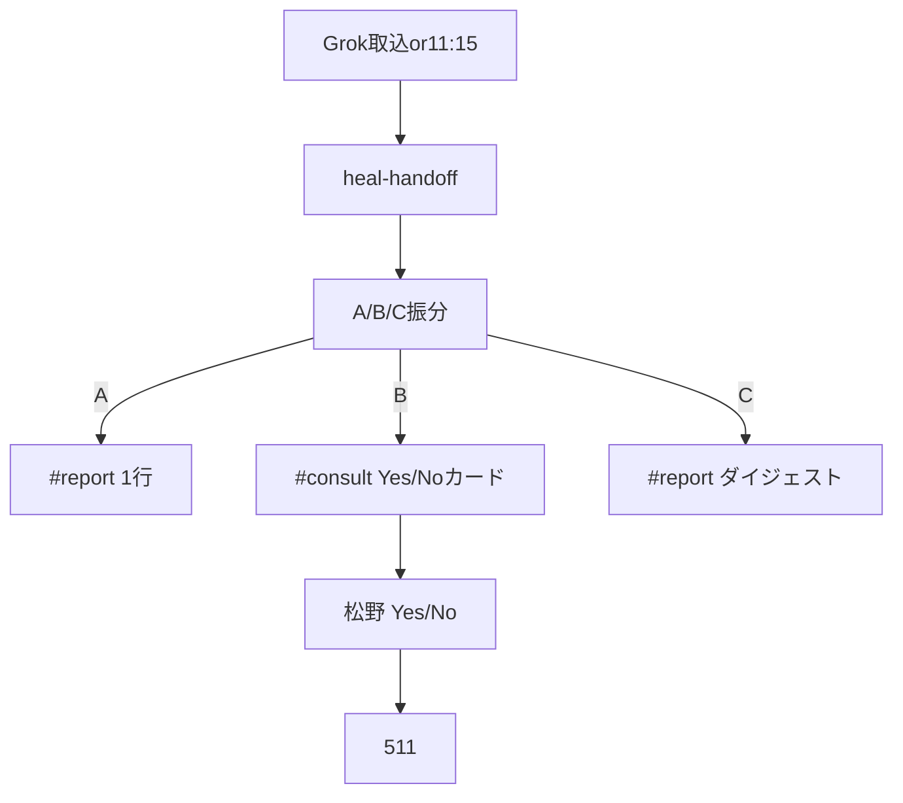

# フロー — 物件一次判定係（114）

- FlowForge（設計図）: [flow_O1OMOoN2vkVf9SKLD9T_mvBy](https://flowforge-259747770348.asia-northeast1.run.app/flows/flow_O1OMOoN2vkVf9SKLD9T_mvBy)
- **実行エンジン（本線）**: Mac Python（Cursor 不要）
  - `scripts/jarvis_property_gate_degraded.py`（heal＋scan＋post）
  - `scripts/jarvis_property_gate_114.py`
- **定期**: launchd `property-gate-114` **毎日 11:15**／朝バンドル（Grok取込直後）／昼 Grok取込 runner 末尾
- 正本: [`23_物件進行ゲート_…`](../../23_物件進行ゲート_Grok調査_20261012.md) · 上限時 [`24_…`](../../24_Jarvis上限時_物件進行ゲート_次善策_20261012.md)

## きっかけ（確定 2026-10-12）

| 種別 | 正 |
|---|---|
| **本線・イベント** | Grok `[Grok調査]` 取込後（朝バンドル／昼 11:00 noon） |
| **本線・時間** | **毎日 11:15 JST** — launchd（取りこぼし） |
| 副・手動 | `--scan --post` / `--deal-id … --post` / `degraded.py` |
| 使わない | Cursor 会話必須にすること／400室ミックス相乗り |

## ゴール・報告

| 項目 | 正 |
|---|---|
| **B 要判断** | Slack **`#consult`**（deal_id・見てほしい3点・Yes/No URL） |
| **A 自動** | Slack **`#report`** 1行（必要なら 511／Tier へ） |
| **C 報告のみ** | Slack **`#report`** 日次ダイジェスト（1日1通） |
| **出さない** | 対外メール送信・Web再調査 |
| **ログ** | 社員フォルダ `logs/` ／ Mac `~/Library/Logs/jarvis_property_gate/` |

## 型（5ステップ）

1. **起動** — 取込後／11:15／手動  
2. **修復** — `kurashift_handoff` 誤ラベル `awaiting_grok` → `awaiting_first_inquiry`（`--heal-handoff`）  
3. **取得** — deals の score・聞く価値・inquiry_action・inquiry_status・To（要約フィールドのみ）  
4. **振分** — **A** 自動／**B** 要人／**C** 報告のみ  
5. **報告** — B→`#consult`、A/C→`#report`。**送信はしない**（Yes 後は **511**）



## 最小実装

```bash
cd ~/git-repos && set -a && source .env.jarvis_private && set +a
# 上限時・定常と同じ一発
~/selenium_env/venv/bin/python scripts/jarvis_property_gate_degraded.py
# 部品
~/selenium_env/venv/bin/python scripts/jarvis_property_gate_114.py --heal-handoff
~/selenium_env/venv/bin/python scripts/jarvis_property_gate_114.py --scan --post
```

設置: `~/git-repos/launchd/install_property_gate_114_launchd.sh`  
無効: `JARVIS_PROPERTY_GATE_DISABLE=1`

## 改善ログ（フロー側）

| 日付 | 変更 |
|---|---|
| 2026-10-09 | 型だけ記載 |
| 2026-10-12 | A/B/C・Slack・CLI 具体化 |
| 2026-10-12 | **本線を launchd／朝バンドル／degraded に確定**（Jarvis上限でも可） |
| 2026-10-12 | FlowForge キャンバスを heal→A/B/C→Slack に同期（設計図） |
