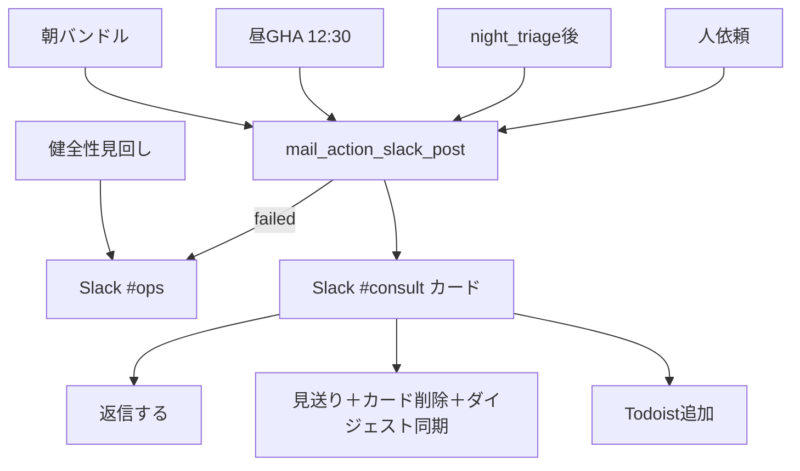

# フロー — メール要対応係（116）素案

第1段階と同一ターンの初回叩き台。FlowForge URL は後追い可。  
作り方: [`06_社員の作り方_二段階_20261009.md`](../../06_社員の作り方_二段階_20261009.md)

- FlowForge（閲覧／編集）: **未作成**（作り込み待ち。本 MD が当面の正）
- Flowforge 入口: https://flowforge-259747770348.asia-northeast1.run.app/
- 動きの例（型参考）: https://flowforge-259747770348.asia-northeast1.run.app/flows/flow_uGZ3apXgbHVdZJfnuqYA8_QZ
- ビルダー共有: https://agent-team-builder-teal.vercel.app/s/uksxiDIzE1AEckKH（**116 追加済・41体**）
- 更新: 2026-10-20（スコア上位5・ダイジェスト＋抽出要約 Plan A）

## いまの結論（文字1行）

pending triage → **スコア上位5**をダイジェスト＋コンパクトカードで `#consult` → 人がボタン了承。送信了承なし・VR混在なし。

## 合流の考え方

T1〜T5 は入口が違うが、投稿はすべて `jarvis_mail_action_slack_post.py --from-triage` に一本化。T5 のみ健全性→`#ops`。



## ステップ一覧

| # | 内容 | 方法 | 人/AI | ツール例 |
|---|---|---|---|---|
| 1 | 合図（T1〜T4） | 朝／GHA／night／手動 | AI | `jarvis_mail_action_slack_post.py` |
| 2 | ノイズ／mute／VR／自分発信除外 | フィルタ | AI | sync_meta `mail_action_skip_mute`＋estate 送信 BCC 誤ラベル除外（Slack 再掲＋Dashboard 未読） |
| 3 | スコア順・上位N選抜＋抽出要旨 | ルール | AI | Plan A（LLMなし） |
| 4 | ダイジェスト＋コンパクトカード | Bot／Webhook | AI | Block Kit |
| 5 | Gmail 既読 | API modify | AI | 物件取込と同型（soft-fail→morning catchup） |
| 6 | 返信／見送り／Todoist | ボタン | **人** | consult-action / `/api/g/ma` |
| 7 | 健全性（T5） | health | AI | `jarvis_mail_action_mute.py --health` |

**人が確かめる印**: ステップ6（ボタン＝対外了承／見送り／手配タスク）。  
**やらない**: 了承なし送信・VR混在・ドメイン一括ミュート・無言 Todoist・本文全文のSlack貼付（詳細は Dashboard）。

## FlowForge 作り込みメモ（別チャットへ渡す用）

- [ ] トリガー5本 → post 合流／T5→ops
- [ ] 停止条件 `JARVIS_MAIL_ACTION_SLACK_DISABLE` をガード
- [ ] 作成後: registry `flowforge_url` と本ファイル先頭リンクを更新 → `jarvis_agent_team_status_sync.py`
- [ ] 共有URLを `config/flowforge_share_urls.json` に追記

## 手順メモ（実装本線・いま動くもの）

```bash
cd ~/git-repos && set -a && source .env.jarvis_private && set +a
~/selenium_env/venv/bin/python scripts/jarvis_mail_action_slack_post.py --from-triage --dry-run
~/selenium_env/venv/bin/python scripts/jarvis_mail_action_slack_post.py --from-triage --limit 5
~/selenium_env/venv/bin/python scripts/jarvis_mail_action_mute.py --health --notify-ops
# 昼: GHA jarvis-mail-action-noon.yml（平日12:30 JST）
# 夜: night_triage 末尾 soft-fail 相乗り
```
