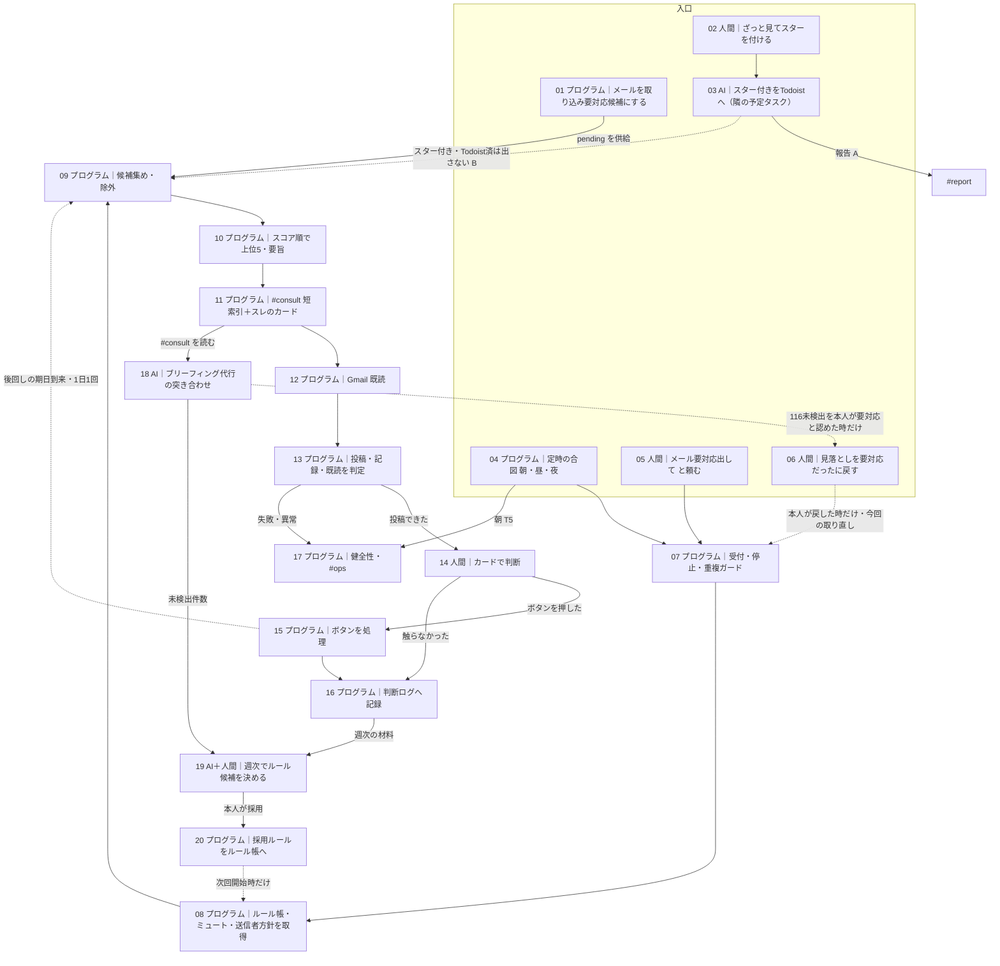

# フロー — メール要対応係（116）v2

618 と同じ形（工程番号・人間/AI/プログラム・担当/道具・判断点・取り直し/次回基準の戻り矢印・保存/画面/報告の分離）で並べ直した版。今ある仕組みを作り直していない。

- 更新: 2026-11-15（v2・松野さん了承。判断 A/B/C と Codex 確認コメントを反映）
- 図（Claude Artifact・本人のみ閲覧）: https://claude.ai/artifact/17ABWZkExkTZSr8bJLkzLQ
- FlowForge: 未作成（本 MD が当面の正）
- ビルダー共有: https://agent-team-builder-teal.vercel.app/s/uksxiDIzE1AEckKH
- 進め方の正本: [`workflow-review/README.md`](../../workflow-review/README.md)
- 実装待ち: [TASK.md](./TASK.md)（B・C）

## いまの結論（文字1行）

pending triage → ルール帳を当てて**スコア上位5**を `#consult`（本線＝短索引／カード＝スレ）→ 人がボタンで返信・見送り・後回し → 判断ログ → 週次でルール帳へ。スター付き（人が選んだもの）は隣の予定タスクが起票し、116 には出さない。

## 凡例

- 人間＝松野さん。AI＝実行時に AI を呼ぶ。プログラム＝AI を呼ばない（AI が書いたコードでも）。
- 実線＝通常。点線＝条件付きの戻り（今回の取り直し／次回基準）。



## 工程

| # | 主体 | 工程 | 担当・道具 | 入力 → 結果・保存 | 状態 |
|---|---|---|---|---|---|
| 01 | プログラム | メールを取り込み要対応候補にする | GHA 05:00 `jarvis-dashboard-gmail-triage.yml`／Mac `jarvis_night_triage.py` → Supabase `triage_items` | 受信メール・Chatwork 未返信 → pending 行。116 自身は取り込まない | 既存 |
| 02 | 人間 | ざっと見てスターを付ける | 松野さん｜Gmail | 一覧をざっと見る → スター＝タスクにしたい印 | 既存（使い方） |
| 03 | AI | スター付きを Todoist へ | Claude 予定タスク 平日 8:38（`trig_01Da1EyELbZPFbYJheDT2BtU`）→ Todoist／Gmail／Slack | `is:starred -label:Todoist済` → Todoist インボックス（`スター起票`・締切なしは今日）、Gmail `Todoist済`。作る前に Gmail リンク・`gmail_thread=<id>`・件名で既存を探す。報告は #report に1通（11/22 まで毎回、以後🟡🔴のみ） | 新設・初回 11/16 |
| 04 | プログラム | 定時の合図 | T1 朝バンドル（Mac launchd `jarvis_morning_mac_refresh.py`）／T2 昼 Mac 定刻キック＋GHA `jarvis-mail-action-noon.yml`／T3 `jarvis_night_triage.py` の後 | 時刻 → 07。朝は 17 も起動 | 既存稼働 |
| 05 | 人間 | 「メール要対応出して」 | 松野さん → Claude／Cursor が CLI（T4） | 音声・チャット → 07 | 既存 |
| 06 | 人間 | 見落としを「要対応だった」に戻す | 松野さん｜判断デスク（ループウェア） | → payload `loopware_miss`。古くても次回の候補 | 既存 |
| 07 | プログラム | 受付・停止・重複ガード | `jarvis_mail_action_slack_post.py`／`_kick-guard.yml`／sync_meta の digest 指紋 | 停止スイッチ `JARVIS_MAIL_ACTION_SLACK_DISABLE`、二重起動・同じ並びの digest を止める | 既存 |
| 08 | プログラム | ルール帳・ミュート・送信者方針を取得 | `jarvis_learned_rules.py` → [learned_rules.md](./learned_rules.md)、sync_meta | 今回効かせる基準。**C**: 読めない回は続行し「ルール未適用」の印・#ops 1行・payload に印 | 既存＋C 実装待ち |
| 09 | プログラム | 候補集め・除外 | 同上 → `triage_items` | pending 最大60＋見落とし戻し＋後回しの期日到来分 → ノイズ・定型・販促・業者返信（516）・自分発信・ミュート・hide を外す。**B**: スター付き・`Todoist済` を Gmail スレッドIDで外す（Gmail に繋がらない時は外さず出す） | 既存＋B 実装待ち |
| 10 | プログラム | スコア順で上位5・要旨 | `score_row`＋ルールの boost/demote・重複除去 | 上位5件と抽出要旨（AIなし）・applied_rules 保持・6位以下は次点として記録 | 既存 |
| 11 | プログラム | #consult 短索引＋スレのカード | Slack Bot（無い時は Webhook の短カード） | ボタン: 返信する／見送り／資料を集めて後回し／Chatworkで返信。投稿時刻を payload へ | 既存 |
| 12 | プログラム | Gmail 既読 | Gmail API | 失敗は朝バンドルで取り直し | 既存 |
| 13 | プログラム | 投稿・記録・既読を判定 | 同上 | 投稿／保存／既読を別々に判定。保存できたことと Slack に出たことを同じ成功にしない。まとめた判定は一部のみ | 一部 |
| 14 | 人間 | カードで判断 | 松野さん｜Slack | 返信（本文確認＝送ってよいの了承）／見送り／後回し／触らない | 既存 |
| 15 | プログラム | ボタンを処理 | Jarvis Dashboard（Vercel）`mailActionSlackAction.ts` | 返信＝Gmail 送信。見送り＝カード削除・索引更新・2回でミュート。後回し＝過去資料＋回答案＋Todoist（`gmail_thread=<id>` を説明欄に）。**B**: 作る前にスター起票済みを確認 | 既存＋B 実装待ち |
| 16 | プログラム | 判断ログへ記録 | Supabase トリガー `triage_items_log_owner_decision` → `owner_decisions`／GHA 平日21:00 `jarvis-mail-action-unseen.yml` | 判断・applied_rules・run。触らないは「未判断」（見送り扱いにしない） | 既存 |
| 17 | プログラム | 健全性・#ops | `jarvis_mail_action_mute.py --health --notify-ops` | 投稿失敗・pending 過多・ミュート過多 → #ops（6時間に1回まで） | 既存 |
| 18 | AI | ブリーフィング代行の突き合わせ | Claude 予定タスク 毎日 12:00 → Slack | Gmail 直近24h と #consult 直近24h → #report に1通、116 未検出は #consult にも | 既存稼働 |
| 19 | AI＋人間 | 週次でルール候補を決める | 314 業務品質監査係（土曜）→ 判断デスクで松野さん | 採用／今回だけ／見送りと本人の理由（AI が理由を補わない） | 既存（314） |
| 20 | プログラム | 採用ルールをルール帳へ | learned_rules.md 確定ルール（1ルール1コミット・取消は revert） | 次回の 08 で読まれる。効果は applied_rules で週次に数える | 既存 |

## 決まったこと（2026-11-15 松野さん了承）

- **A（03）**: スター起票の報告は Slack コネクタで #report に1通。予定タスクの GHA への移管は、松野さんが決めるまで行わない（GHA からの Webhook は 618 で到達確認済み）。
- **B（09・15）**: スター付き・`Todoist済` のメールは 116 に出さない。鍵は Gmail スレッドID。同時実行・ラベル付け失敗・再実行でも二重起票しない。
- **C（08）**: ルール帳を読めない回は止めずに印を付ける。読取失敗を「基準なし」と同じに扱わない。
- 116 のボタン入口（返信／見送り／後回し／Chatworkで返信）は残す。「Slack は報告の出口」は原則で、116 のボタンは本人了承の入口として使われているため。

## 未確認

- スター起票が使う Gmail コネクタのアカウント（116 は admin／estate／m19m の3箱）。
- 昼 GHA の予定実行が約8時間遅れて 20:26 頃にも走る件で、`_kick-guard.yml` が二重投稿を止めているか。
- 台帳の段階は「設計中」だが、実際は毎日稼働している。段階の見直しは週次レビュー（`jarvis_agent_stage_review.py`）で判断する。

## 手順メモ（いま動くもの）

```bash
cd ~/git-repos && set -a && source .env.jarvis_private && set +a
~/selenium_env/venv/bin/python scripts/jarvis_mail_action_slack_post.py --from-triage --dry-run
~/selenium_env/venv/bin/python scripts/jarvis_mail_action_slack_post.py --from-triage --limit 5
~/selenium_env/venv/bin/python scripts/jarvis_mail_action_mute.py --health --notify-ops
```
