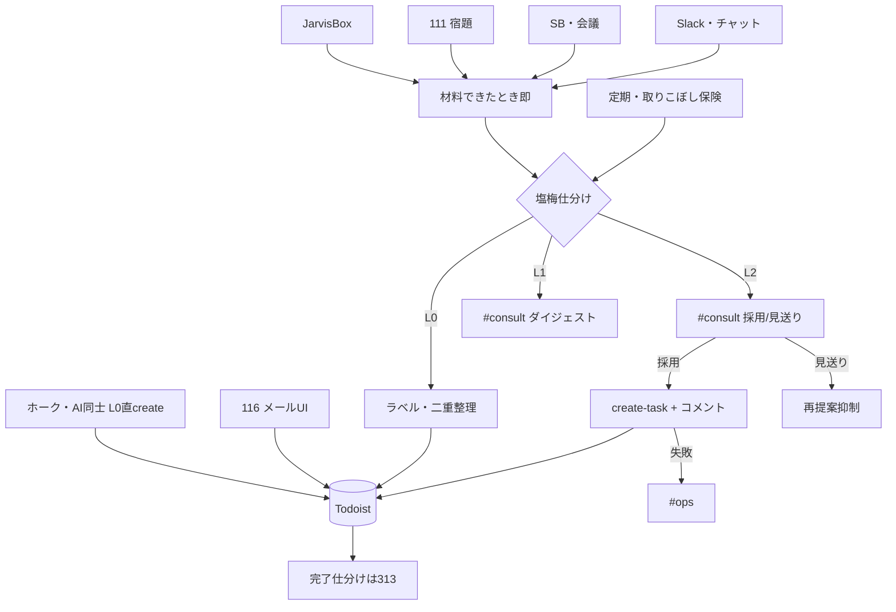

# フロー — Todoist起票整理係（312）

第2段階の作業フロー正本（会話磨き 2026-10-21）。  
作り方: [`06_社員の作り方_二段階_20261009.md`](../../06_社員の作り方_二段階_20261009.md)

- FlowForge（閲覧／編集）: [flow_M8SvKC1IDTDi496Vw-DgGjpD](https://flowforge-259747770348.asia-northeast1.run.app/flows/flow_M8SvKC1IDTDi496Vw-DgGjpD)
- Flowforge 入口: https://flowforge-259747770348.asia-northeast1.run.app/
- ビルダー共有: https://agent-team-builder-teal.vercel.app/s/uksxiDIzE1AEckKH
- 更新: 2026-10-21（合図・いい塩梅3段・即時提案・JarvisBox／AI同士／確定2点）

## いまの結論（文字1行）

材料できたとき即スキャン → 塩梅（L0静かに／L1ダイジェスト見るだけ／L2個別採用・見送り）→ Slack `#consult` → 採用時だけ Todoist create。ホーク・AI同士の直入れは L0 で維持。close は 313。

## 確定（2026-10-21）

| # | 内容 |
|---|---|
| 1 | **投稿先**: 即時の **L1／L2 とも Slack `#consult`**（定期ダイジェストも同 ch） |
| 2 | **AI同士の完了**: 312は「完了疑いをダイジェストに載せる」まで。**実際の close は 313＋オーナー確認二段**（`jarvis-todoist-owner-confirm`） |

## 合流の考え方

ソースは複数（メール・SB・111・JarvisBox・Slack・チャット・ホーク）だが、**出口は一本**: 塩梅仕分け → `#consult`（L1/L2）または L0 直 Todoist。定期は取りこぼし保険。全部を個別ボタンにしない。

## ソース（入口）

| ID | ソース | 扱い |
|---|---|---|
| S-hawk | ホーク／部長 `todoist_tasks` apply | **L0 直 create 維持**。完了確認・実行の正本にも使う |
| S-box | JarvisBox `10_inbox_from_grok/` | 整理対象。poll 後すぐスキャン |
| S-mail | 116 メール `#consult` | UIは返信／見送り／Todoist追加（タスク可否だけではない） |
| S-sb | SecondBrain／会議 Action（714材料） | 材料できたとき即 → L1 or L2 |
| S-111 | パートナー宿題シグナル | 同上 |
| S-slack | Slack `#consult`／`#ai-hub` | 定期・即時のスキャン対象 |
| S-chat | Cursor 会話の宿題 | 人依頼 or 相乗り |
| S-man | 「起票整理して」「認定して」 | いつでも |

## いい塩梅（3段）

| 段 | 人の操作 | 内容 |
|---|---|---|
| **L0** | なし | ホーク／AI直入れ、116で既に Todoist追加したもの。後からラベル・二重整理可 |
| **L1** | **見るだけ**（一括 create しない） | ダイジェスト1通。気になるときだけ一言／L2化。列挙最大7 |
| **L2** | **採用／見送り**（個別） | 迷い・金・対外・レーン不足・二重疑い。1回最大3件 |

弱いシグナル（weak のみ）は L1 に載せない／参考行のみ。815 は起票提案対象外。

### ボタン文言

| ソース | ボタン |
|---|---|
| 純タスク提案 | **採用／見送り** |
| 116 メール | **返信する／見送り／Todoist追加**（返信がありうる） |

## フロー図



## ステップ一覧

| # | 内容 | 方法 | 人/AI | ツール例 |
|---|---|---|---|---|
| 1a | **即時**: 材料検出（Box／SB／111／会話） | イベント | AI | inbox poll／sb_propose／シグナル |
| 1b | **定期**: 横断取りこぼしスキャン | 時間・相乗り | AI | 将来 launchd／GHA。当面は人依頼・パートナー確認ついで |
| 1c | **人**: 認定して／`/todoist` | 依頼 | AI | Cursor |
| 2 | 二重起票・レーン／ラベル点検（properties＝物件＋PM） | CLI／API | AI | `jarvis_todoist_api.py` |
| 3 | 塩梅仕分け L0／L1／L2 | ルール | AI | signals YAML |
| 4 | L1 ダイジェスト or L2 カードを `#consult` | Slack | AI | Webhook／Bot（116同型を将来） |
| 5 | L2 採用 → create＋コメント。見送り → 抑制 | ボタン／一言 | **人**＋AI | Todoist API |
| 6 | L0／既存のラベル・二重整理。**完了疑いは L1 ダイジェスト等に列挙のみ** | CLI／Slack | AI | 312。**close はしない** |
| 7 | 完了仕分け → オーナー確認 → 了承後 close（確認のみ例外含む） | — | **313**＋人 | `/todoist-batch`・二段完了 |

**人が確かめる印**: ステップ5（L2採用／見送り）。L1は把握のみ。116の返信了承は116。金・対外・削除。  
**やらない**: 全件個別ボタン、L1一括 create、815自動起票、了承なし対外送信、312による close、秘密の再掲。

## 係の境界

| 係 | 役割 |
|---|---|
| ホーク／AI | Todoist 直登録（L0）。完了もコメントで残す |
| JarvisBox poll | 材料取込。認定・整理は312 |
| 116 | メール判断（返信UI）。Todoist追加＝共有レール |
| 111 | 取込・差分。宿題は即312へ（自ら create しない） |
| 714 | 会議／Notion残し。Action → 312 |
| **312** | 即時／定期の整理・塩梅・認定・ラベル／二重。完了疑いはダイジェスト列挙まで |
| **313** | 完了仕分け・確認のみ close（＋オーナー確認二段） |

## FlowForge 作り込みメモ

- [x] 即時トリガー（ソース別）→ 塩梅 → `#consult` 合流（2026-10-21・キャンバス反映済）
- [x] L0（ホーク）は create 分岐で人待ちなし（L0ノード＝ラベル・二重のみ）
- [ ] 停止条件（env／disabled）をガード（コード／運用側）
- [x] 作成後: registry と本ファイル先頭リンクを同期 → `jarvis_agent_team_status_sync.py`
- [ ] 共有URLを `config/flowforge_share_urls.json` に追記（要確認）

## 手順メモ（実装本線・いま動くもの）

```bash
# 人依頼・候補（チャット／将来 Slack）
cd ~/git-repos && set -a && source .env.jarvis_private && set +a
~/selenium_env/venv/bin/python scripts/jarvis_todoist_sb_propose.py --latest
# 了承後（当面チャット了承。Slack 採用ボタンは後続）
~/selenium_env/venv/bin/python scripts/jarvis_todoist_sb_propose.py --apply --select 1

# 了承後 create（手動・Jarvis）
~/selenium_env/venv/bin/python scripts/jarvis_todoist_api.py create-task \
  --lane properties --title '[GrandoleI][ミニテック] …' \
  --label GrandoleI,ミニテック \
  --comment '【Jarvis】
サマリ: …
アウトプット:
- [出典](https://…)'

# JarvisBox
~/selenium_env/venv/bin/python scripts/jarvis_bucho_inbox_poll.py
# 116 メール（別UI・共有レール）
~/selenium_env/venv/bin/python scripts/jarvis_mail_action_slack_post.py --from-triage --dry-run
```

**未実装（フロー正・コードは後続）**: L1/L2 の Slack カード本線、材料即時の自動投稿、定期取りこぼしジョブ。当面は CLI＋チャット了承＋116既存ボタンで回す。
