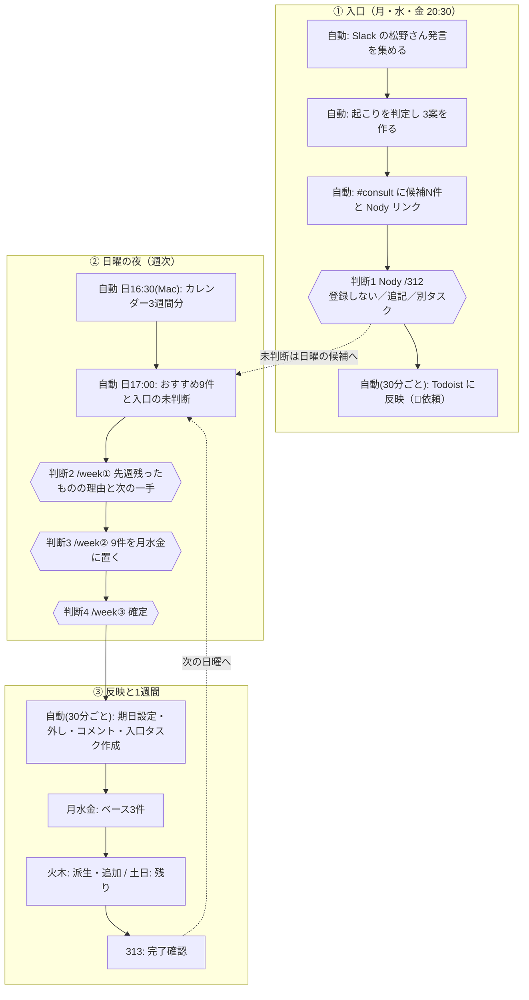

# 312 作業フロー（Nody 版・見直し 2026-11-10）

FlowForge 版（[`flow.md`](./flow.md)）との比較と、説明用に残す見直し版。`flow.md` は変えていない。
見える版（図つき）: [`flow_Nody版_20261110.html`](./flow_Nody版_20261110.html)（ブラウザで開く）。

## 位置づけ

- `flow.md` は FlowForge で磨いた版（10/21〜11/7）。入口は「材料ができたら即スキャン」、判断は Slack のボタン。
- この版は、11/10 に Nody「今週の9件」（`/week`）ができたあとの実際の流れ。判断の場面と記録先を、実装に合わせて書き直した。
- 起票の本線は引き続き 312。閉じる（完了）は 313。312 はタスクを閉じない。

## FlowForge 版との差（比較表）

| 観点 | FlowForge 版（flow.md） | Nody 版（今回） |
|---|---|---|
| 起動 | 材料ができたら即スキャン | 入口は月・水・金 20:30、週次は日曜（16:30 カレンダー／17:00 候補作り） |
| 入口のソース | SB・111・GenMail・会話など複数を想定 | 実装は **Slack だけ**（#consult・#ai-hub・#report の松野さん本人の発言）。拡張は下記 |
| 塩梅（L0/L1/L2） | L0 静かに／L1 ダイジェスト／L2 個別 | 入口は「起こり」を全部お題にして 3 案（登録しない／既存に追記／別タスク）。L0〜L2 の振り分けは未実装 |
| 判断の場所 | Slack `#consult` のボタン・番号 | Nody `/312`（入口）と `/week`（日曜の週次） |
| 出口 | 採用 → Todoist に create | create に加え、**期日の設定・外し**、残った理由のコメント、週の9件の確定 |
| 週の考え方 | なし | 月・水・金に3件ずつ（9件）、火・木は派生・追加、土日は残り。目の前の1週間だけ確定 |
| 判断ログ | Todoist の履歴が中心 | 入口 → `task_loop_decisions`、週次 → `owner_decisions`（surface=weekly_pick） |
| タスクの印 | なし | 件名の印（🤖 AI の判断／🦾依頼 松野さんに頼まれて／印なし 松野さん本人） |

## 全体の流れ

## 松野さんが判断する 4 つの場面

| 場面 | いつ・どこで | 見るもの | 選ぶもの | 選んだあと |
|---|---|---|---|---|
| 判断1 入口 | 月水金の夜、Nody `/312` | 拾った話と類似の既存タスク | 登録しない／既存に追記／別タスク | 30分以内に Todoist へ。未判断は日曜へ |
| 判断2 振り返り | 日曜の夜、`/week` の① | 先週の完了・残り | 残った理由（時間・相手待ち・大きすぎ・優先が下がった・AI開発）と次の一手（来週も／分ける／AIに渡す／やめる） | Todoist のコメント。「やめる」「AIに渡す」は期日を外す |
| 判断3 選んで置く | 日曜の夜、`/week` の② | 3 週間カレンダー、おすすめ 9 件と理由 | どれを・何曜に・どんな理由で。入口の話は今週やる／入れる／見送る | AI 案との差が記録される |
| 判断4 確定 | 日曜の夜、`/week` の③ | 件数、日ごとの期日、外れる期日 | 確定／期日を残す／確定し直す | 30分以内に Todoist が週の形になる |

## 入口の現状と拡張方針（2026-11-10 確認・松野さん了承）

現状（コードで確認）:
- 自動で 312 に入るのは **Slack だけ**。
- 手で動かす: セカンドブレイン（Genspark の録音 → `jarvis_todoist_sb_propose.py`）、拾い漏れスキャン（パートナーやり取り末尾・Obsidian 日誌 → `jarvis_todoist_312_miss_scan.py`）。どちらも定期実行なし、結果は Nody `/312` に入らない。
- 別の流れ: メール要対応（Slack カード・判断デスク）、Obsidian 毎日の見直し（#321）。

方針:
- 入口の母体を Supabase の **コミュニケーション台帳（comm_items）** にそろえ、312 が台帳の新しい「やること」を拾う。
- 台帳の分類: partner／property／inquiry（メール要対応）／self（自分の発言・考え）／agent（外部の参考情報）。
- 順番: ① メール（自分が書いたメールも含める） → ② セカンドブレイン（前日の要約） → ③ Obsidian 日誌 → ④ 外部の参考情報。
- 入るときの仕分け: 宿題 → 312 のお題（Nody で判断）／参考 → 台帳に保存（タスクにしない）／見送り → 入れない。
- 判断の結果は今どおり `owner_decisions` に残す。

## 見直しの提案（未決は松野さんの返事待ち）

1. 入口の判断は「夜に軽く（判断1）」と「日曜にまとめて」の 2 か所。案: 今のまま。日曜に 10 件を超えたら「まとめて見送り」を足す。
2. 締切 7 日前の Slack 通知は未実装。案: 月水金の入口の収集に相乗り。
3. 判断ログを基準（rule-v1）に戻す道筋は未接続。案: 3〜4 週回して安定してから、AI 案と違った置き方を見て版を上げる。
4. 未回答: 🤖（AI が自分の判断で入れたタスク）を Todoist の「今日」から外すか／「その日の枠が済むまで AI 開発を始めない」約束にするか。

## 動き出す日

- 11/10（火）: Mac のカレンダー取込を設定、51 件取込済み。
- 11/11（水）20:30: 入口の最初の収集。
- 11/15（日）16:30・17:00: カレンダー更新と最初の候補作り。夜に判断 2〜4。

## 実装の場所

- 入口: `scripts/jarvis_todoist_312_collect.py`（collect・reflect）
- 週次: `scripts/jarvis_todoist_weekly_pick.py`、`scripts/jarvis_weekly_pick_calendar.py`（Mac）、`.github/workflows/todoist-weekly-pick.yml`
- 画面: `apps/loopware`（`/312`、`/week`）。判断ログの契約: `apps/loopware/lib/decisionContract.ts`
