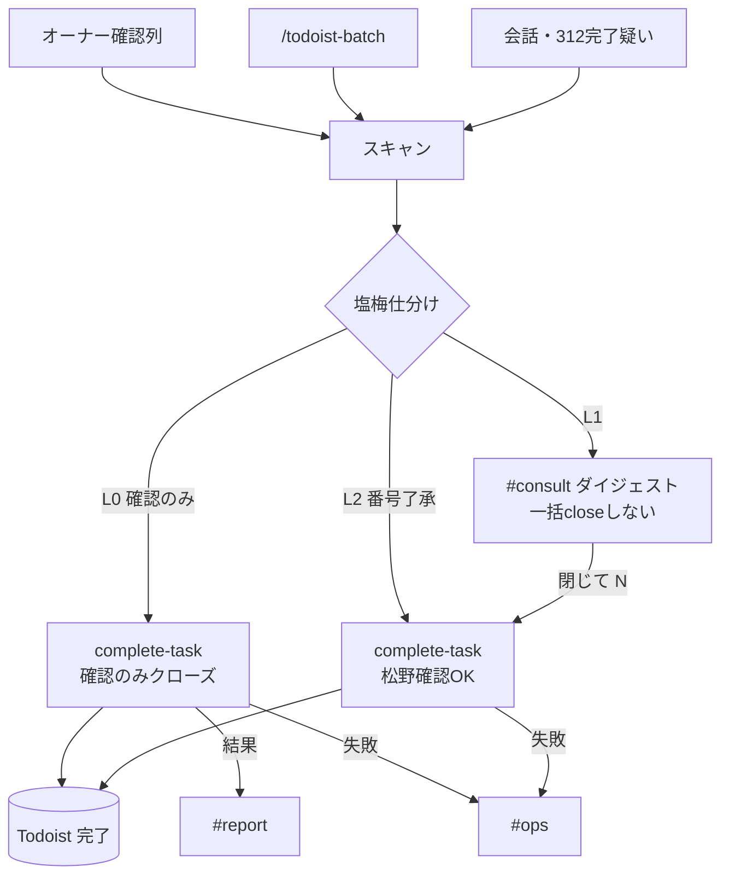

# フロー — Todoist完了候補確認（313）

第2段階の作業フロー正本（312と同型コンセプト・2026-10-21）。  
作り方: [`06_社員の作り方_二段階_20261009.md`](../../06_社員の作り方_二段階_20261009.md)

- FlowForge（閲覧／編集）: [flow_6s1nyBIKzluSsdgR-hs9IolD](https://flowforge-259747770348.asia-northeast1.run.app/flows/flow_6s1nyBIKzluSsdgR-hs9IolD)
- Flowforge 入口: https://flowforge-259747770348.asia-northeast1.run.app/
- 更新: 2026-10-21（**毎日20:00のL1ダイジェストを本線化**／完了動線・塩梅・運用格上げ／FlowForgeキャンバスを実装同型に同期）

## いまの結論（文字1行）

完了相当をスキャン → 塩梅（L0確認のみ静かに／L1ダイジェスト見るだけ／L2個別了承）→ Slack → **了承または確認のみ例外で Todoist close**。新規起票は312。

## 開始トリガー（いつ動くか）

| きっかけ | 時刻 | 何が起きる | 実装 |
|---|---|---|---|
| **定時ダイジェスト（本線）** | **毎日 20:00** | ①9レーン横断の完了候補（**✅番号・最大5**）→ `#consult`（0件なら投稿しない）②**期日超過の整理**（**📅番号・上位5＋新期日案**）→ `#consult`（①とは別投稿）。どちらも**自動変更なし** | launchd `com.matsunoma.jarvis.todoist-313-digest`／[`runner`](../../../../launchd/jarvis_todoist_313_digest_runner.sh) |
| 人の依頼 | 随時 | `/todoist-batch`・「掃除して」→ L1/L0 | skill `todoist-batch-sweep` |
| 完了相当 | 随時 | 会話で完了相当 → 即スキャン | 313_digest |
| 312／hawk | 随時 | 完了疑い・`owner_confirm` を合流 | 同上 |

- 20:00 の投稿は**見るだけ**。閉じるのは人の「閉じて ✅N」／**完了するボタン**（①）か、確認のみの自動close（②）だけ
- 期日は人の「**リスケ 📅N**」／**→日付へ延期ボタン**でだけ動く（自動リスケなし）
- 書き出し先頭: `【相談】313 完了候補確認`（Webhook表示名も `313 完了候補確認`）
- Slack返信拾い: `scripts/jarvis_todoist_313_slack_ingest.py`（✅→close／📅→リスケ。記号でスレ混在を避ける）
- **L2ボタン**: Block Kit → `consult-action`／予備 URL `/api/g/t313/…`（確認画面あり）。Todoistリンクは詳細のみ。URL署名は PROPERTY_GATE 本線（Cloud は TODOIST 可／Vercel は候補キー照合）
- 停止: `JARVIS_TODOIST_313_DIGEST_DISABLE=1`（Slack投稿のみ停止／`--apply` は可）
- ログ: `~/Library/Logs/jarvis_todoist_313_digest/`

## 期日超過の整理（313の第2機能）

- 対象: **期限日が今日より前**のタスク（期限なしは対象外）
- 順位: 重要ラベル（要ボス/優先1/高/緊急）→ 超過日数 → 実装/調査 → すぐ終わる → レーン（properties/apps/kamiooya）
- 新期日案: 超過7日以内=**+2営業日**／8〜30日=**+7日**／31日以上=**+14日**（土日は翌営業日）
- 実行: `scripts/jarvis_todoist_313_overdue.py`（既定は提案のみ／`--apply --select 📅3,📅5` で移動＋コメント）
- 報告: `#consult`（完了候補とは**別投稿**・番号は **📅N**）。返信「リスケ 📅N」→ 期日移動のみ。完了は本体の ✅

## Todoistへの完了動線（出口・必読）

タスク正本は **Todoist**。313まわりの **close 経路は次の3本**（どれも最終的にタスクが消える／完了になる）。

| 経路 | いつ | 人操作 | 実行 |
|---|---|---|---|
| **① 要判断了承 → close** | オーナー確認の要ボス・方針もの | `#consult`／チャットで **閉じて N** | `complete-task` ＋コメント（313） |
| **② 確認のみ（L0）** | 表確認・観測可能な復旧など方針なし | なし（都度了承不要） | オーナー確認経由 → 即 `complete-task`（確認のみクローズ） |
| **③ バッチ／skill** | `/todoist-batch`・会話掃除 | 依頼のみ | skill／CLI。報告は末尾1ブロック |

- **L1（ダイジェスト）からは一括 close しない**（見るだけ。確認のみは②、要判断は①）
- **L1 の各件はタイトルが Todoist へのリンク**（`https://app.todoist.com/app/task/<id>`）。タップで説明・コメント・期限まで見える
- 返信は「閉じて ✅3,✅7」／「✅3,7」／「全部残す」。番号は投稿の並び順（✅付き）
- **312は create しない／close しない**。完了疑いは312が列挙するだけ → 実際の仕分けは313
- **新規 create はしない**（登録動線の外）

```text
[完了相当] → スキャン → 塩梅
   ├─ L0 確認のみ ──→ complete-task（②）
   ├─ L1 → #consult（見るだけ）──→ （一括closeしない）
   └─ L2／番号了承 → complete-task（①）
```

## 確定（2026-10-21）

| # | 内容 |
|---|---|
| 1 | **投稿先**: 要判断 L1／L2 は Slack **`#consult`**。確認のみ一括の結果は **`#report`** |
| 2 | **確認のみ**は Jarvis が close 可（オーナー確認列を一度経由＋定型コメント） |
| 3 | **要判断**は人了承まで残す。一括 close 禁止 |
| 4 | **コメント必須**（先頭に書き手 `【FRIDAY】`／`【Jarvis】`／`【ホーク】`＋完了定型）。チャットだけは不足 |
| 5 | **起票は312**。313は close／仕分けのみ |
| 6 | **運用**: 2026-10-21 夜から **毎日20:00のL1ダイジェスト**（ソフト運用＝自動closeなし）。格上げ履歴は [`PROGRESS.md`](./PROGRESS.md) |

## ソース（入口）

| ID | ソース | 扱い |
|---|---|---|
| S-owner | Todoist **オーナー確認**列（横断レーン） | 本線スキャン → 塩梅 |
| S-batch | `/todoist-batch`・skill | ③。確認のみ②／要判断は残す |
| S-conv | 会話で「完了相当」「掃除して」 | 即スキャン → L1 or ② |
| S-312 | 312が載せた完了疑い | 列挙のみ。close は313 |
| S-hawk | hawk `owner_confirm` / `done` | ②③に合流（秘密なし） |

## いい塩梅（3段）

| 段 | 人の操作 | 内容 |
|---|---|---|
| **L0** | なし | **確認のみ**。Jarvis がすぐ close（コメント必須） |
| **L1** | **見るだけ**（一括 close しない） | ダイジェスト1通。要判断＋確認のみ一覧。列挙最大10 |
| **L2** | **閉じて／残す**（個別） | 迷い・金・対外・方針。番号了承で① |

弱いシグナルは **要判断**寄り（誤 close よりノイズを取る）。815・秘密は禁止。

### 確認のみ（L0）例

- `[表確認]`／UI確認で一致・不一致が1行
- launchd resume 等、観測可能な復旧
- 正本で既完了と分かるフォローのクローズ

### 要判断（残す）例

- 要ボス・検討・資金・解約・対外送信・年額・自信なし

## フロー図



## ステップ一覧

| # | 内容 | 方法 | 人/AI | ツール例 |
|---|---|---|---|---|
| 1a | **即時**: 掃除依頼・完了相当の会話 | 依頼 | AI | skill / digest |
| 1b | **定期**: オーナー確認列の取りこぼし | 時間・相乗り | AI | `313_digest`（格上げ後） |
| 2 | レーン横断でオーナー確認を読む | CLI | AI | `jarvis_todoist_api.py lane` |
| 3 | 塩梅 L0／L1／L2 | ルール | AI | ヒューリスティック＋人が上書き |
| 4 | L1 を `#consult` | Slack | AI | `jarvis_todoist_313_digest.py` |
| 5a | **②** 確認のみ → complete（コメント） | CLI | AI | `--auto-close-confirm` |
| 5b | **①** 要判断 → 人了承後 complete | 一言＋CLI | **人**＋AI | `--apply --select N` |
| 6 | バッチ末尾1ブロック報告 | Slack／チャット | AI | `#report`／`#consult` |

**人が確かめる印**: ステップ5b（閉じて N）。金・対外・削除・方針。  
**やらない**: L1一括 close、要判断の確認のみ扱い、コメント無し close、新規 create、秘密の再掲。

## 係の境界

| 係 | 役割 |
|---|---|
| **312** | Todoist **起票**本線。完了疑いは列挙まで |
| **313** | Todoist **完了仕分け・close**本線 |
| 116 | メール判断（Todoist追加は共有）。close は313 |
| ホーク | L0 create／コメント。完了 close を313に寄せる |

## 運用格上げ（抄・正本は PROGRESS）

| 段階 | 開始目安 |
|---|---|
| A ルール／skill常時 | **今** |
| B ソフト（相乗りdigest） | **2026-10-22〜** |
| C 定時digest | 初回通し成功翌日 or **2026-10-28** |
| D 分類強化 | C安定1週後 |
| E L2ボタン | **実装済 2026-10-22**（完了／延期ボタン。番号返信も併用可） |

**停止**: `JARVIS_TODOIST_313_DIGEST_DISABLE=1`（digest／Slackのみ。`--apply` は可）

## 手順メモ（実装本線）

```bash
cd ~/git-repos && set -a && source .env.jarvis_private && set +a
~/selenium_env/venv/bin/python scripts/jarvis_todoist_313_digest.py --dry-run
~/selenium_env/venv/bin/python scripts/jarvis_todoist_313_digest.py
# 確認のみ
~/selenium_env/venv/bin/python scripts/jarvis_todoist_313_digest.py --apply --auto-close-confirm
# 要判断（了承後）
~/selenium_env/venv/bin/python scripts/jarvis_todoist_313_digest.py --apply --select 1
```

**未実装（後続）**: 分類ML。L2ボタンは 2026-10-22 実装。※定時ジョブは毎日20:00。微修正は本 flow を見て人が直す。

## FlowForge 作り込みメモ

- [x] キャンバスを実装同型（L0/L1/L2・完了動線①②③・313_digest）に差し替え（2026-10-21・localStorage注入）
- [x] 旧「家賃収支監査・毎日11:00」ノードを除去
- [ ] 見た目の微調整は人がキャンバスで（整列・文言）
- 貼付用: [`エージェント指示_FlowForge貼付.md`](./エージェント指示_FlowForge貼付.md)
