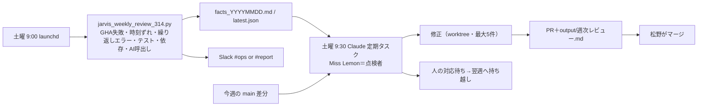

# フロー — 業務品質監査係（314）

文字1行: **土曜 9:00 機械チェック（AI なし）→ 9:30 Miss Lemon が今週の変更をレビュー → 修正 PR → 人がマージ**

| # | ステップ | 誰 |
|---|---|---|
| 1 | 事実を集める（AI なし） | launchd |
| 2 | 要確認を仕分け・今週の変更を観点別にレビュー | Miss Lemon |
| 3 | 小さく確実なものを直す・テスト | Miss Lemon |
| 4 | PR とレビュー MD | Miss Lemon |
| 5 | マージ・人の対応 | 松野 |

やらないこと: マージ、Slack 投稿（Claude 側）、対外送信、秘密の表示、status 変更。
