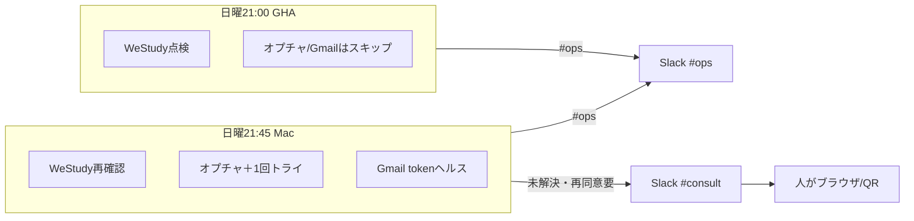

# フロー — 連携健全性点検係（315）

- FlowForge（設計図）: [flow_zYjp6A4HDURefJhSm0h_zUtX](https://flowforge-259747770348.asia-northeast1.run.app/flows/flow_zYjp6A4HDURefJhSm0h_zUtX)
- **一目の流れ図**: [`docs/flow-overview.html`](./docs/flow-overview.html)（**Gmail token 含む3系統**）
- **実行エンジン（本線）**: GitHub Actions `ops-health-315.yml`
- **Mac補完**: launchd 日曜 21:45 `--remediate-once`
- 実装CLI: `scripts/jarvis_ops_health_315.py`

## 点検対象（3系統・2026-10-15）

| # | 系統 | 誰がいつ | 異常時 |
|---|---|---|---|
| 1 | **WeStudy / GHA** | GHA 日曜21:00（本線） | 再実行は人（#consult） |
| 2 | **LINE オプチャ** | Mac 日曜21:45 | 既知復旧1回 → ダメなら人 |
| 3 | **Gmail OAuth token** | Mac 日曜21:45（token JSON） | **再同意は人のみ**（`reauth_estate_gmail_send.py` 等） |



## きっかけ（確定 2026-10-11）

| 種別 | 正 |
|---|---|
| **本線・時間** | **毎週日曜 21:00 JST** — GHA cron（UTC 日曜 12:00） |
| **Mac補完・時間** | **毎週日曜 21:45 JST** — launchd `--remediate-once`（Gmail含む） |
| 副・イベント | WeStudy 週次 GHA の Fail 通知が来たら（手動可） |
| 副・手動 | `workflow_dispatch` または Mac で CLI |
| 使わない | 旧 launchd 日曜 09:15／パートナー確認を復旧の必須経路にすること |

## ゴール・報告（具体）

| 項目 | 正 |
|---|---|
| **報告先** | Slack **`#ops`**（Webhook `SLACK_WEBHOOK_AI_TEAM_OPS`） |
| **要判断** | Slack **`#consult`**（1回トライ後も未解決／Gmail再同意要） |
| **出さない** | `#report`／「チャットに報告」 |
| **1通の中身** | 判定・WeStudy・オプチャ・**Gmail token**・トライ結果（Mac時）・フローURL |
| **ログ** | 社員フォルダ `logs/` ／ Mac `~/Library/Logs/jarvis_ops_health_315/` |

## 型

1. **起動** — GHA 日曜21:00 → `#ops`（WeStudy検知。GmailはMacへ）
2. **1回トライ** — Mac 日曜21:45 → オプチャ既知復旧1回 ＋ **Gmail点検** → 再点検
3. **Slack `#ops`** — OK／修正済／未解決
4. **未解決** — `#consult`（Gmailは是正コマンド付き）

## 最小実装

```bash
cd ~/git-repos && set -a && source .env.jarvis_private && set +a
~/selenium_env/venv/bin/python scripts/jarvis_ops_health_315.py --cloud --post --mark-checked
~/selenium_env/venv/bin/python scripts/jarvis_ops_health_315.py --remediate-once --post --mark-checked
```

## 改善ログ（フロー側）

| 日付 | 変更 |
|---|---|
| 2026-10-09 | 型だけ記載 |
| 2026-10-11 | CLI 実装・#ops 報告1通まで |
| 2026-10-11 | **本線を GHA 日曜21:00 に確定** |
| 2026-10-11 | Mac 21:45 `--remediate-once`（検知→1回トライ→結果） |
| 2026-10-15 | Gmail token ヘルスを Mac 点検に追加（cloud はスキップ） |
| 2026-10-15 | `docs/flow-overview.html` で3系統を可視化 |
