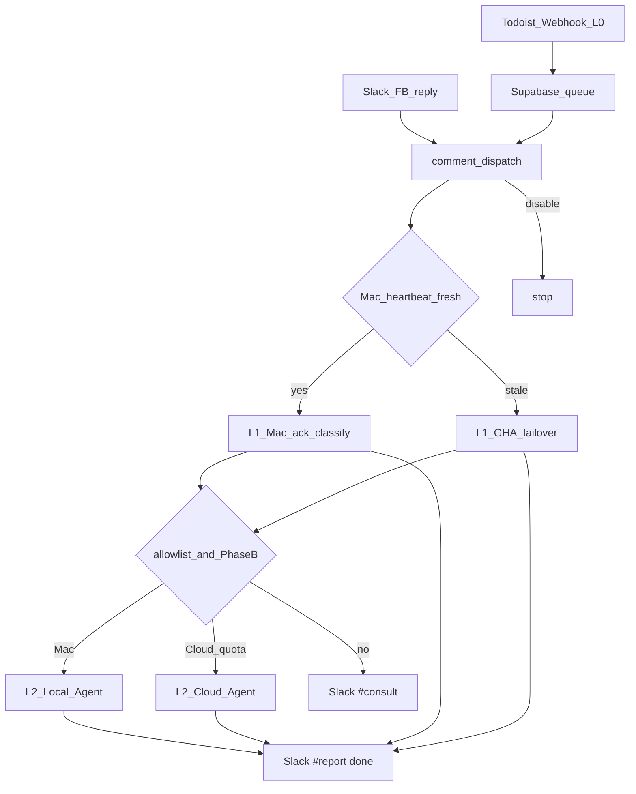

# フロー — コメント起動係（317）素案

- FlowForge（閲覧／編集）: https://flowforge-259747770348.asia-northeast1.run.app/flows/flow_8mwIkbI0S9kV2u5kSwl2I-Oi
- FlowForge（閲覧専用 share）: https://flowforge-259747770348.asia-northeast1.run.app/share/qbbUffZBcoAq1lKG
- Flowforge 入口: https://flowforge-259747770348.asia-northeast1.run.app/
- ビルダー共有: https://agent-team-builder-teal.vercel.app/s/uksxiDIzE1AEckKH（317 反映済）
- ダッシュ: https://jarvis-dashboard-amber.vercel.app/agent-team
- 更新: 2026-10-22（FlowForge 作成・share 発行）

## いまの結論（文字1行）

Slack FB／Todoistコメントを Mac が常駐で拾い Ack→許可リストだけ AI 処置→`#report`。Mac ダウン時は GHA が L1、枠ありなら Cloud が L2。対外・金は人。

## 合流の考え方

Webhook（L0）・FB スレ・launchd／GHA はすべて `jarvis_comment_dispatch.py` に合流。claim／processed で二重処置を防ぐ。



## ステップ一覧

| # | 内容 | 方法 | 人/AI | ツール例 |
|---|---|---|---|---|
| 1 | 起動（launchd／GHA stale／手動） | 時間・イベント | AI | launchd／GHA |
| 2 | 未処理取得 | API | AI | webhook_handle／FB poll |
| 3 | L1 Ack・分類 | ルール | AI | `jarvis_comment_dispatch.py` |
| 4 | L2 許可リスト処置 | Agent | AI | Local／Cloud |
| 5 | 報告 | Webhook | AI | `jarvis_slack_webhook_post.py` |
| 6 | 人が確かめる | Web | **人** | 対外・金・方針 |

**人が確かめる印**: ステップ 6（および許可リスト外）  
**やらない**: 対外送信／秘密再掲／GAS／無確認課金

## FlowForge 作り込みメモ（別チャットへ渡す用）

- [x] トリガー → L0/L1/L2 → Slack 合流（AI初版 `flow_8mwIkbI0S9kV2u5kSwl2I-Oi`）
- [x] 共有URL: `share/qbbUffZBcoAq1lKG`
- [x] registry／本ファイル先頭リンク更新 → status sync
- [ ] ノード磨き（kintone混入があれば差し替え・停止ガード明示）

## 手順メモ（実装本線）

```bash
cd ~/git-repos && set -a && source .env.jarvis_private && set +a
~/selenium_env/venv/bin/python scripts/jarvis_comment_dispatch.py --dry-run
~/selenium_env/venv/bin/python scripts/jarvis_comment_dispatch.py --apply
# Phase B（許可リスト AI）
~/selenium_env/venv/bin/python scripts/jarvis_comment_dispatch.py --apply --phase-b
# 冗長のみ（GHA 想定）
~/selenium_env/venv/bin/python scripts/jarvis_comment_dispatch.py --apply --failover-only
~/git-repos/launchd/install_comment_dispatch_launchd.sh
```
