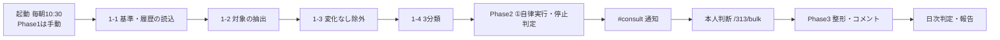

# 318 Todoist消化係 — 作業フロー（読み方メモ）

正本は FlowForge [flow_HMy15MUxWiSpw5QgAPYa_8e4](https://flowforge-259747770348.asia-northeast1.run.app/flows/flow_HMy15MUxWiSpw5QgAPYa_8e4)（承認済み 15 ノード・11 接続）。
ここは「どのノードがどのコードか」の対応表だけ。仕様の文言は FlowForge の各ノードの説明文を見る（ここに写して二重にしない）。

読み方（API）: `.env.jarvis_private` の `FLOWFORGE_READ_PROXY_KEY` を Bearer にして
`https://jarvis-dashboard-amber.vercel.app/api/flowforge/resolve?agentId=318&view=edit` を GET（値は表示しない）。

文字1行: 起動 → [Phase 1] 基準・履歴の読込 → 抽出 → 変化なし除外 → 3分類 → [Phase 2] ①自律実行・停止判定 → #consult 通知 → 本人判断（/313/bulk） → [Phase 3] 判断履歴・【318】コメント整形 → 変更時だけコメント → 日次判定・報告

| FlowForge ノード | 主体 | Phase 1 の実装 | 状態 |
|---|---|---|---|
| start 毎朝の定時実行で起動 | プログラム | `run`（手動だけ）。停止スイッチ・ロック・313 重なり・接続・本人権限・60分・5件 | 実装（定時登録はしない） |
| node_YopbrZa4 採用済み基準・判断履歴の読込 | プログラム | `load_basis`（基準 YAML の adopted／313 `todoist_313_judgments.json`／318 `history.json`） | 実装 |
| node_fetch 対象タスクの抽出 | プログラム | `candidate_filter`＋`rank`（313 overdue の順位付けを直して再利用） | 実装 |
| node_5cc62if9 前回から変化なしの除外 | プログラム | `snapshot`／`detect_change` | 実装 |
| node_classify タスクの3分類判定 | AI（この実行の Claude Code）＋プログラム | `classify`（ルール）→ `--ai-answers`（AI の見直し） | 実装 |
| sub_execute／node_run_a／node_halt_check | AI | — | 未実装（① の自律実行は松野さんが決めてから） |
| node_znkxTG8H #consult へ通知 | 外部サービス | `handoff.consult_text`→`drafts/`。送るのは `--send-slack`＋`--publish` の時だけ | 実装（既定は案の保存） |
| node_human_review /313/bulk で判断 | 人間 | `sync_meta.todoist_318_bulk_queue` → `jarvis_todoist_cleanup_bulk.py` が画面へ。回答は owner_decisions → `fetch_owner_answers` で読み戻し | 実装（載せるのは `--publish` の時だけ） |
| （③の渡し先）312 今週の9件 | プログラム | `sync_meta.todoist_318_weekly_handoff` → `jarvis_todoist_weekly_pick.py` の候補 | 実装（載せるのは `--publish` の時だけ） |
| node_format_log 判断履歴の整形 | プログラム | 内部ログ部分だけ（`runs/<run_id>.json`） | 一部 |
| node_comment Todoist コメント反映 | 外部サービス | — | Phase 3 |
| end 日次結果判定・報告 | プログラム | success／partial／failed／stopped の判定、`#ai-hub` 報告案の保存（送るのは `--send-slack` の時だけ） | 実装 |

## やらないこと（Phase 2 まで）

Todoist へのコメント書き込み（Phase 3）・①の実行・定期起動の登録・313 の 0.5 の移管・他エージェントへの依頼。
Slack 送信と /313/bulk・週次への掲載は、仕組みとテストまで。実際に載せる・送るのは松野さんの了承後に `--publish`／`--send-slack` を付けて動かす。
