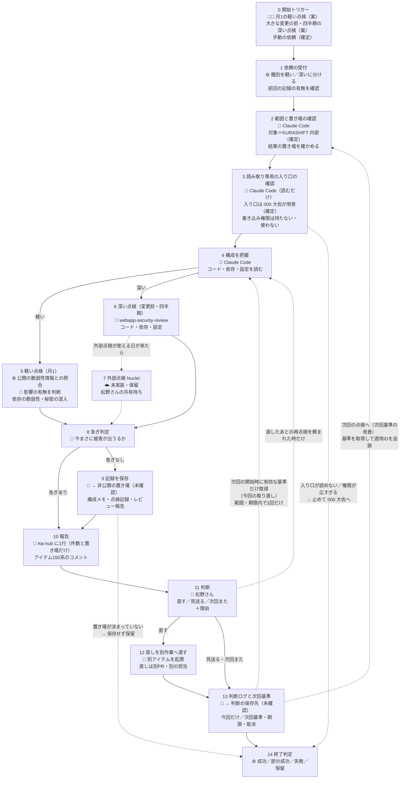

# 319 アプリ安全点検係 — 作業フロー（流れ図・設計中）

型: [`workflow-review/README.md`](../../workflow-review/README.md)・[`prompt-template.md`](../../workflow-review/prompt-template.md)。
**この図は松野さんの確認待ち。** 確認済みの印（registry の `flow_confirmed_at`）は入れていない。FlowForge には未登録（Mermaid の md が正本）。
図の状態は設計であり、実システムでは何も動いていない（実点検・定時実行・権限の発行はまだ無い）。

## 凡例

- 主体: 👤人間／🤖AI（Claude Code＝Miss Lemon）／⚙️プログラム（実行時に AI を呼ばない）／☁️外部サービス
- 区分: **確定**＝松野さんが了承済み／**案**＝提案・松野さんが図を見て決める／**未実装・保留**＝置くだけ
- 色: 実線＝通常／点線＝条件つきの戻り・保留

## 図

## ノード一覧（番号・主体・実行者／道具・作業）

| 番号 | 主体 | 実行者／道具 | 作業 | 区分 |
|---|---|---|---|---|
| 0 | 👤＋🤖 | 松野さんの依頼／（定時は未登録） | 開始。月1の軽い点検・大きな変更の前・四半期の深い点検・手動 | 手動＝確定／頻度＝**案** |
| 1 | ⚙️ | 受付（未実装。当面は Claude Code が手で） | 種別（軽い／深い）を決め、前回の記録の有無を見る | 案 |
| 2 | 🤖 | Claude Code | 対象（KURASHIFT 内部）と結果の置き場を確かめる。置き場が決まっていなければ 9 を保留にする | 対象＝確定／置き場＝**未確認** |
| 3 | 🤖 | Claude Code（読み取りだけ）／入り口は 000 大佐 | Vercel・Supabase の読み取り専用の入り口が使えるか、付与されている権限を読んで確かめる。書き込みができる権限なら使わず止める | 入り口の用意＝確定／実在・範囲＝**未確認** |
| 4 | 🤖 | Claude Code | 構成を把握（何が何の上で動くか）。秘密の値は読まない・書かない | 確定（スキルの手順 1〜2） |
| 5 | ⚙️＋🤖 | 公開の脆弱性情報との照合＋Claude Code | 依存の既知の脆弱性・秘密の混入を見て、このアプリで影響があるものに絞る。依存の取得・実行は伴わない | 内容＝確定／頻度＝**案** |
| 6 | 🤖 | Claude Code＋スキル webapp-security-review | コード・依存・設定の深い点検（他人のデータに触れないか・秘密・直接アクセス・管理機能） | 確定（道具）／頻度＝**案** |
| 7 | ☁️ | Nuclei（外部点検） | 松野さんの共有待ち。使うかも未定 | **未実装・保留** |
| 8 | 🤖 | Claude Code | 今まさに被害が出うる問題か。あれば 9 を待たず 10 で急報し、点検を続けるか止めるかを聞く | 確定（スキルの「急ぐべきもの」） |
| 9 | 🤖 | Claude Code → 非公開の置き場 | 構成メモ・点検記録・レビュー報告を保存。公開リポ・アプリと一緒に配信される場所には置かない | 置き場＝**未確認** |
| 10 | 🤖＋☁️ | Claude Code → Slack `#ai-hub`・Orca のアイテム | 報告の型で1行。指摘の中身・弱点の場所は書かない | 案（報告先の最終は松野さん） |
| 11 | 👤 | 松野さん（アイテムのボタン） | 指摘ごとに「直す／見送る／次回また」を選ぶ。理由は本人の言葉を記録（AI は補作しない） | 確定（直すかは本人） |
| 12 | 🤖 | Claude Code が起票 | 「直す」と選ばれた分だけ別アイテム・別PR へ。点検係は直さない | 確定 |
| 13 | 🤖 | Claude Code → 判断の保存先 | 事項・AI案・本人選択・理由・対象・今回だけ／次回基準・期限・取消・run_id を保存。未判断・見送りを恒久基準にしない | 保存先＝**未確認** |
| 14 | ⚙️ | 終了判定 | 成功／部分成功／失敗／保留を決める | 案 |

## 各工程の定義（要点）

| 工程 | 入力 | 保存先 | 画面・報告先 | 成功／部分成功／失敗 |
|---|---|---|---|---|
| 0〜2 | 依頼（種別・対象） | 受付メモ（非公開） | — | 成功＝種別と範囲が決まる／失敗＝対象不明 |
| 3 | 付与された権限の読み取り | 構成メモの「入り口」欄 | — | 成功＝読み取りだけと確認／**失敗＝書ける・読めない→止める**（読めないを「問題なし」にしない） |
| 4〜7 | コード・依存・設定（読むだけ） | 点検記録（非公開） | — | 成功＝範囲を全部見た／部分成功＝見ていない範囲あり（報告に書く）／失敗＝見られず |
| 8〜9 | 4〜7 の結果 | レビュー報告・点検記録（非公開・置き場は未確認） | — | 成功＝保存できた／**保存できない＝保留（公開側に退避しない）** |
| 10 | 保存済みの記録 | — | `#ai-hub` 1行・アイテム | 成功＝報告が出た。保存の成功と報告の成功は別に数える |
| 11〜13 | 指摘一覧 | 判断ログ（未確認） | アイテムのボタン | 成功＝本人の選択と理由を保存／未選択＝保留（採用扱いにしない） |

## 戻り矢印（無条件の反復はしない）

- **今回の取り直し**（13→4）: 範囲の取りこぼし・読めなかった所があった時だけ、同じ点検の中で1回。繰り返さない。
- **次回基準への改善**（13→2）: 松野さんが「次回基準」にした判断だけを、次回の開始時に取得する。未判断・見送りは基準にしない。取得できない時は基準なしとせず止めて報告する。
- **再点検**（11→4）: 直しが別PRで済み、松野さんが再点検を頼んだ時だけ。
- 自動承認・自動修正は無い。
