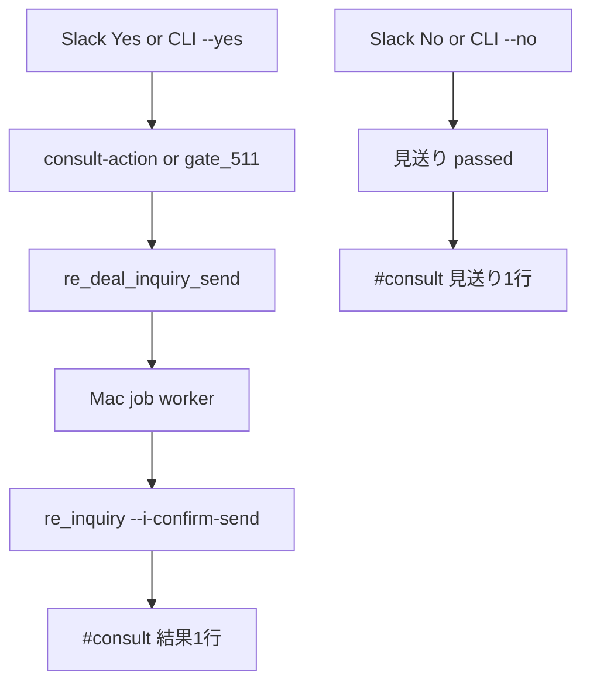

# フロー — 問合せ送信準備係（511）

- FlowForge（設計図）: [flow_Gr7OKXW7L1ElR7yW_XbBCbNH](https://flowforge-259747770348.asia-northeast1.run.app/flows/flow_Gr7OKXW7L1ElR7yW_XbBCbNH)
- **実行エンジン（本線）**: Mac Python ＋ `kurashift_jobs`
  - `scripts/jarvis_property_gate_511.py`
  - 既存 `jarvis_kurashift_re_inquiry.py`（job worker 経由）
- **受信**: jarvis-dashboard `GET|POST /api/slack/consult-action`（Yes/No）
- 正本: [`23_物件進行ゲート_…`](../../23_物件進行ゲート_Grok調査_20261012.md) · 上限時 [`24_…`](../../24_Jarvis上限時_物件進行ゲート_次善策_20261012.md)

## きっかけ（確定 2026-10-12）

| 種別 | 正 |
|---|---|
| **本線・イベント** | Slack Bカードの **Yes／No**（リンク／ボタン／CLI） |
| **副・Aレーン** | 114 が A＋Tier3+To でジョブ積むとき |
| 副・手動 | `--deal-id … --yes` / `--no` |
| 使わない | Yes のあとチャットで「送ってOK？」と二重確認／Cursor 必須 |

## ゴール・報告

| 項目 | 正 |
|---|---|
| **Yes の意味** | その案件の第一問合せ了承（対外了承＝この Yes） |
| **Yes の後** | `re_deal_inquiry_send` ジョブ → Mac job worker → estate 送信 |
| **No の後** | deal 見送り（`passed`）・再調査しない |
| **失敗** | To 未解決等 → `#consult` に1行（止めない） |
| **冪等** | 同一 deal の二重 Yes／送信済は無視 |
| **ログ** | 社員フォルダ `logs/` |

## 型（5ステップ）

1. **起動** — Slack Yes/No／A／手動  
2. **修復** — 必要なら handoff 誤ラベルを first_inquiry へ  
3. **確認** — inquiry_status・To・即死KW・既送信ジョブ  
4. **実行** — Yes→ジョブキュー（または `--direct`）、No→見送り  
5. **報告** — `#consult`（または `#report`）に結果1行  



## 最小実装

```bash
cd ~/git-repos && set -a && source .env.jarvis_private && set +a
~/selenium_env/venv/bin/python scripts/jarvis_property_gate_511.py --deal-id UUID --yes
~/selenium_env/venv/bin/python scripts/jarvis_property_gate_511.py --deal-id UUID --no
~/selenium_env/venv/bin/python scripts/jarvis_property_gate_511.py --deal-id UUID --yes --dry-run
# worker が止まっていたら
launchctl kickstart -k "gui/$(id -u)/com.matsunoma.jarvis.kurashift-job-worker"
```

Slack リンク: `PROPERTY_GATE_ACTION_TOKEN`（jarvis_private ＋ Vercel）  
任意ボタン: `SLACK_SIGNING_SECRET` ＋ Interactivity URL = `/api/slack/consult-action`

## 改善ログ（フロー側）

| 日付 | 変更 |
|---|---|
| 2026-10-09 | Phase C スタブ |
| 2026-10-12 | Yes/No → re_inquiry／ジョブ接続 |
| 2026-10-12 | **consult-action＋冪等＋上限時もCLI可** をフロー正に反映 |
| 2026-10-12 | FlowForge キャンバスを Yes/No→ジョブ送信→#consult に同期（設計図） |
