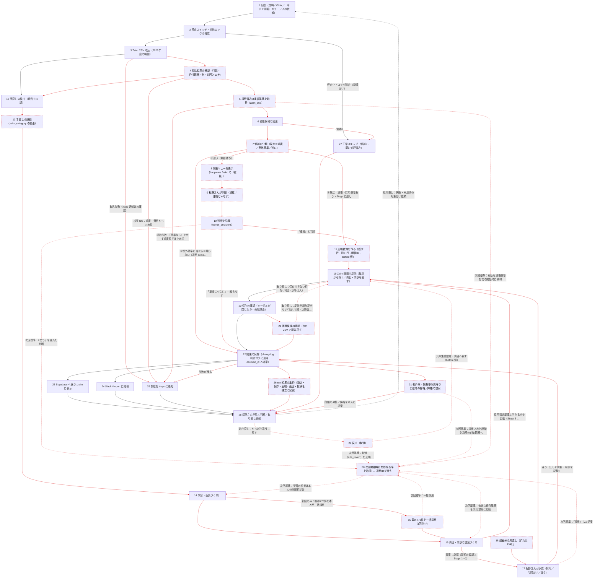

# 613 ChatGPT 持ち込みパック（作業フローの確認用）

Zaim鮮度・二重取込係（613）の作業フローを、松野さんが ChatGPT（チャッピー）のチャットで見ながら確認するための1ファイル。公開リポのため実額・店名・カード名・個人情報は入れていない（カードは『カード1〜』）。正本は同じフォルダの [`flow.md`](./flow.md)（要点だけ写した。違いがあれば flow.md が正）。

## 1. 貼る手順（3行）

1. ChatGPT で**新しいチャット**を開き、このファイルの §2〜§5 を貼る。
2. §2 の「最初の指示」を実行する（ChatGPT が番号を宣言しながらフローを読む）。
3. 図（または §3-B の番号付き文章）を見ながら、§5 の質問に答える。

## 2. ChatGPT への最初の指示（これを先頭に貼る）

```
あなたは「作業フローの確認相手」です。以下の作業フロー（613：Zaim鮮度・二重取込係。重複の除外と費目の学習）を読み、
工程の番号を宣言しながら（例:「工程9について」）、次を指摘してください。
- 抜け（開始・入力・保存・画面反映・報告のどれかが無い工程）
- 失敗した時の動きと、戻り矢印（取り直し・次回基準）の条件が足りているか
- 人が確認すべき点が足りているか／多すぎないか
- 取込・判断の保存・Zaim の保存・画面反映の確認・投稿・学習反映が別々の成功として扱われているか
- 未判断・提案・見送りが恒久基準になってしまう穴、基準を読めなかった時に「基準なし」で進んでしまう穴
- 「自動で重複にした行」が学習の根拠に混ざる穴
ルール: 売買や送金の助言はしない。実額・店名は聞かない・書かない。AI の案と、私（松野）の判断を混ぜない。
私の理由は私の言葉のまま扱い、あなたが補作しない。最後に質問へ番号で答えられるよう、まず工程の理解を3行で要約してください。
```

## 3. フローの要点

### 目的
Zaim の収入・支出の財務記録を正しく保つ。**①重複の除外**（二重に取り込まれた行を『集計に含めない』にする）と**②費目・内訳の学習**（松野さんが直した費目と内訳を覚え、次から同じになるよう提案→承認→自動にする）。決めるのは松野さん。Zaim 画面を直す実行は別の worker。**実行時に AI を呼ぶ工程は0**（全てプログラム）。口座の鮮度（銀行連携・OTP）は本稿の対象外。

**方針**（松野さんの 2026-11-24 の依頼。要約）: 同じ日付・同じ金額・同じカードは**ほとんど重複**。例外は**飲み物（自販機・コンビニ）と交通**。不安なものは Loopware の判断ログに載せ、結果は『重複』か『重複じゃない』。基本は重複にして、学習結果をもとに重複判定にしていく。費目・内訳も、直した内容を学習して同じになるよう見直す。

**規則との整合**: ①『既定＝重複』は**松野さんが採用した基準として登録**（理由は 11/24 の依頼文を原文のまま）。②『重複じゃない』は例外判断として1件ずつ記録し、今回だけ／次回基準は本人が選ぶ。③**自動で重複にした行は学習の根拠にしない**。④実行前に、有効・本人採用済み・未取消・期限内の基準だけを取得し、読めなければ『基準なし』にせず止める。

**前提**（別 worker の作業。未検証）: Zaim 画面の診断（明細 ID は URL に出る／モーダルの待ち／同額2行で止まる）と、型A・型B の『安全な組』を直す PR（作成中）。

凡例: **現行**＝今のコードの動き／**提案**＝未実装。主体は 人／プログラム／外部サービス（AI は実行時に呼ばない）。赤＝提案。

### 3-A. 図（31 工程。Mermaid が崩れたら 3-B へ）



### 3-B. 番号付き文章の版（図が崩れた時はこちら）

1. **起動（定時／GHA／「今すぐ更新」キュー／人の依頼）**（プログラム｜実装済）：2へ（起動）
2. **停止スイッチ・排他ロックの確認**（プログラム｜一部）：3へ（停止中でなく、ロックが取れた）／27へ（停止中・ロック競合（記録だけ））
3. **Zaim CSV 取込（2026年度の明細）**（プログラム｜実装済）：4へ（取込成功）／12へ（（現行）検証なしで学習へ）／25へ（取込失敗（#ops 通知は未確認））
4. **取込結果の検証（行数・日付範囲・列・前回との差）**（プログラム｜未実装(提案)）：5へ（検証 OK）／12へ（検証 OK）／25へ（検証 NG：重複・費目とも止める）
5. **採用済みの重複基準を取得（zaim_dup）**（プログラム｜未実装(提案)）：6へ（基準を読めた）／25へ（読取失敗：『基準なし』とせず重複系だけ止める）
6. **重複候補の抽出**（プログラム｜一部）：7へ（候補あり）／27へ（候補0）
7. **候補の分類（既定＝重複／例外基準／迷い）**（プログラム｜未実装(提案)）：11へ（①既定＝重複（採用基準あり・Stage に達した分））／8へ（③迷い（判断待ち））／22へ（②例外基準に当たる＝触らない（適用 decision_id を記録））
8. **判断キューを表示（Loopware /zaim の『重複』）**（プログラム｜未実装(提案)）：9へ（画面に出た）
9. **松野さんが判断（重複／重複じゃない）**（人｜未実装(提案)）：10へ（判断した）
10. **判断を記録（owner_decisions）**（プログラム｜未実装(提案)）：11へ（『重複』と判断）／22へ（『重複じゃない』＝触らない） 戻り: 30へ（次回基準：『次も』を選んだ判断）
11. **反映依頼を作る（残す行・除く行・明細ID・before 値）**（プログラム｜未実装(提案)）：19へ（承認済み、または採用基準に当たる自動分）
12. **手直しの検出（費目＋内訳）**（プログラム｜一部）：13へ（手直しを検出）
13. **手直しの記録（zaim_category の拡張）**（プログラム｜未実装(提案)）：14へ（本人が直した行だけ）
14. **学習（仮説づくり）**（プログラム｜一部）：15へ（初回のみ：既存773件を本人が一括採用）／16へ（仮説ができた）
15. **既存773件を一括採用（1回だけ）**（人｜未実装(提案)）：16へ（採用済み基準として登録） 戻り: 30へ（次回基準：一括採用）
16. **費目・内訳の提案づくり**（プログラム｜一部）：17へ（提案→承認（新規の仮説と Stage 1〜2））／19へ（採用済み基準に当たる分を自動（Stage 3 以降））
17. **松野さんが承認（採用／今回だけ／違う）**（人｜一部）：19へ（採用／今回だけ）／22へ（違う（正しい費目・内訳を記録）） 戻り: 30へ（次回基準：『採用』した提案）
18. **過去分の見直し（ずれた134行）**（プログラム｜未実装(提案)）：17へ（見直し候補を承認画面へ）
19. **Zaim 画面で反映（集計から除く／費目・内訳を直す）**（プログラム｜一部）：20へ（保存操作をした）
20. **保存の確認（モーダルが閉じたか・失敗理由）**（プログラム｜一部）：21へ（保存を確認できた）／22へ（成否を changelog に記録） 戻り: 19へ（取り直し：保存できない行だけ1回（以降は人））
21. **画面反映の確認（次の CSV で読み戻す）**（プログラム｜未実装(提案)）：22へ（読み戻しの結果） 戻り: 19へ（取り直し：反映が読み戻せない行だけ1回（以降は人））
22. **結果の保存（changelog＋判断ログに適用 decision_id と結果）**（プログラム｜一部）：23へ（保存した）／24へ（保存した）／26へ（run を集約）／25へ（失敗が残る）／31へ（週次の材料）
23. **Supabase へ送り /zaim に表示**（プログラム｜実装済）：28へ（画面で見る）
24. **Slack #report に短報**（プログラム｜一部）：28へ（短報で見る）
25. **失敗を #ops に通知**（プログラム｜実装済）：28へ（失敗を見る）
26. **run 結果の集約（取込・保存・反映・画面・投稿を独立に記録）**（プログラム｜未実装(提案)）：28へ（run の要約で見る）
27. **正常スキップ（候補0・既に処理済み）**（プログラム｜一部）：28へ（（記録だけ））
28. **松野さんが見て判断／取り直し依頼**（人｜実装済）：終わり。 戻り: 1へ（取り直し：失敗・未反映の対象だけ依頼）／29へ（取り直し：やっぱり違う→戻す）
29. **戻す（取消）**（人｜未実装(提案)）：終わり。 戻り: 19へ（元の集計設定・費目へ戻す（before 値））／30へ（次回基準：取消（rule_revert）を反映）
30. **次回開始時に有効な基準を取得し、適用IDを追う**（プログラム｜未実装(提案)）：終わり。 戻り: 5へ（次回基準：有効な重複基準を次の開始時に取得）／16へ（次回基準：有効な費目基準を次の提案に反映）／14へ（次回基準：学習の根拠は本人の判断行だけ）
31. **例外率・失敗率の見守りと段階の昇格／降格の提案**（プログラム｜未実装(提案)）：28へ（段階の昇格／降格を本人に提案） 戻り: 30へ（次回基準：採用された段階を次回の自動範囲へ）

### 3-C. ノード表（簡略。詳細は flow.md §4）

| # | 工程 | 主体 | 状態 |
|---|---|---|---|
| 1 | 起動（定時／GHA／「今すぐ更新」キュー／人の依頼） | プログラム | 実装済 |
| 2 | 停止スイッチ・排他ロックの確認 | プログラム | 一部 |
| 3 | Zaim CSV 取込（2026年度の明細） | プログラム | 実装済 |
| 4 | 取込結果の検証（行数・日付範囲・列・前回との差） | プログラム | 未実装(提案) |
| 5 | 採用済みの重複基準を取得（zaim_dup） | プログラム | 未実装(提案) |
| 6 | 重複候補の抽出 | プログラム | 一部 |
| 7 | 候補の分類（既定＝重複／例外基準／迷い） | プログラム | 未実装(提案) |
| 8 | 判断キューを表示（Loopware /zaim の『重複』） | プログラム | 未実装(提案) |
| 9 | 松野さんが判断（重複／重複じゃない） | 人 | 未実装(提案) |
| 10 | 判断を記録（owner_decisions） | プログラム | 未実装(提案) |
| 11 | 反映依頼を作る（残す行・除く行・明細ID・before 値） | プログラム | 未実装(提案) |
| 12 | 手直しの検出（費目＋内訳） | プログラム | 一部 |
| 13 | 手直しの記録（zaim_category の拡張） | プログラム | 未実装(提案) |
| 14 | 学習（仮説づくり） | プログラム | 一部 |
| 15 | 既存773件を一括採用（1回だけ） | 人 | 未実装(提案) |
| 16 | 費目・内訳の提案づくり | プログラム | 一部 |
| 17 | 松野さんが承認（採用／今回だけ／違う） | 人 | 一部 |
| 18 | 過去分の見直し（ずれた134行） | プログラム | 未実装(提案) |
| 19 | Zaim 画面で反映（集計から除く／費目・内訳を直す） | プログラム | 一部 |
| 20 | 保存の確認（モーダルが閉じたか・失敗理由） | プログラム | 一部 |
| 21 | 画面反映の確認（次の CSV で読み戻す） | プログラム | 未実装(提案) |
| 22 | 結果の保存（changelog＋判断ログに適用 decision_id と結果） | プログラム | 一部 |
| 23 | Supabase へ送り /zaim に表示 | プログラム | 実装済 |
| 24 | Slack #report に短報 | プログラム | 一部 |
| 25 | 失敗を #ops に通知 | プログラム | 実装済 |
| 26 | run 結果の集約（取込・保存・反映・画面・投稿を独立に記録） | プログラム | 未実装(提案) |
| 27 | 正常スキップ（候補0・既に処理済み） | プログラム | 一部 |
| 28 | 松野さんが見て判断／取り直し依頼 | 人 | 実装済 |
| 29 | 戻す（取消） | 人 | 未実装(提案) |
| 30 | 次回開始時に有効な基準を取得し、適用IDを追う | プログラム | 未実装(提案) |
| 31 | 例外率・失敗率の見守りと段階の昇格／降格の提案 | プログラム | 未実装(提案) |

### 3-D. 重複の分け方（要点）

- **既定＝重複**: 型A（スマートレシート合計＝カード1行）・型B（同カード同日同額で片方だけ記述あり）・同カード同日同額（採用済み基準に当たるもの）。
- **対象外**: 交通・高速／スマートレシート同士の同額／保険の別口座。
- **例外**: 飲み物（見分け方は未決）。当面は『迷い』として判断キューへ。
- **迷い（判断キュー）**: 行数がちがう・記述ありで内容がちがう・食費の少額で店が集中・飲み物らしい・基準が読めない。自動では決めない。
- 2026年度 CSV（1/1〜11/18）の概数: 同カード同日同額 195 グループ（うち交通 101＝対象外）→残り 94（うち食費 54 は9店に集中）。型A は 34 組で 6 組が二重。行数がちがう候補は 50 組。

### 3-E. 費目・内訳の分け方（要点）

- 検出は CSV の前後差分。**内訳だけの直しも拾う**。Jarvis 自身の適用行は除く。
- 学習は**本人が直した行だけ**。鍵＝店／店＋金額／店＋品目の語／店＋金額帯。費目と内訳は一組。count≥2 は『仮説』まで。
- 既存の自動可 773 件は**一度まとめて採用**。以後の新規は**提案→承認**。採用済み基準に当たるものだけ、段階が進んでから自動。
- 過去分: 基準とずれた 134 行（費目 101・内訳だけ 33）を『揃える／このまま』で見直す。

### 3-F. 段階化（Stage 0〜4）

0 今回（型A・型B の安全な組を提案どおり直す。今回だけ）→1 提案（全件を判断）→2 承認（安全な組はまとめて承認）→3 自動＋週次まとめ（戻しボタン）→4 自動＋抜き取り。昇格・降格は本人の採用。

## 4. 決まったこと（K）と未決（Q）・未確認（U）

### 決定済み（松野さん。ChatGPT は覆さず、運用上の穴だけ指摘する）

- **K1（2026-11-24）重複の既定対象**：型A・型B＋同カード・同日・同額を『既定＝重複』の対象にする。交通・高速・スマートレシート同士・保険別口座は対象外
- **K2（2026-11-24）判断ログの置き場**：Loopware（Supabase owner_decisions）に置く
- **K3（2026-11-24）費目の自動適用**：既存の自動可ルール773件を一度まとめて採用し、新規は『提案→承認』に改める
- **K4（2026-11-24）内訳の手直しの学習**：内訳（カテゴリの内訳）だけの手直しも学習の対象にする
- **K5（2026-11-24）『既定＝重複』の登録のしかた**：松野さんが採用した基準として登録する。理由は 11/24 の依頼文を原文のまま記録し、AI が言い換えない
- **K6（2026-11-24）学習の根拠**：『自動で重複にした行』は学習の根拠にしない。学習に使うのは松野さんが自分で判断した行だけ

### 未決の判断点（松野さんに聞く順）

- **Q1** 『飲み物』の見分け方。例外クラスに入れる条件（店・金額帯・品目の語）をどう決めるか
- **Q2** 重複の時にどちらを残すか（レシート側／記述あり側／記述なし同士は先の行）
- **Q3** 『重複じゃない』を次回基準にする条件（何回で提案するか・鍵＝店×金額帯×カード・期限）
- **Q4** 理由は任意でよいか／例外の時だけ声で一言にするか
- **Q5** 判断ログの surface 名（重複は新設 zaim_dup、費目は既存 zaim_category を拡張、でよいか）
- **Q6** 段階を上げる条件（Stage 1→2→3→4 の数字）
- **Q7** 過去分134行の見直しの範囲（2026年度のみ／全期間）と時期
- **Q8** Zaim 反映を担当する別 worker との順序と、明細 ID で行を指定する方式にしてよいか
- **Q9** 『既定＝重複』基準の期限（見直し日）と、例外率が超えたら見直す目安
- **Q10** 判断待ちの知らせ方（#report に件数／#consult／Loopware の画面だけ）

### 未確認（U）

- **U1** Zaim 画面の診断結果（明細 ID が URL に出る・モーダルの待ち・同額2行で止まる）の再確認
- **U2** 型A・型B の『安全な組』を直す PR の中身とマージ状況
- **U3** 本番 Supabase に最新の migration と zaim_category が入っているか／Loopware /zaim が本番で動くか
- **U4** watch_status(zaim_quality) の現在の件数
- **U5** 同日同額の食費54グループ（9店に集中）の実体。飲み物かどうか
- **U6** 交通の同日同額が本当に往復か
- **U7** 自己強化（Jarvis の自動直しを松野さんの直しとして数える）が実際に起きているか
- **U8** changelog の失敗が再試行で成功した分
- **U9** Zaim 画面で明細を一意に指定する方法（明細 ID のどこに出るか）
- **U10** CSV 取込が失敗した時に #ops へ通知が出るか
- **U11** 同一 row_key（日付・金額・店・支払元・方法が同じ）の行の扱い
- **U12** GHA だけで動かせるか
- **U13** 2025年度以前のデータ
- **U14** 重複・費目の自動適用を止める専用スイッチ
- **U15** 1判断に複数行を載せる時の payload の形（targets・before・after）
- **U16** 『学習した費目直し』の現行確認（正しい／違う）を新しい承認に置き換える時の移行

## 5. ChatGPT に確認してほしい質問（10個）

1. 重複の『既定＝重複』を採用基準として登録する流れ（工程5→7→30）で、松野さんの理由・期限・取消が足りているか。足りない記録項目はあるか。
2. 『重複じゃない』を次回基準にする条件（今回だけ／次も、何回で提案するか）の置き方で、1回きりの判断が恒久基準になってしまう穴はないか。
3. 自動で重複にした行を学習の根拠から外す線引き（K6）は十分か。他に学習へ混ざる経路（Jarvis 自身の費目の直し、CSV 多数決のルール）はないか。
4. 判断キュー（迷い）の条件は妥当か。多すぎて松野さんの手間が増える所、少なすぎて自動に倒れる所はないか。
5. 取込・判断の保存・Zaim の保存・画面反映の確認（読み戻し）・投稿・学習反映を別の成功にした扱いで、報告が分かりにくくならないか。CSV が火・金だけで確認が3〜4日遅れる点は許容できるか。
6. 戻り矢印（保存できない行・読み戻せない行は1回だけ自動、以降は人）と、取消（工程29）で、元に戻せない場面は残るか。
7. 既存773件の一括採用（工程15）で、松野さんが何を見て採用できるか。一覧に足りない情報はあるか。
8. 段階化（Stage 0〜4）の昇格・降格の条件に、先に決めておくべきものはあるか（例外率・失敗率・件数の扱い）。
9. 工程の番号・順序・矢印で、読んでいて分からなかった所、条件が書いていない矢印はどこか。
10. 実装や運用を始める前に、先に決めておくべきことで、このフローに書かれていないものはあるか。

## 6. 結果の持ち帰り方

1. ChatGPT の答えを、松野さんが**このチャット（Claude／Orca のボット）に貼る**。または flow.md の該当項目（§12 判断点・§13 未確認）に書く。答えは要約せず、松野さんの言葉で付けた理由もそのまま残す。
2. ボットは、答えを工程番号に対応づけ、採用・見送り・要確認に分けて見せる。採否を決めるのは松野さん。ボットは理由を補作しない。
3. 採用された分だけ、同じ番号・順序・接続・戻り条件で `flow.md`／`flow.json`／`flow.html` を直し、結果を項目に報告する。ChatGPT で確認した日は §15 のチェックに記録する。
4. Codex（Orca の worker）のレビューは任意の別の目（補助）。ChatGPT との確認の代わりにはならない。

関連: [`workflow-review/README.md`](../../workflow-review/README.md)・[`prompt-template.md`](../../workflow-review/prompt-template.md)、全体ルール `62_ボット共通ルール入口_20261123.md`、同型の例 [`614 のパック`](../614_ポイント・還元ウォッチ係/chatgpt_review_pack.md)。
