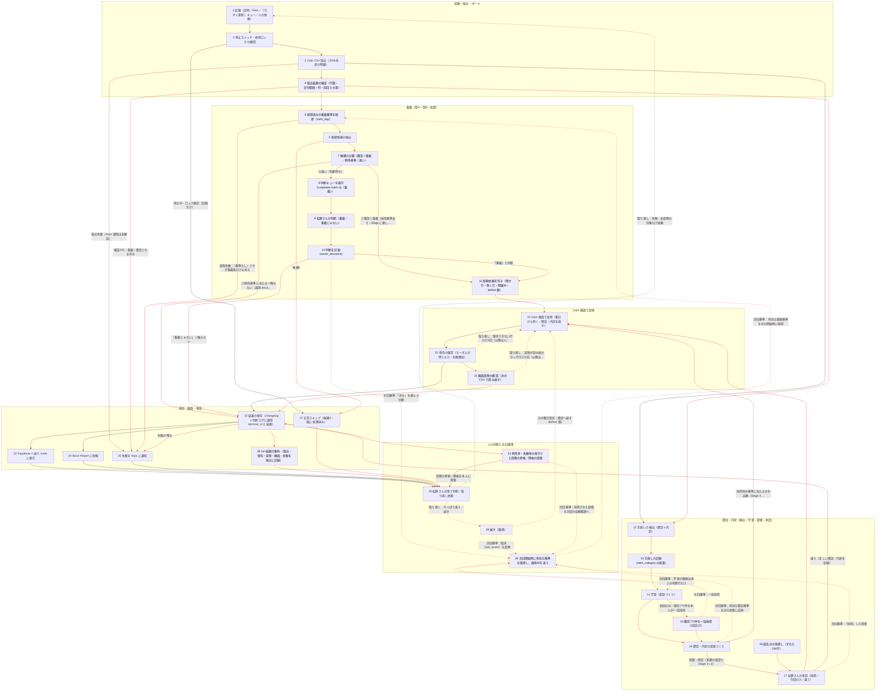

# フロー — Zaim鮮度・二重取込係（613）

**状態**: **第1稿**（Claude・2026-11-24）。松野さんの判断点4件の回答（K1〜K4）を反映した。ChatGPT での確認・松野さんの図の確認はこれから。**コード・Zaim・実データ・DB・設定は変えていない（docs のみ）**。
親: 600 リソース・家計BL ラコ #41／#42（『魂を込める』の進め方＝作業フローを ChatGPT のチャットで松野さんが見ながら確認して固める）。
図（同じ内容）: [`flow.json`](./flow.json)（正本）・[`flow.html`](./flow.html)（ブラウザで開く。金融サイト・DB・Slack に接続しない）。ChatGPT 持ち込み: [`chatgpt_review_pack.md`](./chatgpt_review_pack.md)。
**FlowForge**: 54b の決まりにより画面は触らない・登録しない。このフォルダの `flow.json`／`flow.md`／`flow.html` が当面の正。旧版（2026-10-14 の指示書）は [`CLAUDE.md`](./CLAUDE.md) の §6（口座の鮮度の流れ）が引き続き正。
手順: [`workflow-review/README.md`](../../workflow-review/README.md)・[`prompt-template.md`](../../workflow-review/prompt-template.md)。工程番号は図・表・会話で共通（1〜31）。

## 0. この稿の位置づけと方針

**この稿の中心**は『重複の除外』と『費目・内訳の学習』。口座の鮮度（銀行連携の遅れ・OTP・再接続）は本稿の対象外で、[`CLAUDE.md`](./CLAUDE.md) §6-A のまま（資産棚卸しの表に既存として載せる）。

**方針（松野さんの 2026-11-24 の依頼と回答。要約。原文はこの docs に転記していない）**

- 同じ日付・同じ金額・同じカードは**ほとんど重複**。例外は**飲み物（自販機・コンビニ）と交通**（交通・高速は対象外＝K1）。
- 不安なもの・行数がちがっても同日・同額・同支払先で疑いがあるものは、**Loopware の判断ログ**に載せる。判断の結果は『重複』か『重複じゃない』。『重複じゃない』は圧倒的に少ないので、**基本は重複にして**、その学習結果をもとに重複判定にしていく。
- **費目・内訳も毎回直している**ので、直した内容を学習して、同じ内訳科目になるように見直す。財務の手間を集約する。

**規則（5・6）とのつなぎ**（`~/.claude/rules/matsuno-workflow-review.md`）

1. **『既定＝重複』は松野さんが採用した基準として登録する**（K5）。理由は **11/24 の依頼文を原文のまま**記録する。AI が言い換えない。範囲・対象・期限（見直し日）・取消方法を付ける。
2. **『重複じゃない』は例外判断として1件ずつ記録**し、『今回だけ』か『次も（次回基準）』かを本人が選ぶ。選ばれない限り次回基準にしない。
3. **自動で重複にした行は学習の根拠にしない**（K6）。学習に使うのは松野さんが自分で判断した行だけ。
4. 実行の前に、**有効で本人採用済み・未取消・期限内の基準だけ**を取得して使い、適用した `decision_id` と結果を記録する。**読取失敗を『基準なし』として扱わない**（その系統だけ止める）。未判断・提案・見送りは恒久基準にしない。

**決定済み（2026-11-24）**

| # | 日付 | 事項 | 決定 | メモ |
|---|---|---|---|---|
| K1 | 2026-11-24 | 重複の既定対象 | 型A・型B＋同カード・同日・同額を『既定＝重複』の対象にする。交通・高速・スマートレシート同士・保険別口座は対象外 | 松野さんの回答（コーディネーター経由）。方針は『ほとんど重複。例外は飲み物と交通』。飲み物の見分け方（店・金額帯）は未決（Q1） |
| K2 | 2026-11-24 | 判断ログの置き場 | Loopware（Supabase owner_decisions）に置く | surface 名（zaim_dup 案・zaim_category 拡張）は未決（Q5）。.jarvis_state は判断の正本にしない |
| K3 | 2026-11-24 | 費目の自動適用 | 既存の自動可ルール773件を一度まとめて採用し、新規は『提案→承認』に改める | 現行の『count≥2 で本人採用前に自動適用』を直す。採用は一覧を見て本人が行う（ノード15） |
| K4 | 2026-11-24 | 内訳の手直しの学習 | 内訳（カテゴリの内訳）だけの手直しも学習の対象にする | 現行コードは費目が変わった行だけ拾う。検出（ノード12）を直す |
| K5 | 2026-11-24 | 『既定＝重複』の登録のしかた | 松野さんが採用した基準として登録する。理由は 11/24 の依頼文を原文のまま記録し、AI が言い換えない | 原文はこの docs には転記していない（手元にあるのは要約だけ）。登録の時に本人の原文を貼る |
| K6 | 2026-11-24 | 学習の根拠 | 『自動で重複にした行』は学習の根拠にしない。学習に使うのは松野さんが自分で判断した行だけ | 例外率の分母にも入れない（ノード31） |

**前提（別 worker の作業。この稿を書いた者は未検証。§13 の U1・U2）**

- **Zaim 画面の診断結果**（別 worker）: 明細 ID は URL に出る／モーダルの待ちが要る／同額2行で止まる、など。『同額2行で止まる』は、金額＋店名で行を探す現行の方式が重複行に弱いことと整合する（§2・ノード19）。
- **型A・型B の『安全な組』を直す PR**（別 worker が作成中。番号・差分は未確認）。この稿の Stage 0（§11）はその PR を前提にし、**今回だけ**の実行として扱う。

## 1. 何のための社員か

Zaim（家計簿）の**収入・支出の財務記録を正しく保つ**。①**重複の除外**（二重に取り込まれた行を『集計に含めない』にする）と、②**費目・内訳の学習**（松野さんが直した費目と内訳を覚え、次から同じになるよう提案→承認→自動にする）。決めるのは松野さん。Zaim の画面を直す実行は別 worker。

**実行時に AI を呼ぶ工程は0**（抽出・分類・学習・提案づくりはすべてプログラム）。AI（Claude／Codex／ChatGPT）が出てくるのは設計・保守と、松野さんの依頼で手動実行する時だけ。隣の係: 612（年会費）・611（AI枠）・316（メトリクス分析）は別。

## 2. 資産の棚卸し（参照日 2026-11-24。調査は 11/23〜24。数字は実額なし）

凡例: **実装済**＝コードがあり動作の証拠を確認／**一部**＝動くが穴がある／**未実装**＝提案のみ／**未確認**＝今回確かめていない。

| 資産 | 中身 | 状態 | 確認した根拠 |
|---|---|---|---|
| Zaim CSV 取込 | `zaim_csv_export.py`（Playwright・Mac のみ）。launchd 火・金 12:00（`zaim_csv_weekly_runner.sh`）。出力は OneDrive 配下の `Zaim.<年>年度.csv` | 実装済 | launchd の予定を確認。ログが 11/10・13・17・20 にある（中身は未読）。2026年度 CSV は 1/1〜11/18 の payment 6,970 行。**列に明細 ID は無い**（日付・方法・カテゴリ・カテゴリの内訳・支払元・品目・メモ・お店・支出・集計の設定ほか） |
| 品質検知（重複） | `jarvis_zaim_quality_check.py` の `find_pairs`＝**型A**（スマートレシート合計＝カード1行。日常店キーワード・±1日・±3円）、Amazon サイト×カード、must_include／must_exclude、費目レビュー | 一部 | 型B・拡張（同カード同日同額・行数ちがい）は無い。2026年度の既存ウォッチは 127 組中 5 組が『両方含める』 |
| Watch runner | `jarvis_zaim_watch_runner.py`＝学習→品質検知→安全な集計／高確信度費目の自動適用→snapshot→changelog→push。`--limit 8`・`--skip-apply`・`--skip-learn`・`--dry-run` | 一部 | 自動適用は本人採用の前に動く（count≥2） |
| Zaim 画面の反映 | `215_kamiooya/C1_cursor/finance/zaim_budget_sync/zaim_money_edit.py`（Playwright）＝`set_aggregate`（集計に含める／含めない）・`set_category`（費目＋内訳）。Zaim API には『集計に含めない』が無いため画面操作 | 一部 | **行は金額＋店名で探す**。changelog（8/2〜11/20・重複除く）で費目直しの失敗 55／成功系 13、集計直しの失敗 7／成功系 11。理由は『明細行が見つからない』『保存ボタンが見つからない』が中心 |
| 費目学習 | `jarvis_zaim_learn.py`。鍵＝その他系は店名／それ以外は店＋金額。count≥2 で自動可。`zaim_learn_rules.json`・`zaim_learn_csv_index.json`・`zaim_learn_snapshot.json`（Mac の `.jarvis_state`） | 一部 | ルール 798／自動可 773／本人の手直し由来 37／残りは CSV 多数決（bootstrap）。**内訳だけの直しは検出しない**。**同一 row_key の行は索引で1つに潰れる**。自己適用の除外は見当たらない（実データ未検証） |
| Loopware `/zaim` | `apps/loopware`（Nody）。学習した費目直しを『正しい／違う』で確かめる。surface=`zaim_category`・employee=613。違うは学習停止のコメントも送る | 実装済 | コードを確認。本番の動作は未確認（U3） |
| Supabase `owner_decisions` | 判断ログ契約 v1（`decisionContract.ts`）。追記のみ・`idem_key` で二重防止。`loopware_criteria`（基準の採用・取消）・`rule_review`・自律度のはしご・`/review` | 実装済 | surface に `zaim_category` はあるが **`zaim_dup` は無い**。本番 DB は読んでいない（U3） |
| 618 の判断ログ実行基盤 | `jarvis_asset_618_runtime.py`＝本人の明示採用・targets・effective_from／expires_at・`reverts_id`・run 限定・読取失敗は `Blocked` | 実装済 | 規則5・6 の先行例。流用できる |
| Jarvis ダッシュボード `/zaim` | 鮮度・ピン・学習一覧。`watch_status`（id=zaim_quality）を読む | 実装済 | 本番画面は今回開いていない |
| GHA `zaim-finance-sync` | check と Watch（更新ボタンは押さない）。CSV は Mac の OneDrive 配下のため GHA だけでは読めない | 実装済 | cron は workflow を確認 |
| 口座の鮮度（銀行連携・OTP） | `jarvis_zaim_bank_sync_*`・`reconnect`（`CLAUDE.md` §6-A） | 実装済 | **本稿の対象外**（既存のまま）。2026-11-25 から CSV 最終取引日に加え Zaim の更新日時・エラー表示も判定（`jarvis_zaim_online_accounts.py`、`CLAUDE.md` §6-A） |

**確定/提案の区別**: ノード4・5・7・8・9・10・11・13・15・18・21・26・29・30・31 は**提案（未実装）**。一部実装は 2・6・12・14・16・17・19・20・22・24・27。他は既存。
**既存社員との境界**: 612・611・316・618 は作り直さない。618 の判断ログの型は読み方だけ参考にする。

## 3. フロー図

凡例: 主体＝人／AI／プログラム／外部サービス。**赤の線・赤の点線の枠＝提案（未実装）**。実線＝通常・分岐、点線＝今回の取り直し・次回基準への改善。各つなぎに［現行］（今のコードの動き）か［提案］が付く（全一覧は flow.json）。

**ノード数 31（人 5：9・15・17・28・29）／つなぎ 59／判断点 10（未決）・決定済み 6／未確認 16。**

### 主な流れを文字で（図が崩れた時はこちら。flow.html／flow.json と同じ番号・つなぎ）

1. **起動（定時／GHA／「今すぐ更新」キュー／人の依頼）**（プログラム｜実装済）：2へ（起動）
2. **停止スイッチ・排他ロックの確認**（プログラム｜一部）：3へ（停止中でなく、ロックが取れた）／27へ（停止中・ロック競合（記録だけ））
3. **Zaim CSV 取込（2026年度の明細）**（プログラム｜実装済）：4へ（取込成功）／12へ（（現行）検証なしで学習へ）／25へ（取込失敗（#ops 通知は未確認））
4. **取込結果の検証（行数・日付範囲・列・前回との差）**（プログラム｜未実装(提案)）：5へ（検証 OK）／12へ（検証 OK）／25へ（検証 NG：重複・費目とも止める）
5. **採用済みの重複基準を取得（zaim_dup）**（プログラム｜未実装(提案)）：6へ（基準を読めた）／25へ（読取失敗：『基準なし』とせず重複系だけ止める）
6. **重複候補の抽出**（プログラム｜一部）：7へ（候補あり）／27へ（候補0）
7. **候補の分類（既定＝重複／例外基準／迷い）**（プログラム｜未実装(提案)）：11へ（①既定＝重複（採用基準あり・Stage に達した分））／8へ（③迷い（判断待ち））／22へ（②例外基準に当たる＝触らない（適用 decision_id を記録））
8. **判断キューを表示（Loopware /zaim の『重複』）**（プログラム｜未実装(提案)）：9へ（画面に出た）
9. **松野さんが判断（重複／重複じゃない）**（人｜未実装(提案)）：10へ（判断した）
10. **判断を記録（owner_decisions）**（プログラム｜未実装(提案)）：11へ（『重複』と判断）／22へ（『重複じゃない』＝触らない） 戻り: 30へ（次回基準：『次も』を選んだ判断）
11. **反映依頼を作る（残す行・除く行・明細ID・before 値）**（プログラム｜未実装(提案)）：19へ（承認済み、または採用基準に当たる自動分）
12. **手直しの検出（費目＋内訳）**（プログラム｜一部）：13へ（手直しを検出）
13. **手直しの記録（zaim_category の拡張）**（プログラム｜未実装(提案)）：14へ（本人が直した行だけ）
14. **学習（仮説づくり）**（プログラム｜一部）：15へ（初回のみ：既存773件を本人が一括採用）／16へ（仮説ができた）
15. **既存773件を一括採用（1回だけ）**（人｜未実装(提案)）：16へ（採用済み基準として登録） 戻り: 30へ（次回基準：一括採用）
16. **費目・内訳の提案づくり**（プログラム｜一部）：17へ（提案→承認（新規の仮説と Stage 1〜2））／19へ（採用済み基準に当たる分を自動（Stage 3 以降））
17. **松野さんが承認（採用／今回だけ／違う）**（人｜一部）：19へ（採用／今回だけ）／22へ（違う（正しい費目・内訳を記録）） 戻り: 30へ（次回基準：『採用』した提案）
18. **過去分の見直し（ずれた134行）**（プログラム｜未実装(提案)）：17へ（見直し候補を承認画面へ）
19. **Zaim 画面で反映（集計から除く／費目・内訳を直す）**（プログラム｜一部）：20へ（保存操作をした）
20. **保存の確認（モーダルが閉じたか・失敗理由）**（プログラム｜一部）：21へ（保存を確認できた）／22へ（成否を changelog に記録） 戻り: 19へ（取り直し：保存できない行だけ1回（以降は人））
21. **画面反映の確認（次の CSV で読み戻す）**（プログラム｜未実装(提案)）：22へ（読み戻しの結果） 戻り: 19へ（取り直し：反映が読み戻せない行だけ1回（以降は人））
22. **結果の保存（changelog＋判断ログに適用 decision_id と結果）**（プログラム｜一部）：23へ（保存した）／24へ（保存した）／26へ（run を集約）／25へ（失敗が残る）／31へ（週次の材料）
23. **Supabase へ送り /zaim に表示**（プログラム｜実装済）：28へ（画面で見る）
24. **Slack #report に短報**（プログラム｜一部）：28へ（短報で見る）
25. **失敗を #ops に通知**（プログラム｜実装済）：28へ（失敗を見る）
26. **run 結果の集約（取込・保存・反映・画面・投稿を独立に記録）**（プログラム｜未実装(提案)）：28へ（run の要約で見る）
27. **正常スキップ（候補0・既に処理済み）**（プログラム｜一部）：28へ（（記録だけ））
28. **松野さんが見て判断／取り直し依頼**（人｜実装済）：終わり。 戻り: 1へ（取り直し：失敗・未反映の対象だけ依頼）／29へ（取り直し：やっぱり違う→戻す）
29. **戻す（取消）**（人｜未実装(提案)）：終わり。 戻り: 19へ（元の集計設定・費目へ戻す（before 値））／30へ（次回基準：取消（rule_revert）を反映）
30. **次回開始時に有効な基準を取得し、適用IDを追う**（プログラム｜未実装(提案)）：終わり。 戻り: 5へ（次回基準：有効な重複基準を次の開始時に取得）／16へ（次回基準：有効な費目基準を次の提案に反映）／14へ（次回基準：学習の根拠は本人の判断行だけ）
31. **例外率・失敗率の見守りと段階の昇格／降格の提案**（プログラム｜未実装(提案)）：28へ（段階の昇格／降格を本人に提案） 戻り: 30へ（次回基準：採用された段階を次回の自動範囲へ）

## 4. 各ノード表

各ノードの『開始トリガー・入力・処理・保存先・画面反映先・報告先・成功/部分成功/失敗・判断点』を1行にまとめた。**取込・判断の保存・Zaim の保存・画面反映の確認・投稿・学習反映は別々の成功**（§9）。

### 起動・取込・ガード

| # | 工程（主体｜実行者・道具／開始） | 入力 → 処理 | 保存先／画面／報告 | 成功／部分成功／失敗 | 判断点 | 実装・今回の状態 |
|---|---|---|---|---|---|---|
| 1 | **起動（定時／GHA／「今すぐ更新」キュー／人の依頼）** プログラム｜launchd 火・金 12:00（zaim_csv_weekly_runner.sh）／GHA zaim-finance-sync（check と Watch。取込はしない）／jarvis_zaim_refresh_queue_poll.py／人（会話） 開始: カレンダー時刻・キュー・依頼 | なし（runner が .env.jarvis_private を読む。値はログに出さない） → 該当スクリプトを起動し ~/Library/Logs/jarvis_zaim/ にログを残す | 保存: Mac ログ 画面: なし 報告: なし（結果は 24／25） | 成功: ログ末尾が正常終了 部分: — 失敗: ログが無い（Mac スリープ等）／rc≠0 → 25 | なし | 実装済 今回: 確認済／確認済み 根拠: launchd の予定は火・金 12:00（install_zaim_csv_weekly_launchd.sh）。~/Library/Logs/jarvis_zaim/ に 11/10・13・17・20 のログがある（中身は未読） |
| 2 | **停止スイッチ・排他ロックの確認** プログラム｜zaim_playwright.lock・口座 automation:off・JARVIS_ZAIM_*_DISABLE（確認できたのは bank sync と 費目 Slack 報告の2つ） 開始: 起動直後 | env・state の disabled・ロックファイル → 止める印があれば取込・反映をしない。Playwright は 1 本ずつ | 保存: ログ 画面: なし 報告: 停止・ロック競合は #ops（ゼロ報告は連投しない） | 成功: 止める印を守って進む／止まる 部分: — 失敗: 読めない→安全側（その系統だけ止める） | なし（停止は人だけが決める） | 一部 今回: 未検証／一部確認 根拠: bank sync の DISABLE は jarvis_zaim_bank_sync_check.py で確認。重複・費目の自動適用を止める専用スイッチは未実装（§10 の提案） |
| 3 | **Zaim CSV 取込（2026年度の明細）** プログラム｜zaim_csv_export.py（Playwright）→ OneDrive 配下の Zaim.<年>年度.csv（Mac のみ） 開始: ノード1 の後 | Zaim の Web ログイン状態（秘密は出さない） → CSV を書き出す | 保存: OneDrive 配下の CSV 画面: なし 報告: 失敗は 25 | 成功: CSV が最新日付まで書けた 部分: 古い日付まで／一部の年度だけ 失敗: ログイン壁・書き出し失敗 | なし | 実装済 今回: 確認済／確認済み 根拠: 2026年度 CSV は 1/1〜11/18 の 6,970 payment 行を読めた（列は日付〜集計の設定。明細 ID の列は無い）。GHA だけでは読めない（Mac の OneDrive 配下） |
| 4 | **取込結果の検証（行数・日付範囲・列・前回との差）** プログラム｜新規の小さな検査（jarvis_zaim_quality_check.py に足す想定） 開始: ノード3 の後 | 今回 CSV・前回の索引（zaim_learn_csv_index.json） → 列が揃っているか・日付が進んだか・行数が急に減っていないか。NG なら以降を止める | 保存: ログ・判断ログの run 記録 画面: なし 報告: NG は #ops | 成功: OK→重複・費目へ 部分: 一部の年度だけ OK 失敗: 検査自体が失敗→以降を止める（成功とみなさない） | 検査の閾値（急減の目安）は本人と決める | 未実装(提案) 今回: 未実行／提案 根拠: 現行は検証なしで 学習（12）へ進む（3→12） |

### 重複（型A・型B・拡張）

| # | 工程（主体｜実行者・道具／開始） | 入力 → 処理 | 保存先／画面／報告 | 成功／部分成功／失敗 | 判断点 | 実装・今回の状態 |
|---|---|---|---|---|---|---|
| 5 | **採用済みの重複基準を取得（zaim_dup）** プログラム｜Loopware API（owner_decisions surface=zaim_dup を読む）。型は 618 の resolve_decisions を参考 開始: ノード4 の後 | owner_decisions（rule_accept／rule_once／rule_revert・有効期間・取消） → 本人が明示採用し、未取消・有効期間内の基準だけを取得。『既定＝重複』と例外基準を分けて持つ | 保存: run の記録（取得した decision_id 一覧） 画面: なし 報告: 読取失敗は #ops | 成功: 基準を読めた 部分: 一部の基準だけ読めた→読めた分だけ使う（残りは判断キュー） 失敗: 読めない→『基準なし』とせず重複系だけ止める | なし | 未実装(提案) 今回: 未実行／提案 根拠: 618 の jarvis_asset_618_runtime.py に同型の実装がある（読み方・期限・取消・run 限定）。zaim_dup の surface は未登録 |
| 6 | **重複候補の抽出** プログラム｜jarvis_zaim_quality_check.py の find_pairs（型A）＋新規の型B・拡張 開始: 基準の取得後 | 今回 CSV の支出行（振替・残高調整を除く） → 型A=スマートレシートの合計とカード1行／型B=同カード・同日・同額で片方だけ記述あり／拡張=同カード・同日・同額、行数がちがっても同日・同額・同支払先。対象外（交通・高速・スマートレシート同士・保険別口座）は最初から除く | 保存: 候補一覧（run 内） 画面: なし 報告: なし | 成功: 候補が出た／0件 部分: 対象外の判定が曖昧な行は『迷い』へ 失敗: CSV が読めない→4 へ | なし（範囲は決定済み） | 一部 今回: 未検証／確認済み 根拠: 型A は実装済（日常店キーワード・±1日・±3円）。型B・拡張は未実装。2026年度の概数: 同カード同日同額 195 グループ（うち交通 101）、残り 94 |
| 7 | **候補の分類（既定＝重複／例外基準／迷い）** プログラム｜新規（zaim_dup の判定部品） 開始: ノード6 の後 | 候補・採用済み基準（5） → ①型A・型B＋同カード同日同額で採用基準に当たる＝『既定＝重複』②例外基準に当たる＝『重複じゃない』（触らない）③それ以外＝迷い（判断キュー）。自動で決めた行には必ず適用 decision_id を付ける | 保存: 分類結果（run 内） 画面: なし 報告: なし | 成功: 全候補が①②③に分かれた 部分: 基準が読めなかった分は③へ 失敗: 分類不能→③へ（自動で重複にしない） | 『既定＝重複』の対象は決定済み。例外基準の鍵は未決 | 未実装(提案) 今回: 未実行／提案 根拠: 自動で重複にした行は『本人の判断』ではない。学習の根拠にしない（§6・§8） |
| 8 | **判断キューを表示（Loopware /zaim の『重複』）** プログラム｜apps/loopware（/zaim を拡張。AI は呼ばない） 開始: 分類（7）の後 | 迷いの候補・AI案（既定＝重複） → 候補を『日付・額・カード・行数・品目の有無』で並べ、AI案を添えて出す。店名は本人の画面にだけ出る | 保存: Loopware の判断待ち 画面: Loopware /zaim 報告: 判断待ち件数を #report（実額OK） | 成功: 画面に出た 部分: 一部しか出ない 失敗: 出ない→件数だけ #ops | なし | 未実装(提案) 今回: 未実行／提案 根拠: 現行の /zaim は『学習した費目直しの正しい／違う』のみ（zaimCore.ts・api/zaim/route.ts） |
| 9 | **松野さんが判断（重複／重複じゃない）** 人｜松野さん（Loopware /zaim。音声・チャット可） 開始: 画面を開いた時 | 候補・AI案 → 『重複』『重複じゃない』を選ぶ。今回だけ／次も、を選ぶ。理由は本人の言葉のまま（空でも可） | 保存: 10 へ 画面: Loopware /zaim 報告: — | 成功: 判断した 部分: 一部だけ判断した→残りは判断待ちのまま（採用扱いにしない） 失敗: 判断しない→判断待ち（既定＝重複を自動で当てない） | 理由は任意（本人の言葉のまま）。AI が補作しない | 未実装(提案) 今回: 未実行／提案 根拠: 見送り・保留は恒久基準にしない |
| 10 | **判断を記録（owner_decisions）** プログラム｜Loopware POST /api/log → Supabase owner_decisions（surface=zaim_dup 案） 開始: 判断した時 | 判断・理由・対象・scope・期限・run_id → 1判断1行（idem_key で二重防止）。保存に失敗したら『端末のみ』と出し、成功扱いにしない | 保存: owner_decisions 画面: 保存シートに『共有DB／端末のみ』 報告: なし | 成功: 保存できた（persisted:true） 部分: 端末のみ（保存失敗） 失敗: 保存失敗は黙って通さない | surface 名は未決（zaim_dup 案） | 未実装(提案) 今回: 未実行／提案 根拠: contract は decisionContract.ts が正本。surface を足すと写し2本とテストの更新が要る |
| 11 | **反映依頼を作る（残す行・除く行・明細ID・before 値）** プログラム｜新規（zaim_dup の反映部品） 開始: 『重複』と判断された時／採用基準に当たる自動分の段階に達した時 | 判断・対象行・Zaim の明細 ID（URL に出る＝申し送り・未検証） → どの行を『集計に含めない』にするか決める。元の集計設定（before）を必ず控える | 保存: 反映依頼（run 内） 画面: なし 報告: なし | 成功: 依頼が作れた 部分: 一部の行だけ明細 ID が取れた 失敗: 明細 ID が取れない行は反映しない（金額＋店名では探さない） | 残す側（レシート側／記述あり側）は未決 | 未実装(提案) 今回: 未実行／提案 根拠: CSV に明細 ID 列は無い（列を確認済み）。明細 ID の取り方は Zaim 画面診断（別 worker）の結果が前提 |

### 費目・内訳（検出・学習・提案→承認）

| # | 工程（主体｜実行者・道具／開始） | 入力 → 処理 | 保存先／画面／報告 | 成功／部分成功／失敗 | 判断点 | 実装・今回の状態 |
|---|---|---|---|---|---|---|
| 12 | **手直しの検出（費目＋内訳）** プログラム｜jarvis_zaim_learn.py の learn_from_csv_diff を拡張 開始: ノード4 の後 | 前回の索引×今回 CSV（row_key＝日付／金額／店／支払元／方法） → 費目が変わった行に加え、内訳（カテゴリの内訳）だけ変わった行も拾う。Jarvis 自身の適用行（snapshot の auto_applied）は除く。同一 row_key が複数ある行は連番か明細 ID で区別 | 保存: 検出一覧（run 内） 画面: なし 報告: なし | 成功: 検出できた 部分: 同一 row_key の行は区別できず1行扱い 失敗: 索引が読めない→学習をスキップ | なし（内訳も学習する＝決定済み） | 一部 今回: 未検証／確認済み 根拠: 現行は費目の変化だけ検出（内訳だけは continue）。自己適用の除外は見当たらない（実データ未検証）。同一 row_key は辞書で上書きされる（コードで確認） |
| 13 | **手直しの記録（zaim_category の拡張）** プログラム｜Loopware API → owner_decisions（surface=zaim_category） 開始: 検出の後 | 元の費目・内訳／直した後の費目・内訳 → 元＝AI案、直した後＝本人選択として1行。理由は空（本人が書いた時だけ）。『手で直した』という事実だけを残す | 保存: owner_decisions 画面: /zaim（一覧） 報告: なし | 成功: 保存できた 部分: 端末のみ 失敗: 保存失敗を黙って通さない | なし | 未実装(提案) 今回: 未実行／提案 根拠: 現行の zaim_category は『正しい／違う』の確認のみ |
| 14 | **学習（仮説づくり）** プログラム｜jarvis_zaim_learn.py（鍵を拡張） 開始: 記録の後 | 本人が直した行（13）だけ → 鍵＝店／店＋金額／店＋品目の語／店＋金額帯。費目と内訳を一組で持つ。count≥2 は『仮説』に上げるだけで、有効な基準にはしない。ブートストラップ（CSV 多数決）と自動分は入力にしない | 保存: zaim_learn_rules.json（Mac・.jarvis_state）。仮説は Loopware にも出す 画面: /zaim 報告: 仮説の件数 | 成功: 仮説が出た 部分: 一部の鍵だけ 失敗: 衝突（conflict）は仮説にしない | 鍵の種類と金額帯の切り方は未決 | 一部 今回: 未検証／確認済み 根拠: 現行は 798 ルール／自動可 773／手直し由来 37／残りは多数決の bootstrap。内訳はルールに入るが直しのきっかけにならない |
| 15 | **既存773件を一括採用（1回だけ）** 人｜松野さん（Loopware /zaim の一覧で『まとめて採用』） 開始: 初回の1回 | 現行の自動可ルール（773件）の一覧 → 一覧を見て、まとめて採用／除外する店を外す。採用したものだけ『採用済み基準』になる。理由は本人の言葉のまま | 保存: owner_decisions（rule_accept・対象一覧・期間） 画面: Loopware /zaim 報告: 採用件数を #report | 成功: 採用した 部分: 一部だけ採用（外した分は仮説に戻す） 失敗: 採用しない→773件は自動適用を止めて提案のみ | 件数と範囲は本人が決める | 未実装(提案) 今回: 未実行／提案 根拠: 決定済み（2026-11-24）。現行の自動適用は『本人採用前』に動いている点を直す |
| 16 | **費目・内訳の提案づくり** プログラム｜jarvis_zaim_learn.py の resolve_suggestion を拡張 開始: 検出・学習の後／過去分の見直し時 | 明細・採用済み基準（30）・仮説 → 採用済み基準に当たる明細へ『費目＋内訳』を提案。新規の仮説は『提案→承認』。Stage 3 以降は採用済み基準に当たるものだけ自動 | 保存: 提案一覧（run 内） 画面: Loopware /zaim 報告: 提案件数を #report | 成功: 提案が作れた 部分: 基準が読めた分だけ 失敗: 読めない→提案しない（基準なしとして自動に倒さない） | 自動にする範囲は Stage で決める | 一部 今回: 未検証／確認済み 根拠: 現行の resolve_suggestion は『その他系は店名鍵／それ以外は店＋金額鍵』で、しきい値 count≥2 |
| 17 | **松野さんが承認（採用／今回だけ／違う）** 人｜松野さん（Loopware /zaim） 開始: 提案が出た時 | 提案・根拠の件数 → 採用／今回だけ／違う、正しい費目・内訳、理由は本人の言葉のまま（任意） | 保存: owner_decisions 画面: Loopware /zaim 報告: — | 成功: 判断した 部分: 一部のみ 失敗: 判断しない→提案のまま（自動にしない） | 理由は任意 | 一部 今回: 未検証／一部確認 根拠: 現行の /zaim は反映後の『正しい／違う』確認。承認が先の流れは未実装 |
| 18 | **過去分の見直し（ずれた134行）** プログラム｜新規（一覧づくり） 開始: 本人が頼んだ時（範囲と時期は未決） | 採用済み基準と今の費目・内訳 → 基準とずれた行（2026年度で 134 行＝費目 101・内訳だけ 33）を一覧にして『揃える／このまま』を17の画面で聞く | 保存: 一覧（run 内） 画面: Loopware /zaim 報告: 件数を #report | 成功: 一覧が出せた 部分: 一部の鍵だけ 失敗: 基準が読めない→出さない | 範囲（今年度のみ／全期間）と時期は未決 | 未実装(提案) 今回: 未実行／提案 根拠: 134 行は 2026年度 CSV と 11/20 時点のルールでの数え方。最近直した行はルール側が古いだけの可能性 |

### Zaim 画面で反映

| # | 工程（主体｜実行者・道具／開始） | 入力 → 処理 | 保存先／画面／報告 | 成功／部分成功／失敗 | 判断点 | 実装・今回の状態 |
|---|---|---|---|---|---|---|
| 19 | **Zaim 画面で反映（集計から除く／費目・内訳を直す）** プログラム｜215_kamiooya/C1_cursor/finance/zaim_budget_sync/zaim_money_edit.py（Playwright）。担当は別 worker 開始: 承認・自動条件を満たした行ごと | 反映依頼（11／16）・明細 ID → Zaim API には『集計に含めない』が無いため画面操作。明細 ID の詳細画面を直接開く案（URL に ID が出る＝申し送り）。1行ずつ・--limit を守る | 保存: Zaim（外部） 画面: Zaim の画面 報告: なし（結果は 22） | 成功: 行ごとに保存まで進んだ 部分: 一部の行だけ成功 失敗: 行が見つからない・保存ボタンが無い・モーダル待ちで止まる（同額2行で止まる＝申し送り） | なし | 一部 今回: 未検証／確認済み 根拠: 現行は金額＋店名で行を探す。changelog（8/2〜11/20）では費目直しの失敗が55件（重複除く）、集計直しの失敗が7件。理由は『明細行が見つからない』『保存ボタンが見つからない』が中心 |
| 20 | **保存の確認（モーダルが閉じたか・失敗理由）** プログラム｜zaim_money_edit.py（同じ Playwright セッション内） 開始: ノード19 の直後 | 画面の状態 → 保存後にモーダルが閉じ、同じ明細を開き直して値が変わったかを見る。待ち時間は上限つき。失敗理由を行ごとに残す | 保存: changelog（zaim_watch_changelog.json） 画面: なし 報告: 失敗は #ops | 成功: 保存まで確認できた 部分: 一部の行だけ 失敗: 保存できない→19 に1回だけ戻す（以降は人） | なし | 一部 今回: 未検証／一部確認 根拠: 現行は rc と changelog の status（failed／pending_confirm／confirmed）。『保存した』と『画面に出た』は別の確認 |
| 21 | **画面反映の確認（次の CSV で読み戻す）** プログラム｜jarvis_zaim_quality_check.py（読み戻しの比較を足す） 開始: 次の CSV 取込の後（火・金） | 反映依頼・次の CSV → 『集計の設定』『カテゴリ』『内訳』が期待どおりになったかを、明細 ID か row_key＋連番で行ごとに比べる | 保存: 判断ログ（結果） 画面: Loopware /zaim 報告: 差が残る行を #report | 成功: 期待どおり 部分: 一部の行だけ 失敗: 読めない→『未確認』とし、成功にしない | なし | 未実装(提案) 今回: 未実行／提案 根拠: 保存の確認（20）とは別の成否。CSV が火・金だけなので確認は最大3〜4日遅れる |

### 保存・画面・報告

| # | 工程（主体｜実行者・道具／開始） | 入力 → 処理 | 保存先／画面／報告 | 成功／部分成功／失敗 | 判断点 | 実装・今回の状態 |
|---|---|---|---|---|---|---|
| 22 | **結果の保存（changelog＋判断ログに適用 decision_id と結果）** プログラム｜jarvis_zaim_watch_runner.py ＋ Loopware API 開始: 反映・確認の後 | 各ノードの成否 → 行ごとに『適用した decision_id』『結果（成功／部分成功／失敗／未確認）』を残す | 保存: zaim_watch_changelog.json（Mac）／owner_decisions 画面: /zaim 報告: なし | 成功: 保存できた 部分: 判断ログだけ失敗など 失敗: 保存失敗は #ops | なし | 一部 今回: 未検証／確認済み 根拠: changelog は現行。適用 decision_id の記録は未実装 |
| 23 | **Supabase へ送り /zaim に表示** プログラム｜jarvis_zaim_watch_runner.py の push（watch_status id=zaim_quality） 開始: 保存の後 | changelog・品質ウォッチ → ダッシュボード用に送る | 保存: Supabase watch_status 画面: Jarvis ダッシュボード /zaim・Loopware /zaim 報告: なし | 成功: 送れた（戻り値0） 部分: 一部だけ 失敗: 送れない→ #ops | なし | 実装済 今回: 未検証／確認済み 根拠: 本番画面の表示は今回開いていない（未確認） |
| 24 | **Slack #report に短報** プログラム｜watch_runner 内（SLACK_WEBHOOK_AI_TEAM_REPORT）。重複用の短報は新規 開始: 保存の後 | 件数・結果 → 『提案n／自動n／判断待ちn／反映の成否』を実額つきで短く（Slack は本人の通知＝実額OK。公開リポには書かない） | 保存: Slack 画面: なし 報告: #report | 成功: 投稿できた 部分: 一部だけ 失敗: 投稿失敗は #ops。控えは配信の証拠にしない | なし | 一部 今回: 未検証／一部確認 根拠: 費目の短報は現行（直し／学習が1件以上の時だけ。JARVIS_ZAIM_CATEGORY_SLACK_REPORT_DISABLE=1 でオフ）。重複の短報は未実装 |
| 25 | **失敗を #ops に通知** プログラム｜jarvis_zaim_bank_notify.py など（SLACK_WEBHOOK_OPS） 開始: 失敗・停止・読取失敗 | エラー → 件数と対象だけ。ゼロ報告は連投しない | 保存: Slack 画面: なし 報告: #ops | 成功: 通知できた 部分: — 失敗: 通知失敗→次回に持ち越し | なし | 実装済 今回: 未検証／一部確認 根拠: 取込失敗時の #ops 通知は未確認 |
| 26 | **run 結果の集約（取込・保存・反映・画面・投稿を独立に記録）** プログラム｜新規（run 記録） 開始: run の最後 | 各ノードの成否 → 『取込／判断の保存／Zaim 保存／画面反映の確認／投稿／学習反映』を別々の成否で1つの run_id にまとめる | 保存: owner_decisions（run）／ログ 画面: /zaim の run 一覧 報告: 要約を #report | 成功: 全部の成否が揃った 部分: 一部が未確認 失敗: 集約失敗→個別の成否を残す | なし | 未実装(提案) 今回: 未実行／提案 根拠: 614 の flow.md のノード31（集約）と同じ考え方 |
| 27 | **正常スキップ（候補0・既に処理済み）** プログラム｜各スクリプト 開始: 候補が無い時 | — → 何もせず終わる（成功に数えない） | 保存: ログ 画面: なし 報告: 無言 | 成功: — 部分: — 失敗: — | なし | 一部 今回: 未検証／一部確認 根拠: 現行は候補0でも learn→watch が回る。『正常スキップ』の印は未整備 |

### 人の判断と次回基準

| # | 工程（主体｜実行者・道具／開始） | 入力 → 処理 | 保存先／画面／報告 | 成功／部分成功／失敗 | 判断点 | 実装・今回の状態 |
|---|---|---|---|---|---|---|
| 28 | **松野さんが見て判断／取り直し依頼** 人｜松野さん（Loopware /zaim・Jarvis /zaim・Slack） 開始: 画面・Slack を見た時 | 画面・短報 → 必要なら対象を言って取り直し／戻しを依頼 | 保存: 会話 画面: 各 /zaim 報告: — | 成功: 判断した 部分: — 失敗: — | 取り直す対象（行・グループ） | 実装済 今回: 確認済／確認済み 根拠: /zaim の『確認した』『おかしい』が現行の入口 |
| 29 | **戻す（取消）** 人｜松野さん → Loopware（rule_revert）＋ Zaim 画面（元の集計設定へ） 開始: 『やっぱり違う』と思った時 | 対象・before 値 → 判断を取り消し（reverts_id）、Zaim の集計設定を元に戻す依頼を作る。元の判断は消さず追記 | 保存: owner_decisions（rule_revert）／反映依頼 画面: Loopware /zaim 報告: #report | 成功: 戻せた 部分: 一部の行だけ 失敗: before 値が無い行は人が手で戻す | 取消の範囲（1件／この条件ぜんぶ） | 未実装(提案) 今回: 未実行／提案 根拠: 11 で before 値を控えるのが前提 |
| 30 | **次回開始時に有効な基準を取得し、適用IDを追う** プログラム｜Loopware API（loopware_criteria／zaim_dup／zaim_category の読み出し） 開始: 次回の 5／16 の開始時 | owner_decisions → 本人採用済み・未取消・期限内の基準だけ取得。今回だけの判断は持ち越さない。未判断・提案・見送りは恒久基準にしない。適用した decision_id と結果を run に残す | 保存: run の記録 画面: /zaim 報告: — | 成功: 取得できた 部分: 一部だけ 失敗: 読めない→『基準なし』と扱わず、その系統だけ止める | なし | 未実装(提案) 今回: 未実行／提案 根拠: 規則5・6。618 に同型の実装あり |
| 31 | **例外率・失敗率の見守りと段階の昇格／降格の提案** プログラム｜新規（週次レビュー /review・agent_stage） 開始: 週次 | 判断ログ・run の成否 → 例外率（『重複じゃない』÷本人が判断した件数）・反映失敗率を出し、段階の昇格／降格を『提案』する。採否は本人（agent_stage） | 保存: owner_decisions 画面: /review 報告: 週次の #report | 成功: 提案できた 部分: — 失敗: — | 昇格の条件の数字は本人が決める | 未実装(提案) 今回: 未実行／提案 根拠: 自動で重複にした行は分母に入れない |

## 5. 取り直しと次回改善（戻り矢印）

**今回の取り直し**（対象を絞り、条件付き。無条件の自動反復・自動承認はしない）:

| 現行/提案 | 元 | 先 | 条件 |
|---|---|---|---|
| 提案 | 20 保存の確認（モーダルが閉じたか・失敗理由） | 19 Zaim 画面で反映（集計から除く／費目・内訳を直す） | 【取り直し】保存できない行だけ1回（以降は人） |
| 提案 | 21 画面反映の確認（次の CSV で読み戻す） | 19 Zaim 画面で反映（集計から除く／費目・内訳を直す） | 【取り直し】反映が読み戻せない行だけ1回（以降は人） |
| 現行 | 28 松野さんが見て判断／取り直し依頼 | 1 起動（定時／GHA／「今すぐ更新」キュー／人の依頼） | 【取り直し】失敗・未反映の対象だけ依頼 |
| 提案 | 28 松野さんが見て判断／取り直し依頼 | 29 戻す（取消） | 【取り直し】やっぱり違う→戻す |
| 提案 | 29 戻す（取消） | 19 Zaim 画面で反映（集計から除く／費目・内訳を直す） | 元の集計設定・費目へ戻す（before 値） |

- 取り直しの対象は『保存できない行・反映が読み戻せない行・失敗した対象だけ』。成功済みの行は再実行しない。自動での再試行は**1行につき1回まで**、以降は人（ノード28）。

**次回基準への改善**（今回の結果は変えず、次回の開始時に反映）:

| 現行/提案 | 元 | 先 | 条件 |
|---|---|---|---|
| 提案 | 10 判断を記録（owner_decisions） | 30 次回開始時に有効な基準を取得し、適用IDを追う | 【次回基準】『次も』を選んだ判断 |
| 提案 | 17 松野さんが承認（採用／今回だけ／違う） | 30 次回開始時に有効な基準を取得し、適用IDを追う | 【次回基準】『採用』した提案 |
| 提案 | 15 既存773件を一括採用（1回だけ） | 30 次回開始時に有効な基準を取得し、適用IDを追う | 【次回基準】一括採用 |
| 提案 | 29 戻す（取消） | 30 次回開始時に有効な基準を取得し、適用IDを追う | 【次回基準】取消（rule_revert）を反映 |
| 提案 | 30 次回開始時に有効な基準を取得し、適用IDを追う | 5 採用済みの重複基準を取得（zaim_dup） | 【次回基準】有効な重複基準を次の開始時に取得 |
| 提案 | 30 次回開始時に有効な基準を取得し、適用IDを追う | 16 費目・内訳の提案づくり | 【次回基準】有効な費目基準を次の提案に反映 |
| 提案 | 30 次回開始時に有効な基準を取得し、適用IDを追う | 14 学習（仮説づくり） | 【次回基準】学習の根拠は本人の判断行だけ |
| 提案 | 31 例外率・失敗率の見守りと段階の昇格／降格の提案 | 30 次回開始時に有効な基準を取得し、適用IDを追う | 【次回基準】採用された段階を次回の自動範囲へ |

- 次回に効くのは**本人が採用した基準だけ**。『今回だけ』は持ち越さない。未判断・提案・見送りは基準にしない。

## 6. 重複（型A・型B・拡張＝判断キュー）

**対象のクラス**（K1。範囲は松野さんの回答どおり）

| クラス | 扱い |
|---|---|
| 型A（スマートレシートの合計＝カード1行） | 既定＝重複の対象 |
| 型B（同カード・同日・同額で片方だけ記述あり） | 既定＝重複の対象 |
| 拡張：同カード・同日・同額（行数がちがっても同日・同額・同支払先の疑いを含む） | 既定＝重複の対象。**迷う組は判断キュー**（ノード8） |
| 交通・高速（往復で同額が普通） | **対象外** |
| スマートレシート同士の同額（同じレシートの別品目） | **対象外** |
| 保険の別口座（同日・同額が並ぶ） | **対象外** |
| 飲み物（自販機・コンビニ） | **例外**＝『重複じゃない』が多いクラス。見分け方（店・金額帯・品目の語）は未決（Q1）。当面は『迷い』として判断キューへ |

**2026年度 CSV の概数**（1/1〜11/18・支出 6,061 行。グループ数。**重ならない数え方ではない**。店名・金額は書かない）

| 見方 | 件数 |
|---|---|
| 同日・同額・同じ支払元（カード）で2行以上 | 195 グループ（403 行）。うち交通 101（高速代 98）＝対象外。残り **94 グループ（201 行）** |
| その94の中身 | 記述なし同士 16／型B（片方だけ記述）12／記述あり同内容 2／記述あり・内容ちがい 64。集計設定は両方『含める』78・一方除外済み 13・両方除外 3 |
| カード別（両方『含める』78） | カード1 47／カード2 18／カード3 11／カード5 2 |
| 食費（上の94の内） | 54 グループ（≤300円が 50）。**9店に集中**（最多1店で 24）。品目がちがうもの 53。定義済みのコンビニ系の語には0件（U5） |
| 型A（レシート合計＝カード1行。店名ゆるめ・±1日・±3円） | 34 組。28 は処理済み、**6 が二重**（両方『含める』）。既存ウォッチの数え方では 127 組中 5 |
| 行数がちがう候補（同日・同店・支払元ちがい・合計が同額） | 50 組。『1行 vs 2〜4行』9／『1行 vs 1行』40（うち37は保険・生活インフラの別口座） |
| 同じ支払元の中で『1行＝ほかの行の合計』 | 18 組（うち14 はレシート明細） |
| 支払元がちがう同日同額で2口以上まだ『含める』 | 103 グループ |
| スマートレシート同士の同額複数行 | 320 グループ（868 行）＝対象外 |

**分類のしかた**（ノード7）

1. **既定＝重複**: 型A・型B・同カード同日同額で、**採用済みの『既定＝重複』基準**に当たり、対象外クラスでなく、例外基準に当たらないもの。Stage に応じて『提案』『承認』『自動』（§11）。
2. **例外＝重複じゃない**: 採用済みの例外基準に当たるもの。触らない。適用した `decision_id` を残す。
3. **迷い（判断キュー）**: 行数がちがう・記述ありで内容がちがう・食費の少額で店が集中・飲み物らしい・基準が読めない・既定と例外が衝突する、のどれか。**自動では決めない**。

**判断→学習の流れ**（ノード9→10→14→30→5）: 松野さんが『重複／重複じゃない』を押す → 判断ログに1行 →『重複じゃない』が溜まった条件（店×金額帯×カード）を**仮説**として出す → 本人が採用した時だけ例外基準 → 次回の開始時（ノード5）に有効な基準として取得。**既定で自動に重複にした行は、この流れの入力に入れない**（K6）。

**Zaim への反映**（ノード11→19→20→21）: Zaim API に『集計に含めない』が無いため画面操作（別 worker）。**明細 ID で行を指定**（URL に出る＝申し送り・未検証）。残す側・除く側と、元の集計設定（before）を必ず控え、戻せるようにする。**金額＋店名では探さない**。

## 7. 費目・内訳（検出・学習・提案→承認・自動・過去分134行の見直し）

**検出**（ノード12）: 火・金の CSV 前後差分。直す点（K4）: ①費目が同じでも**内訳だけ変わった行**を拾う ②Jarvis 自身の適用行（snapshot の `auto_applied`）を除く ③同一 row_key の行は連番か明細 ID で区別する。

**学習**（ノード13→14）: 本人が直した行だけを入力にする。鍵＝店／店＋金額／店＋品目の語／店＋金額帯。**費目と内訳を一組**で持つ。count≥2 は『仮説』に上げるだけ。**CSV 多数決（bootstrap）と自動適用の行は入力にしない**（K6）。衝突（conflict）は仮説にしない。

**提案→承認→自動**（ノード15〜17）: 既存の自動可 773 件は**一覧を見て、一度まとめて採用**（K3。外す店は外す）。以後の新規の仮説は**提案→承認**。採用済み基準に当たる明細だけ、Stage 3 以降で自動。外れた時は『違う』と**正しい費目・内訳**を判断に残し、学習を直す（現行は店を止めるだけ）。

**過去分の見直し**（ノード18）: 基準とずれた行を一覧にして『揃える／このまま』を聞く。2026年度で **134 行**（費目ちがい 101・内訳だけちがい 33。11/20 時点のルールとの比較。最近直した行はルール側が古いだけの可能性）。範囲と時期は未決（Q7）。

**現行の数字**（Mac の state・件数だけ）

| 項目 | 件数 |
|---|---|
| ルール | 798（店名鍵 約214／店＋金額鍵 584） |
| 自動可（count≥2・衝突なし） | 773 |
| 由来 | 本人の手直し 37／CSV 多数決（bootstrap）約759 |
| 当たる行（2026年度の支出 6,061 行のうち） | 4,001（66%）。一致 3,867／費目ちがい 101／内訳だけちがい 33 |
| 店で費目・内訳が割れる | 5回以上出る店 109 のうち 48。多数派でない行 693（店だけでは決まらず、品目・金額帯が要る） |
| 確認の結果（changelog・重複除く） | 『正しい』48／『違う』9／確認待ち 93 |

## 8. 判断ログの契約（Loopware ＝ Supabase `owner_decisions`）

規則5・6 の記録要件を、既存の契約（`decisionContract.ts`）の列と `payload` に置く案。**surface 名・action の語・payload の形は未決（Q5・U15）**。

| 記録するもの | 置き場（案） | 決まり |
|---|---|---|
| 事項 | `surface`（zaim_dup／zaim_category）・`target_type`・`subject` | 重複グループ1つ／費目の提案1つ＝1事項 |
| AI案 | `ai_proposal` | 例『既定＝重複』『この店は◯◯／△△』。AI の言葉は AI 案としてだけ残す |
| 本人選択 | `action`（accept／reject＝重複への同意／例外）＋`final_text`・`payload.verdict`（duplicate／not_duplicate など） | 未判断・見送り・保留は採用扱いにしない |
| 本人の理由 | `note` | **松野さんの言葉のまま。空でも記録。AI が補作しない** |
| 対象 | `target_id`＋`payload.targets`（row_key＋同キー内の連番、可能なら明細 ID） | 同一 row_key が複数ある行を区別する（U11） |
| 今回だけ／次回基準 | `action`（rule_once／rule_accept）・`payload.scope`（once／next） | 次回基準は本人が選んだ時だけ |
| 期限・取消・改定 | `payload.effective_from`・`expires_at`・`reverts_id`（rule_revert）。改定は新しい採用で置き換え | 元の行は消さず追記 |
| run_id | `payload.run_id` | 『今回だけ』は run に結び付ける |
| 適用 decision_id と結果 | run の記録の `applied_decision_ids`・行ごとの結果 | 自動で当てた行にも必ず付ける。読取失敗は『基準なし』にしない |
| 二重防止 | `idem_key`（`payload`） | 同じ判断の再送は1行 |
| 反映前後 | `payload.before`／`payload.after`（集計の設定・費目・内訳） | 戻せるように before を必ず控える |

**記録の失敗**は黙って通さない（保存できなければ『端末のみ』と表示し、成功扱いにしない）。**読取の失敗**は『基準なし』と扱わず、その系統だけ止めて #ops に出す。

## 9. 成功の定義（取込・判断の保存・Zaim の保存・画面反映の確認・投稿・学習反映を分ける）

次の6つは**別々の成功**として数える（1つにまとめない）。正常スキップは成功に数えない。控えファイルは配信の証拠にしない。

| 系統 | ①取込 | ②判断の保存 | ③Zaim の保存（操作） | ④画面反映の確認（読み戻し） | ⑤投稿 | ⑥学習・基準の反映 |
|---|---|---|---|---|---|---|
| 重複 | CSV が最新日付まで読めた（ノード3・4） | owner_decisions に1行（persisted:true） | 『集計に含めない』の保存まで（ノード20） | **次の CSV で『集計の設定』が変わった**（ノード21） | #report に Webhook 200 | 次回開始時に採用済み基準を読めた（ノード5・30） |
| 費目・内訳 | 同上 | 手直し・承認の記録（ノード13・17） | 費目＋内訳の保存まで | 次の CSV で費目・内訳が期待どおり | #report | 仮説→採用→次回の提案に効いた（ノード14・16・30） |

**部分成功**は『一部の行だけ反映できた』『Zaim には保存したが読み戻しは未確認』『判断は保存したが Zaim に反映していない』など、足りない所を短報に明記して数える。**『保存した』を『画面に出た』と言わない。**

## 10. 停止スイッチ

| 止めたいもの | 方法 |
|---|---|
| 口座の鮮度の更新 | `JARVIS_ZAIM_BANK_SYNC_DISABLE=1` または state の `disabled`（確認済み）。口座ごとの `automation: off` |
| 費目の Slack 短報 | `JARVIS_ZAIM_CATEGORY_SLACK_REPORT_DISABLE=1`（確認済み） |
| 自動適用 | Watch runner の `--skip-apply`／`--limit`／`--dry-run`（引数） |
| Playwright の競合 | `zaim_playwright.lock` で1本ずつ |
| 重複の抽出・提案・反映すべて | **提案**: `JARVIS_ZAIM_DUP_DISABLE=1`（未実装） |
| 反映だけ止める（提案は続ける） | **提案**: `JARVIS_ZAIM_DUP_APPLY_DISABLE=1`（未実装） |
| 費目の自動適用だけ止める | **提案**: `JARVIS_ZAIM_CATEGORY_AUTO_DISABLE=1`（未実装） |

**停止は人だけが決める**（自動停止は置かない）。**基準の読取失敗**（ノード5・30）はその系統だけ止め、止めた事実を #ops に出す。env の中身は確認していない（U14）。

## 11. 段階化（Stage 0〜4）

昇格・降格は**本人の採用**で決める（`agent_stage` の仕組みを流用）。数字の目安は未決（Q6）。

| Stage | 内容 | 人の関わり | 進む条件／戻す条件 |
|---|---|---|---|
| **0（今回）** | 型A・型B の『安全な組』を、提案どおり直す（別 worker の PR。U2）。松野さんの明示依頼なので**今回だけ**の実行として1件記録（run_id・対象行・before） | 依頼どおり。実行後に結果を確認 | 反映を読み戻して確認できたら Stage 1 へ。失敗の行は人 |
| **1 提案** | 抽出→判断ログへ全件。『既定＝重複』を AI 案として出し、ワンタップで判断 | 全件を判断 | 判断が溜まり例外率・失敗率が見える（数字は未決）→2 へ／基準が読めない→止める |
| **2 承認** | 『安全な組』は**まとめて承認**、迷いは1件ずつ | まとめ承認＋迷いだけ | 承認の取り消しが少ない→3 へ／取り消しが増えたら 1 へ戻す |
| **3 自動＋週次まとめ** | 採用済み基準に当たる安全な組だけ自動。週1で件数と**戻しボタン** | 週1の確認 | 例外率が低いまま→4 へ／上がったら 2 へ戻す |
| **4 自動＋抜き取り** | 例外率が低い間は抜き取り確認のみ | 抜き取り | 例外が出たら 3 へ戻す |

費目も同じ段階（K3: 既存773件の一括採用が Stage 2 相当の入口。新規は提案から）。昇格の判断は週次レビュー（ノード31）が**提案**し、本人が採否を決める。

## 12. 決定済みと未決定の判断点

**決定済み**は §0 の表（K1〜K6）。**未決**（聞く順。『先に進めてよい部分』は回答を待たずに技術調査・実装 TASK 化してよいもの）:

| 聞く順 | # | 関連ノード | 判断事項 | おすすめ・理由 | 保留した場合 | 先に進めてよい部分 | 関連する未確認 |
|---|---|---|---|---|---|---|---|
| 1 | Q1 | n06・n07 | 『飲み物』の見分け方。例外クラスに入れる条件（店・金額帯・品目の語）をどう決めるか | 2026年度 CSV では、食費の同日同額54グループは9店に集中し、定義済みのコンビニ系の語には0件。想定と別の店の少額反復かもしれない | 飲み物らしい行は『迷い』として判断キューに載せ、見分け方は判断が溜まってから決める | 判断キューへ載せるところまでは先に進めてよい | U5 |
| 2 | Q2 | n11・n19 | 重複の時にどちらを残すか（レシート側／記述あり側／記述なし同士は先の行） | Zaim 画面では同額2行で止まる＝申し送り。残す側が決まらないと反映依頼が作れない | 反映せず判断待ちのまま | なし | U9・U11 |
| 3 | Q3 | n09・n30 | 『重複じゃない』を次回基準にする条件（何回で提案するか・鍵＝店×金額帯×カード・期限） | 1回だけの『重複じゃない』は今回だけにする（規則5）。次回基準は本人が『次も』を選んだ時だけ | 全部『今回だけ』として扱う | 今回だけの記録は先に進めてよい | — |
| 4 | Q4 | n09・n17 | 理由は任意でよいか／例外の時だけ声で一言にするか | 理由は本人の言葉のまま。AI が補作しない。毎回要求すると手間が増える | 理由は任意（空でも記録） | 先に進めてよい | — |
| 5 | Q5 | n10・n13 | 判断ログの surface 名（重複は新設 zaim_dup、費目は既存 zaim_category を拡張、でよいか） | surface を足すと decisionContract.ts と写し2本・同期テストの更新が要る | 既存の surface（zaim_category）に payload で区別して載せる | 契約の下書きまで先に進めてよい | — |
| 6 | Q6 | n31 | 段階を上げる条件（Stage 1→2→3→4 の数字） | 例外率・反映失敗率・件数。数字は本人が決める。AI は提案だけ | Stage 1（提案）から動かさない | なし | — |
| 7 | Q7 | n18 | 過去分134行の見直しの範囲（2026年度のみ／全期間）と時期 | 最近直した行はルール側が古いだけの可能性がある | 見直さない（新規の手直しから学習） | 一覧づくりは先に進めてよい | U13 |
| 8 | Q8 | n19・n20・n21 | Zaim 反映を担当する別 worker との順序と、明細 ID で行を指定する方式にしてよいか | 現行は金額＋店名で探して失敗が多い。同額2行で止まる＝申し送り | 反映は人が Zaim 画面で行う | 読み戻し（21）の設計は先に進めてよい | U9・U11 |
| 9 | Q9 | n05 | 『既定＝重複』基準の期限（見直し日）と、例外率が超えたら見直す目安 | 基準は期限・取消つきで登録する（規則5・6） | 期限を置かず、週次レビューで見直す | なし | — |
| 10 | Q10 | n08・n24 | 判断待ちの知らせ方（#report に件数／#consult／Loopware の画面だけ） | Slack は報告の出口が基本。起動・回答は音声／チャット | #report に件数だけ | 先に進めてよい | — |

## 13. 未確認一覧

**最優先**（この稿の前提そのもの。先に確かめる）:

- **U1**（n19・n20・n21・n11）Zaim 画面の診断結果（明細 ID が URL に出る・モーダルの待ち・同額2行で止まる）の再確認 — 別 worker の調査結果の申し送り。この稿を書いた者は画面を開いていない。明細 ID が出る条件・どの画面か・待ち時間の目安は未確認
- **U2**（n06・n19）型A・型B の『安全な組』を直す PR の中身とマージ状況 — 別 worker が作成中の PR。番号・差分は未確認。この稿の Stage 0 はその PR を前提にする
- **U3**（n10・n30）本番 Supabase に最新の migration と zaim_category が入っているか／Loopware /zaim が本番で動くか — DB・画面は読んでいない／開いていない

**その他**:

- **U4**（n23）watch_status(zaim_quality) の現在の件数 — DB 未読。changelog は Mac の state ファイルだけ読んだ
- **U5**（n06・n07）同日同額の食費54グループ（9店に集中）の実体。飲み物かどうか — 店名は見ていない・書かない。上位3店は本人の画面で見せるのが早い
- **U6**（n06）交通の同日同額が本当に往復か — CSV に時刻がない
- **U7**（n12）自己強化（Jarvis の自動直しを松野さんの直しとして数える）が実際に起きているか — コード上は除外が見当たらないだけ。実データ未検証
- **U8**（n19・n20）changelog の失敗が再試行で成功した分 — 同一 id の重複が 47 件ある。失敗件数は重複を除いても多い
- **U9**（n11・n19）Zaim 画面で明細を一意に指定する方法（明細 ID のどこに出るか） — CSV に明細 ID 列は無い（列を確認済み）。読み戻し（21）は row_key＋連番か明細 ID
- **U10**（n04・n21）CSV 取込が失敗した時に #ops へ通知が出るか — 未確認
- **U11**（n12・n21）同一 row_key（日付・金額・店・支払元・方法が同じ）の行の扱い — 索引は辞書のため同じ行が1つに潰れる（コードで確認）。重複行そのものが学習・読み戻しで見えなくなる
- **U12**（n01・n03）GHA だけで動かせるか — CSV は Mac の OneDrive 配下。Mac 実行が前提（GHA は check と Watch まで）
- **U13**（n18）2025年度以前のデータ — 2026年度（1/1〜11/18）だけ調べた
- **U14**（n02）重複・費目の自動適用を止める専用スイッチ — 現状は無い。確認できたのは bank sync の DISABLE と費目 Slack 報告の DISABLE。env の中身は見ていない
- **U15**（n10）1判断に複数行を載せる時の payload の形（targets・before・after） — 未設計。618 の spec 形式が参考
- **U16**（n13）『学習した費目直し』の現行確認（正しい／違う）を新しい承認に置き換える時の移行 — 現行 surface=zaim_category の過去の行の扱いは未設計

## 14. 気づいた点（直していない・docs のみの作業のため）と直す提案

- **F1** 費目の自動適用が『本人採用の前』に動いている（count≥2）。K3 で直す（ノード15・16）
- **F2** 内訳だけの手直しは検出されない（K4。ノード12）
- **F3** 同一 row_key の行が索引で1つに潰れる。同日同額の重複行は学習・読み戻しの対象にならない（U11）
- **F4** Zaim 画面の反映は金額＋店名で行を探すため、費目直しの失敗が55件・集計直しの失敗が7件（重複除く）。重複行ほど当たりにくい
- **F5** ブートストラップ（CSV 多数決）由来のルールが約759件で、本人の手直し由来は37件。本人採用ではない（K3 の一括採用で扱う）

**直す提案（未着手・コードは直していません）**

| # | ノード | 対応するF | 提案 | 着手の条件 |
|---|---|---|---|---|
| P1 | n05・n10・n30 | F1 | zaim_dup と費目の基準を 618 の runtime の型で読み書きする（本人採用・期限・取消・run 限定・読取失敗は止める） | Q5 の回答後（契約の下書きまでは先に進めてよい） |
| P2 | n12 | F2・F3 | 手直し検出に内訳を足し、同一 row_key は連番か明細 ID で区別し、自己適用行を除く | K4 は決定済み。U11 の確認後に着手 |
| P3 | n19・n20・n21 | F4 | 明細 ID で行を開く・保存確認の待ちに上限・読み戻しで確認する | Zaim 画面診断（U1）の確認後。別 worker と順序を決める（Q8） |

## 15. 『魂がこもった』への進み具合

親の定義: 作業フローをチャッピー（ChatGPT のチャット）で磨き込み → ビジュアルで確認 → 松野さんが『これなら動く』と判断 → 運用して回った。**D（回った証拠）は実際の実行ログ・読み戻しで確認する**（金額の中身は書かない）。

**A. 磨き込み済みか**

- [x] 資産棚卸し・番号つきフロー・成功の定義・段階化を作った（Claude・2026-11-24。この稿）
- [ ] 松野さんがチャッピー（ChatGPT のチャット）で作業フローを確認した（持ち込み: `chatgpt_review_pack.md`）
- [ ] （任意）Codex が別の目としてレビューした
- [ ] 直しが出たら同じ番号で `flow.json`／`flow.md`／`flow.html` に戻した

**B. 図の確認済みか**

- [ ] 松野さんが `flow.html` を開いて、番号・つなぎ・戻り矢印（現行と提案の別）を見た（確認は後追いでもよい＝2026-11-15）

**C. 松野さんの判断**

- [x] K1〜K4（重複の既定対象・置き場・費目の自動適用・内訳の学習）：決定済み（2026-11-24）
- [ ] K5『既定＝重複』を採用基準として登録（理由は 11/24 の依頼文の原文）
- [ ] Q1〜Q10 に回答した（保留は『保留』と記録）
- [ ] 松野さんが『これなら動く』と判断した（本人の言葉で記録。AI が代わりに書かない）

**D. 運用して回った証拠**（Stage ごと。ログ・判断ログ・読み戻しで確認）

- [ ] 【Stage 0】型A・型B の PR（別 worker）がマージされ、次の CSV 取込（火・金 12:00）で、直した行の『集計の設定』が読み戻しで期待どおりになった（行ごと。失敗の行は人）
- [ ] 基準の取得ができ、読取失敗の時に重複系だけ止まった（実際に確認）
- [ ] 判断が owner_decisions に保存され（persisted:true）、適用 decision_id が run に残った
- [ ] 『重複じゃない』の判断が次回の基準として効いた（本人が『次も』を選んだ分だけ）
- [ ] 内訳だけの手直しが学習の仮説に上がった

## 付記: 重複除外ツールの実装（ノード11・19・20・29 の先行実装、2026-11-24）

判断キュー（5・7〜10）は未実装のまま、画面側の反映（11・19・20）と戻す（29）だけを先に作った。`scripts/jarvis_zaim_dup_exclude.py`（既定 dry-run。`--apply` はラコの明示指示後のみ）。

- **対象**: 型A（レシート内訳の合計＝同日・同額・一意のカード行→カード行）と型B（同カード・同日・同額・同店のちょうど2行で片方だけ品目/メモあり→記述なし側）。3行以上・交通（高速・ETC）・スマートレシート同士・すでに除外済み・記述あり側が除外済み（逆向き）は対象外。1回の上限5件。
- **19（行の特定）**: 金額の完全一致＋出金元＋お店（＋型Bは記述の有無）で**ちょうど1件**のときだけ。0件・複数件は何もしない。明細IDは edit アイコンの `data-url=/money/{ID}/edit`。30行以上の日は検索フォームの金額下限=上限（＋集計設定）で絞る。
- **20（確認）**: 保存後に日別を再読み込みし、同じ明細IDの行の集計アイコンが『常に含めない』になったとき成功。失敗3回で要手動（`#ops` に1回）。
- **11・29（記録・戻す）**: `.jarvis_state/zaim_dup_exclusions.json` に 日付・額・店・カード・型・明細ID・前の設定・実行日時・実行ID・確認結果。`--revert <明細ID>`／`--revert-run <実行ID>` で、IDで指して前の設定へ戻す。
- **Watch runner との分担**: カード側除外（`target=card`）は runner では自動適用せず、このツールが担当する（記録が残り戻せるため）。
- **未接続**: 5（採用済み基準の取得）・7（分類）・10（判断の記録）・21（CSV 読み戻し）は未実装。
