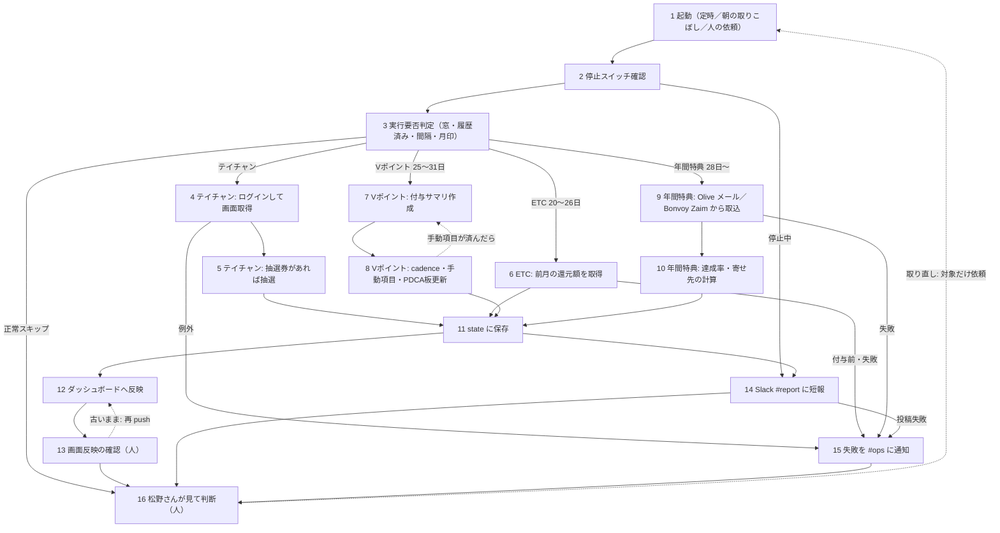

# 614 ChatGPT 持ち込みパック（作業フローの確認用）

ポイント・還元ウォッチ係（614）の作業フローを、松野さんが ChatGPT（チャッピー）のチャットで見ながら確認するための1ファイル。公開リポのため実額・個人情報は入れていない。正本は同じフォルダの [`flow.md`](./flow.md)（要点だけ写した。違いがあれば flow.md が正）。

## 1. 貼る手順（3行）

1. ChatGPT で**新しいチャット**を開き、このファイルの §2〜§6 を貼る。
2. §2 の「最初の指示」を実行する（ChatGPT が番号を宣言しながらフローを読む）。
3. 図（または §3-B の番号付き文章）を見ながら、§5 の質問に答える。

## 2. ChatGPT への最初の指示（これを先頭に貼る）

```
あなたは「作業フローの確認相手」です。以下の作業フロー（614：ポイント・還元ウォッチ係）を読み、
工程の番号を宣言しながら（例:「工程6について」）、次を指摘してください。
- 抜け（開始・入力・保存・画面反映・報告のどれかが無い工程）
- 失敗した時の動きと、戻り矢印（取り直し）の条件が足りているか
- 人が確認すべき点が足りているか／多すぎないか
- 保存・画面反映・投稿・月印が別々の成功として扱われているか
ルール: 売買や送金の助言はしない。実額は聞かない・書かない。AI の案と、私（松野）の判断を混ぜない。
私の理由は私の言葉のまま扱い、あなたが補作しない。最後に質問へ番号で答えられるよう、まず工程の理解を3行で要約してください。
```

## 3. フローの要点

### 目的
得る側（テイチャン・ETC還元・Vポイント定例・年間特典）の定例が、本当に動いて新しい数字を持ってきたかを松野さんに1か所で見せ、年間特典の寄せ先などの判断材料を出す。決めるのは松野さん。払う側（612）・Zaim の鮮度（613）は別の係。実行時に AI を呼ぶ工程は0（全てプログラム）。

凡例: **現行**＝今のコードの動き／**提案**＝未実装。主体は 人／プログラム／外部サービス。

### 3-A. 図（主な流れ16工程。詳細は 3-C のノード表。Mermaid が崩れたら 3-B へ）



（番号は上の16工程用。flow.md の32ノード番号とは違う。対応は 3-C の「flow番号」列）

### 3-B. 番号付き文章の版（図が崩れた時はこちら）

1. **起動**：定時（launchd）／朝の取りこぼし／人の依頼。→ 2へ。
2. **停止スイッチ確認**：停止中なら 14（短報）へ。それ以外は 3へ。
3. **実行要否判定**：窓・履歴済み・間隔・月印を見て系統へ分岐。要らなければ正常スキップ（ログのみ）で 16へ。
4. **テイチャン：画面取得**：Vpass にログインし画面と写真を取る。例外は 15へ。成功は 5へ。
5. **テイチャン：抽選**：券があれば抽選。→ 11へ。
6. **ETC：前月分の取得**：付与前・失敗は 15へ（20〜26日の窓内は翌日の定時で再試行）。成功は 11へ。
7. **Vポイント：付与サマリ作成**：既存の履歴・監査から作る。→ 8へ。
8. **Vポイント：cadence・手動項目・PDCA板の更新**：手動項目（Tサイト取得など）があれば人が対応し、済んだら 7をやり直す。→ 11へ。
9. **年間特典：取込**：Olive は Gmail の月次メール、Bonvoy は Zaim の取込行から概算。失敗は 15へ。→ 10へ。
10. **年間特典：達成率・必要月額・おすすめ寄せ先の計算**（＋Vポイントの出口の静的リスト）。→ 11へ。
11. **state に保存**。→ 12と14へ。
12. **ダッシュボードへ反映（push）**。→ 13へ。
13. **画面反映の確認（人）**：古いままなら 12をやり直す（人が依頼した時だけ）。→ 16へ。
14. **Slack #report に短報**：投稿失敗は 15へ。→ 16へ。
15. **失敗を #ops に通知**。→ 16へ。
16. **松野さんが画面・Slack を見て判断**：取り直したい対象があれば、対象を言って 1へ（成功済みの系統は再実行しない）。

### 3-C. 32ノード表（簡略。詳細は flow.md §4）

| flow番号 | 工程 | 主体 | 状態 |
|---|---|---|---|
| 1 | 定時起動（launchd 4本） | プログラム | 現行 |
| 2 | 朝の取りこぼし起動 | プログラム | 現行 |
| 3 | 人の依頼で起動 | 人 | 現行 |
| 4 | 停止スイッチ確認 | プログラム | 現行 |
| 5 | 実行要否判定 | プログラム | 現行 |
| 6 | Vpass ログイン→テイチャン画面取得 | プログラム／外部 | 現行 |
| 7 | サイト状態の判定（メンテ検知） | プログラム | D4で実装済 |
| 8 | 抽選券確認・抽選 | プログラム | 現行 |
| 9 | ETC 前月還元額の取得 | プログラム／外部 | 現行 |
| 10 | Vポイント付与サマリ作成 | プログラム | 現行 |
| 11 | cadence差分・手動項目・PDCA板更新 | プログラム | 現行 |
| 12 | 手動項目の対応（Tサイト取得など） | 人 | 現行 |
| 13 | Olive：Gmail 月次メール取込 | プログラム／外部 | 現行（本番未実行） |
| 14 | Bonvoy：Zaim 取込行から概算 | プログラム | 現行 |
| 15 | 達成率・必要月額・寄せ先の計算 | プログラム | 現行 |
| 16 | state に保存 | プログラム | 現行 |
| 17 | ダッシュボードへ反映（push） | プログラム | 現行 |
| 18 | 画面反映の確認 | 人 | 提案 |
| 19 | Slack #report に短報 | プログラム | 現行 |
| 20 | 失敗を #ops に通知 | プログラム | 現行 |
| 21 | Slack 控えの保存（非公開側へ） | プログラム | F8で実装済 |
| 22 | 松野さんが見て判断 | 人 | 現行 |
| 23 | 判断ログに記録 | プログラム | 提案 |
| 24 | 次回開始時に有効な基準を取得・適用ID追跡 | プログラム | 一部 |
| 25 | 取得元ごとの成否・鮮度の判定と推奨停止 | プログラム | 提案 |
| 26 | 月印と再試行の独立判定 | プログラム | 提案 |
| 27 | 基準日の判定と部分成功 | プログラム | D6で実装済 |
| 28 | 保存の検証（読み直し） | プログラム | 提案（保存順はD6で修正） |
| 29 | 排他ロックと起動間隔 | プログラム | D4で実装済 |
| 30 | 再開の検知 | プログラム | D4で実装済 |
| 31 | run 結果の集約（保存・画面・投稿を独立に記録） | プログラム | 提案 |
| 32 | 正常スキップ（終了・ログのみ） | プログラム | 現行 |

## 4. 決まったこと（D・F）と未確認（U）

### 決定済み（2026-11-23 松野さん。ChatGPT は覆さず、運用上の穴だけ指摘する）

- **D4 テイチャンのメンテ停止中**：確認は3日間隔に戻す。短報は「メンテナンス停止中（最終確認日）」。再開を検知したら通常の間隔に戻す。
- **D6 Vポイントの Tサイト履歴**：取得時期は決めない。履歴が古い時は「部分成功」と読む。基準日が対象月の末日以降でなければ月印を付けない。
- **F8 Slack 控え**：公開リポに書かず、非公開側へ出す（テイチャン・ETC・Vポイント・年間特典とも）。
- **D9 Slack の短報**：本人への通知なので実額を載せてよい。公開リポ（コード・docs・PR）には実額を書かない。

### 未決の判断点（松野さんに聞く順）

D1 年間特典の寄せ先（信頼できる材料が出てから）／D2 条件金額の公式確認の時期／D5 Vポイント Slack を毎日か月1か／D7 画面反映の自動読み返し／D8 判断ログの保存先／D3 Vポイントの出口表示。

### 未確認（U）

- 最優先：U16 年間特典 11/28 の初回本番起動／U6 取込失敗が exit 0 で月印になるか／U5 Vポイント state の保存漏れ（修正済・再現未確認）／U4 古い履歴での月印。
- その他：U1 テイチャンのメンテ開始・再開日／U2 券の実在／U3 Vポイント launchd の毎日発火／U7 年間特典 launchd の了承記録／U8 本番画面の表示／U9 push の反映遅れ／U10 Slack に実際に届いた投稿／U11 ETC付与前失敗の通知／U12 Olive メールの到着日／U13 Olive・Bonvoy の条件金額／U14 テイチャンの1日5〜7件のログ原因／U15 停止スイッチの env。

## 5. ChatGPT に確認してほしい質問（10個）

1. 失敗した時の戻り方（対象の系統だけ取り直し、窓内は1日1回）で運用が回るか。回らない場面はあるか。
2. 人が見る点（画面反映の確認・判断・手動項目）は足りているか。多すぎて見落とす点はないか。
3. 定時＋朝の取りこぼし＋人の依頼の3つの起動で、二重実行や取りこぼしが起きる抜けはないか。
4. テイチャンの確認頻度（メンテ停止中は3日間隔）は適切か。再開の見つけ方に穴はないか。
5. 「保存」「画面反映」「Slack 投稿」「月印」を別々の成功にした扱いで、報告が分かりにくくならないか。
6. Vポイントの「部分成功」（基準日が古い）の見せ方は、松野さんが判断しやすいか。
7. 年間特典で「取得元が失敗・古い時は推奨しない」の線引きは妥当か。
8. 判断を記録して次回の基準にする流れ（工程22→23→24）で、未判断・見送りが恒久基準になってしまう穴はないか。
9. 工程の番号・順序・矢印で、読んでいて分からなかった所、条件が書いていない矢印はどこか。
10. 実装や運用を始める前に、先に決めておくべきことで、このフローに書かれていないものはあるか。

## 6. 結果の持ち帰り方

1. ChatGPT の答えを、松野さんが**このチャット（Claude／Orca のボット）に貼る**。または flow.md の該当項目（§6 判断点・§10 未確認）に書く。答えは要約せず、松野さんの言葉で付けた理由もそのまま残す。
2. ボットは、答えを工程番号に対応づけ、採用・見送り・要確認に分けて見せる。採否を決めるのは松野さん。ボットは理由を補作しない。
3. 採用された分だけ、同じ番号・順序・接続・戻り条件で `flow.md`／`flow.json`／`flow.html` を直し、結果を項目に報告する。ChatGPT で確認した日は §13 のチェックに記録する。
4. Codex（Orca の worker）のレビューは任意の別の目（補助）。ChatGPT との確認の代わりにはならない。

関連: [`workflow-review/README.md`](../../workflow-review/README.md)・[`prompt-template.md`](../../workflow-review/prompt-template.md)、全体ルール `62_ボット共通ルール入口_20261123.md`。
