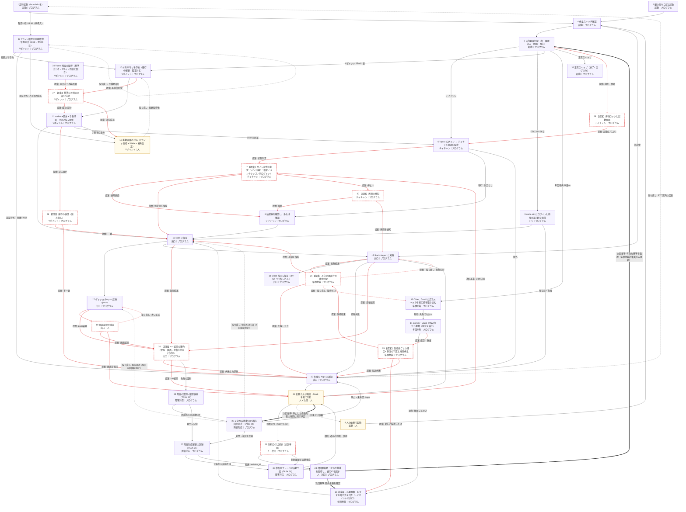

# フロー — ポイント・還元ウォッチ係（614）

**状態**: **第2稿**（Codex レビュー反映・Claude 2026-11-23）。第1稿は PR #595。Codex の再確認・松野さんの図の確認はこれから。  
親: 600 リソース・家計BL ラコ #36（『魂を込める』今週の社員＝614）。  
図（同じ内容）: [`flow.json`](./flow.json)（正本）・[`flow.html`](./flow.html)（ブラウザで開く。金融サイト・DB・Slack に接続しない）。  
**FlowForge**: 54b の決まりにより画面は触らない・登録しない。このフォルダの `flow.json`／`flow.md`／`flow.html` が当面の正。  
手順: [`workflow-review/README.md`](../../workflow-review/README.md)・[`prompt-template.md`](../../workflow-review/prompt-template.md)。工程番号は図・表・会話で共通（第1稿の 1〜24 は据え置き、第2稿の追加は 25〜32、第3稿の追加は 33〜34、P2 の追加は 35〜38＝TASK の工程33〜36。TASK の 33〜36 と flow の 33・34 は番号が衝突するため 35〜38 に振り、対応表を §4 に置いた）。  
**2026-11-25 追記（第3稿）**: 松野さんの決定 D10 により、Tサイト履歴を11/25に手動で1回取り直し（付与サマリは dry-run で『成功』）、Tサイトの定期取得を窓C前日（毎月24日 08:30）に追加（**n33・実装済・launchd は未導入**）、Vpass 残高の取得部品を追加（**n34・取得部品のみ・定例へは未組み込み**）。

**実装の進み（2026-11-23〜）**: **PR-P2（2026-11-28 作成・本番未確認・マージは松野さんの判断）**＝判断ログと有効基準（n22〜n24）・障害の識別と履歴検索（n35）・安全な自動復旧と連続3回の停止（n36。保存だけのやり直しと再 push に接続）・障害対応履歴（n37）・参照用 Markdown の自動生成（n38）。**PR-P1（2026-11-25 作成・マージは 11/28 の年間特典の初回の結果を確認した後）**＝画面反映の照合（n17・n18）・Slack の重複防止（n19・n21）・#ops 通知（n20）・run 集約（n31）・全体停止（n04）・Vポイント定例の排他（n29）。**PR-P0b（2026-11-24 作成・マージは 11/25 09:40 の窓C の後）**＝Vポイントの保存読み戻し（n28）・D6 の確認テスト（n27）・ETC の対象月検証／取得待ちと失敗の区別／月印の条件（n09）。**PR-P0a（2026-11-24）**＝年間特典の誤成功防止（n13・n14・n15・n16・n25・n26・n28 の年間特典分。F5・F9 の修正。単体テスト済・本番は 11/28 の初回で確認）。D6（Vポイント基準日・部分成功・F3・F4）・D4（テイチャン停止中の扱い・F1・F2 の一部）・F8（Slack 控えを非公開側へ）を実装済み。ほかの不具合は §11、直す提案は §12 のとおり未修正。launchd・設定は直していない。

## 0. 第2稿での変更点（Codex レビュー 2026-11-23：『そのまま運用せず修正が必要』）

Codex が○とした点（テイチャンの朝の再起動条件、Vポイントの月印と短報、年間特典の exit 0、JSON と HTML・Mermaid の一致）は第1稿のまま。誤り指摘6件・優先修正5件を次のとおり直した。

| Codex の指摘 | 直した所 |
|---|---|
| ×1 『毎日は朝の取りこぼしによる』『メンテ10/22』は断定できない | 『推定』『未特定』に直した（§2・§2 事実確認・ノード2・6・8・U1・U14・F1・F2・D4）。起動条件（券数>0）はコード上の事実、毎日・1日5〜7件の原因は未特定。メンテ開始は写真の観測間隔内の推定で、写真は Claude の目視のみ |
| ×2 U3『10/25 ログ無し』は誤り | 10/25 は2本・10/26 は1本の run ログがあるが**どれも0バイト**＝実行成功の証拠にならない（U3・ノード10・§2） |
| ×3 n5→n21（正常スキップ→控え保存）の矛盾／Vポイントは月印後も定例全体が動く | 新ノード32『正常スキップ（ログのみ）』を作り n5→n32 に変更。n21 は『投稿成功後、または dry-run で保存』。Vポイントは月印後も全体が動き分岐するのはサマリ生成だけ、と n5・n10・n11 に明記 |
| ×4 n13→n20 を『現行の検知』と描くのは不正確／『古いデータでは推奨しない』は実装済みでない | n13→n20 を削除。**全ての矢印に［現行］［提案］を付けて識別**（図は提案を赤線）。n13〜n15 の失敗欄を現行の事実に直し、n15 を『一部実装』、F9 を追加 |
| ×5 『実額を短報に載せない』と実装の不一致 | **松野さんの決定（2026-11-23）**で解消：Slack=実額あり／公開リポ=実額なし。§8・D9（決定済み）・F7・F8 に反映 |
| ×6 n21 の控えは dry-run でも作られる | n21・n19 に明記。控え単独は配信の証拠にしない（U10・F8） |
| ①年間特典 | ノード25（取得元ごとの成否・鮮度・推奨停止）・26（月印と再試行の独立判定） |
| ②Vポイント | ノード27（基準日判定・部分成功）・28（保存の検証） |
| ③テイチャン | ノード7（メンテ検知）に加え 29（排他と起動間隔）・30（再開検知）。D4 も 4a/4b/4c に分割 |
| ④出口 | ノード31（保存・画面・投稿を独立に記録）・32（正常スキップ）・21 の定義を直した |
| ⑤判断ログ | ノード23・24 を『実装予定』と明示。必須記録要件は既存ルールとして先に進めてよい |
| 判断点の順番 | §6 を D4→D6→D1/D2→D5→D7/D8→D3 に並べ替え。U4↔D6・U13↔D2・U14↔D4 を関連づけ |
| 未確認の最優先 | §10 の先頭に置き、§13 の『回った証拠』に11/28 の初回起動と品質不備の確認を入れた |

## 1. 何のための社員か

得る側（テイチャン・ETC還元・Vポイント定例・年間特典）の定例が**本当に動いて新しい数字を持ってきたか**を1係で松野さんに見せ、年間特典の寄せ先などの**判断材料**を出す。決めるのは松野さん。払う側（年会費・課金）は 612、Zaim の鮮度は 613。

**実行時にAIを呼ぶ工程は0**（全て Python／launchd のプログラム）。AI（ジャービス／Codex／Claude）が出てくるのは、松野さんの依頼で本線を手動実行する時と、設計・保守の時だけ。

## 2. 資産の棚卸し（参照日 2026-11-23）

凡例: **実装済**＝コードがあり動作の証拠を確認／**一部**＝動くが検知・保存に穴／**手動**＝人が動く／**未実装**＝提案のみ／**未確認**＝今回確かめていない。ログの『件数』は起動回数で、成功の証拠にはならない（0バイトのログは成功の証拠にしない）。

| 系統 | 本線（スクリプト・launchd） | 起動 | 状態 | 動いた証拠（実額は書かない） |
|---|---|---|---|---|
| テイチャン | `jarvis_teiki_barai_chance.py`・`teiki_draw_runner.sh` | launchd 月・木10:15（runs=3・最終 exit 0）＋朝の取りこぼし。朝の条件はコード上『券数>0 または 間隔到来』で、state に券数=2 が残る間は毎朝真になる。ログが毎日ある**原因は未特定**（推定は残る券数） | **一部**（サイトがメンテ停止中でも報告が止まらない） | Mac の run ログは 10/21〜11/23 の毎日（11/6〜11/20 は1日5〜7件＝起動回数）。Slack 控え: 確認 33 件・失敗 4 件。最終抽選 10/11。**10/22 朝の写真からサイトがメンテ画面（10/22・10/29・10/31・11/23 の写真を Claude が目視。開始は観測間隔内の推定。再開は『決まり次第』）** |
| ETC還元 | `jarvis_etc_rebate_fetch.py`・`etc_rebate_monthly_runner.sh` | launchd 20〜26日09:30（runs=3・最終 exit 0）＋朝の取りこぼし | **実装済** | 11/20 05:12 に取得成功（10月利用分）・Slack 控えあり。11/21・11/22 は履歴済みで正常スキップ。次: 11/23〜26 は履歴済みスキップの見込み |
| Vポイント定例（窓C） | `jarvis_vpoint_routine.py`・`jarvis_vpoint_monthly_check.py`・`jarvis_vpoint_cadence_check.py`・`jarvis_vpoint_pdca.py`・`vpoint_routine_runner.sh` | launchd 25〜31日09:40＋朝の取りこぼし（月印がない時）。**月印が付いた後も launchd は毎日動き、定例全体が走る（分岐するのはサマリ生成だけ）** | **一部**（印は付くがデータは 9/10 のTサイト履歴のまま。asks の保存に疑い） | 10/25〜10/31 の7日分の Slack 控え。Mac の run ログは 10/25（2本）・10/26 が**0バイト**、中身があるのは 10/27〜31。`last_check_c`=2026-10。**11/25 が11月窓の初日** |
| 年間特典ウォッチ | `jarvis_card_benefit_watch.py`・`jarvis_card_benefit_monthly.py`・`card_benefit_monthly_runner.sh`・`config/card_benefit_watch.yaml` | launchd 毎月28日09:50＋朝の取りこぼし（28日以降） | **実装済・本番未実行** | 11/23 00:20 に plist 作成、dry-run の控え（state 側）まで。`last_monthly_run` なし＝**初回の本番は 11/28** |
| 共通：Slack 短報 | `jarvis_points_rebate_slack_report.py`・`jarvis_slack_webhook_post.py` | 各本線から | 実装済 | 11/23 05:13 Webhook 200。同日・同文は再投稿しない。**控えは dry-run でも作られる** |
| 共通：画面 | `apps/jarvis-dashboard/app/vpoint`・`/etc`、`jarvis_dashboard_push.py --watch-only` | 各本線の `--push`／dashboard-push 毎日12:30 | 実装済（反映確認は人） | push の戻り値0を確認。本番画面は今回開いていない |
| 共通：朝の取りこぼし | `jarvis_morning_mac_refresh.py`（呼び出し元 `jarvis_triage_morning_open.py`） | Mac を開いた朝 | 実装済 | 系統ごとの条件で runner を起動 |

**Vポイントの出口**（`/vpoint#vpoint-exit`）は計算ではなく `config/card_benefit_watch.yaml` の静的リスト（確認済み／注意／未確認。投資を先頭・『元本割れの可能性・判断は松野さん』）。ノード15の画面に含める。  
**確定/提案の区別**: ノード7・18・23・25〜31 は**提案（未実装）**、24 は一部実装（config 読込のみ既存）。他は既存。  
**既存社員との境界**: 612（払う側）・613（Zaim 鮮度）・618（資産記録）は作り直さない。年間特典の Zaim 概算は 613 の取込結果を読むだけ。

### 11/23 時点の事実の確認

| 依頼文の事実 | 確認結果 |
|---|---|
| テイチャン＝毎日 | 一致（run ログは毎日）。launchd は月・木のみ。毎日になる**原因は未特定**。有力な候補は、朝の条件が『前回の券数>0』で毎朝真になること（条件はコードで確認済み。それが毎日の起動を起こしているかは未確認） |
| ETC還元＝20〜26日 | 一致（launchd 20〜26日09:30。履歴済みなら正常スキップ） |
| Vポイント定例＝25日〜月末の毎日（窓C） | 一致（launchd 25〜31日09:40）。10月窓の発火は Slack 控え7日分。run ログは 10/25・10/26 が0バイト、中身は 10/27〜31 |
| 年間特典＝毎月28日09:50＋朝の取りこぼし | 一致。plist 作成済み・**まだ一度も本番では動いていない** |

## 3. フロー図

凡例: 色＝主体（紫=プログラム／黄=人／青=AI／緑=外部サービス）。赤の破線枠＝**提案（未実装）**。**赤い線＝提案の矢印、黒い線＝現行（今のコードの動き）**。実線＝通常の流れ・分岐、**点線＝今回の取り直し（元のノードへ・条件付き）**、**太線＝次回基準への改善（次回開始時に反映）**。無条件の反復・自動承認は置かない。各矢印の［現行］［提案］は §4・§5 の表と flow.html に書いてある。Mermaid は自動配置のため、見づらい時は flow.html で。

### 主な流れを文字で
1. 起動（定時1／朝の取りこぼし2／人の依頼3）→ 停止スイッチ4 → 実行要否5。正常スキップは 32（ログのみ）。
2. 5 が系統ごとに分岐: テイチャン6〜8（提案：29 排他・間隔／7 メンテ検知／30 再開検知）／ETC9／Vポイント10〜12（提案：27 基準日判定／28 保存検証）／年間特典13〜15（提案：25 取得元別の成否・鮮度／26 月印と再試行）。
3. 全系統が保存16 → 画面反映17→確認18／Slack 短報19→控え21 に合流。失敗は #ops 20。提案31 が保存・push・画面・投稿を独立に集約する。
4. 人が22で判断 → 記録23（P2 実装済み）→ 次回の基準24（年間特典の推奨だけ接続）→ 次回の5へ。失敗・確認不能は 35 で識別 → 36 が承認済みの安全な対策だけ実行（連続3回目は停止）→ 37 に記録 → 38 が Markdown を自動生成。

## 4. 各ノード表

各ノードの『開始トリガー・入力・処理・保存先・画面反映先・報告先・成功/部分成功/失敗・判断点』を1行にまとめた。**保存・push・画面反映・投稿・月印は別々の成功**（17・18・19・26・31）。

### 起動・ガード

| # | 工程（主体｜実行者・道具） | 入力 → 処理 | 保存先／画面反映先／報告先 | 成功／部分成功／失敗 | 判断点 | 実装・今回の状態 |
|---|---|---|---|---|---|---|
| 1 | **定時起動（launchd 4本）** プログラム｜macOS launchd → launchd/*_runner.sh（teiki-draw 月・木10:15／etc-rebate-monthly 20〜26日09:30／vpoint-routine 25〜31日09:40／card-benefit-monthly 28日09:50） 開始: カレンダー時刻（Mac が起きている時だけ動く） | なし（runner が .env.jarvis_private を読み込む。値はログに出さない） → 該当スクリプトを起動し、~/Library/Logs/<系統>/ にログを残す | 保存: Mac ログ（# start / # end exit=…） 画面: なし 報告: なし（結果の短報は各スクリプトが出す） | 成功: ログ末尾が「# end exit=0」 部分: — 失敗: ログが無い（Mac スリープ等）→ ノード2が補う／exit≠0 → ノード20 | なし | 実装済（確認済み） 今回: **一部** 根拠: launchctl print と plist（2026-11-23）。teiki=月・木10:15で runs=3・最終 exit 0／etc=20〜26日で runs=3・最終 exit 0／vpoint=runs=0（再読込で数え直された可能性。10/27〜31 のログ中身は有り）／card-benefit=11/23 00:20 に plist 作成・未実行（初回の本番は 11/28） |
| 2 | **朝の取りこぼし起動** プログラム｜jarvis_morning_mac_refresh.py（呼び出し元は jarvis_triage_morning_open.py＝triage-morning-open launchd RunAtLoad） 開始: Mac を開いた朝。系統ごとに「取りこぼし条件」を判定して該当 runner を起動 | 各 state（etc_monthly／vpoint_monthly／teiki_barai_chance／card_benefit_watch） → etc=20〜26日かつ前月分が履歴に無い／vpoint=25日以降かつ当月印(last_check_c)なし／年間特典=28日以降かつ当月印(last_monthly_run)なし／テイチャン=券が1枚以上 または 前回確認から interval_days(3)日以上 | 保存: runner をバックグラウンド起動（~/Library/Logs/<系統>/morning_catchup.*.log） 画面: なし 報告: なし | 成功: 条件に合う系統だけ起動する 部分: — 失敗: 起動失敗はログ（spawn failed）のみ。通知なし | なし | 実装済（確認済み） 今回: **確認済** 根拠: teiki: 11/6〜11/20 は1日5〜7件の run ログ（起動回数。11/10 は 05:11〜05:19 に6件）、11/21〜23 は1件。コード上、朝の条件は『state の券数>0 または interval 到来』（jarvis_morning_mac_refresh.py:501-529）で、state の券数=2 が残っている間は毎朝真になる。ただしこれが毎日・多重起動の原因かは**未特定**（呼び出し元・重複の原因は未確認。launchd は月・木のみ）。etc: 11/20 05:12 に朝の取りこぼしで起動し取得成功 |
| 3 | **人の依頼で起動** 人｜松野さん（音声／チャット）→ ジャービス／Codex／Claude が該当スクリプトを手動実行（実行はプログラム。AI は呼び出すだけ） 開始: 「テイチャン」「ETC還元」「Vポイント定例」「年間特典を更新して」など | 依頼文。取り直しは対象ノード番号を言う → 該当の本線スクリプトを --run／--apply／--force 付きで実行 | 保存: 本線と同じ（ログ・state・Slack） 画面: 本線と同じ 報告: 本線と同じ | 成功: 対象ノードの成功条件を満たす 部分: 一部の対象だけ成功 失敗: 対象ノードの失敗に同じ | 取り直す対象はどれか（松野さんが選ぶ） | 手動（確定） 今回: **未検証** 根拠: CLAUDE.md「動き出す合図」に記載。今回は実行していない |
| 4 | **停止スイッチ確認** プログラム｜各スクリプト冒頭（env の *_DISABLE と state の disabled） 開始: 全ての起動の直後 | env（値は読まない・書かない）／各 state の disabled → teiki=JARVIS_TEIKI_BARAI_DISABLE／etc=JARVIS_ETC_MONTHLY_DISABLE・JARVIS_ETC_REBATE_AUTO_DISABLE／vpoint=JARVIS_VPOINT_MONTHLY_DISABLE・JARVIS_VPOINT_ROUTINE_DISABLE／年間特典=JARVIS_CARD_BENEFIT_DISABLE／Slack=JARVIS_POINTS_REBATE_SLACK_REPORT_DISABLE と種別別。朝の取りこぼし判定側にも同じ判定がある。**614 全体停止**（PR-P1（2026-11-25 実装・本番未確認。マージは 11/28 の年間特典の初回の結果を確認した後））: JARVIS_614_GLOBAL_STOP=1 または 614_watch/GLOBAL_STOP ファイルが最優先で、系統別の停止・--force・手動取得でも解除されず、保留中の #ops 通知の再送も止まる（解除した次回起動で再送）。読めない時は安全側（停止）で緊急ログに残す。名称は仮置き（変更可） | 保存: 停止なら何もせず終了（teiki・etc は「停止」の短報、vpoint・年間特典は無言） 画面: なし 報告: 停止中のとき teiki・etc のみ短報 | 成功: 停止の有無を正しく見分けた 部分: — 失敗: env を読めない→停止なしとして進む（読取失敗＝基準なし扱いになる点は未確認） | 止めるかどうかは松野さん（ここは自動で止めない） | 実装済（全体停止は PR-P1・本番未確認）（確認済み） 今回: **確認済** 根拠: state の disabled は teiki／etc／vpoint いずれも false（2026-11-23）。env の中身は確認していない |
| 5 | **実行要否判定（窓・履歴済み・間隔・月印）** プログラム｜teiki=is_due()／etc=default_target_month()・history_has()／vpoint=in_window_c()・last_check_c／年間特典=needs_catchup() 開始: 停止スイッチを通った後 | 今日の日付、各 state（履歴・印・前回確認日） → 動く／スキップを決める。正常スキップはノード32（ログのみ・成功に数えない）。Vポイントは launchd が25〜31日に毎日動き、月印が付いた後も cadence・asks・PDCA・テイチャン呼び出し・push・Slack は毎回動く。条件分岐するのは付与サマリの生成だけ（jarvis_vpoint_routine.py:302-310） | 保存: 次のノード（6／9／10／13）へ。正常スキップはノード32へ 画面: なし 報告: スキップは無言（teiki のみ『スキップ』短報） | 成功: 必要な時だけ動く 部分: — 失敗: state が壊れて読めない→再実行側に倒れる（etc・vpoint の読込例外は『要実行』扱い） | なし（人の依頼 n03 は窓外でも --force で動かせる） | 実装済（確認済み） 今回: **確認済** 根拠: etc: 11/21・11/22 09:30 のログが『history already has 2026-10』で正常スキップ。年間特典: 11/23 時点で last_monthly_run なし＝初回は 11/28 |
| 32 | **正常スキップ（終了・ログのみ）**（第2稿追加） プログラム｜各スクリプトの skipped 出力（etc=『history already has …』など） 開始: ノード5が『窓外・履歴済み・間隔内』と判定（第2稿追加） | ノード5の判定結果 → 何もせず終了。state・画面・Slack を変えない。成功の件数に数えない（teiki のみ『スキップ』短報）。控え保存（ノード21）へはつながない | 保存: ログ（skipped） 画面: なし 報告: なし（teiki のみ短報） | 成功: 必要のない時に動かなかった 部分: — 失敗: 動くべきなのにスキップした（月印だけ付いて取込失敗した月など）→提案ノード31で検出 | なし | 実装済（確認済み） 今回: **確認済** 根拠: etc 11/21・11/22 09:30 のログ『history already has 2026-10』。Vポイントは月印後もスキップせず定例全体が動く（ノード5） |

### テイチャン

| # | 工程（主体｜実行者・道具） | 入力 → 処理 | 保存先／画面反映先／報告先 | 成功／部分成功／失敗 | 判断点 | 実装・今回の状態 |
|---|---|---|---|---|---|---|
| 6 | **Vpass ログイン → テイチャン画面を取得** プログラム｜jarvis_teiki_barai_chance.py --run --push（Playwright／Mac Chrome CDP 専用プロファイル・終了時に自動で閉じる）。外部サービス: Vpass（三井住友カード）・定期払いチャンス 開始: ノード5が『券あり／間隔到来』と判定 | VPASS_* の認証（env。値は書かない） → Vpass SSO → gift_info 画面の本文と画面写真を取る。ログイン未完了なら券数・規約は更新しない | 保存: 画面写真（.jarvis_state/teiki_barai_chance/・非公開）／本文テキスト 画面: なし（ノード16〜17で反映） 報告: なし（ノード19） | 成功: ログインでき、画面本文を取れた 部分: ログイン途中で止まる（login_incomplete） 失敗: ブラウザ例外→ノード20 | なし（規約未同意・OTP は人） | 実装済（確認済み） 今回: **一部** 根拠: 11/23 05:13 のログと画面写真: ログインは通ったが画面は『システムメンテナンスにより一時停止』。10/22・10/29・10/31・11/23 の写真を Claude が目視（Codex による写真の検証は未実施）。10/21 の写真は通常サイズ・10/22 朝の写真からメンテ画面なので、開始は『観測間隔内（10/21〜10/22 朝）の推定』。10/31 は再開予定11/16、11/23 は延期で『再開時期が決まり次第』。失敗の控えは 10/27・10/29・11/2・11/10 の4件（『Target page, context or browser has been closed』） |
| 7 | **サイト状態の判定（メンテ検知：通常／メンテナンス／未ログイン）** プログラム｜jarvis_teiki_barai_chance.py に追加する判定（提案。実行時に AI は呼ばない） 開始: ノード6の直後 | 本文テキスト（『システムメンテナンス』『サービスを一時的に停止』等） → 現状は『未ログイン』しか見分けない（コードに『メンテ』の判定なし）。提案: メンテ画面なら『サイト停止中』と本文の再開予定を保存し、券数・規約は前回値のまま『古い』と明示。起動の頻度・排他はノード29、再開の検知はノード30に分ける（ここは検知だけ） | 保存: site_status（通常／メンテ／未ログイン）と画面から読んだ再開予定文、最終確認できた日 画面: /vpoint のテイチャン欄に『停止中（最終に券数を確認できた日◯）』 報告: Slack『テイチャン停止中（サイト側メンテ）』を状態が変わった時だけ | 成功: 停止中を『確認のみ』と区別して保存・表示できる 部分: 本文が想定外（未知の文言）→『読めず』として #ops 相談へ 失敗: 判定の取りこぼし→今と同じ『確認のみ』報告（現状） | D4（4a 頻度／4b 通知／4c 再開検知）。ここは『検知する』ことだけを扱う | 実装済（D4・2026-11-23。実環境での初回は次回の確認）（確認済み：単体テスト・dry-run） 今回: **未実行** 根拠: D4 で実装：画面本文に『メンテナンス』と停止の文言があれば site_status=maintenance、再開予定の行を保存。停止中は画面操作をせず券数・規約は前回値のまま。11/23 の画面の文言で単体テスト（偽ページ）。未確認: 実サイトでの検知（次回の確認）。以下は実装前: 現状の報告: 11/23 の Slack 控えは『結果: 確認のみ（抽選なし）／状態: 規約=yes · 券=2枚』。券数は画面に出ておらず、前回値の2枚が残っている（最終抽選は 10/11） |
| 8 | **抽選券を確認し、あれば抽選** プログラム｜jarvis_teiki_barai_chance.py（_parse_counts／_click_draw）。外部サービス: 定期払いチャンス 開始: ノード7が『通常画面』 | 券枚数・Wチャンス枚数（画面本文） → 枚数が1以上なら抽選ボタンを押す（無料の抽選。既存運用では自動実行の取り決め）。0枚ならスキップ | 保存: draw_history（最大12件）、券数の更新、サービス追加候補（Step1） 画面: /vpoint#teiki-barai（券・最終確認・追加候補） 報告: Slack『テイチャン』（抽選あり／確認のみ） | 成功: 抽選が ok／券0で正常スキップ 部分: 抽選したが結果文が読めない 失敗: 押下失敗→ノード20 | D4: 追加候補（SBI・コミュファ・AXA・Chatwork 等）を対象に入れるか（画面確認は人） | 実装済（確認済み） 今回: **保留** 根拠: 最終抽選は 10/11（draw_history 3件: 9/10・9/11・10/11）。以後サイトが停止中（10/22 朝の写真からメンテ画面＝開始は観測間隔内の推定）のため抽選の実績なし |
| 29 | **排他ロックと起動間隔**（第2稿追加） プログラム｜teiki_draw_runner.sh／jarvis_teiki_barai_chance.py／jarvis_morning_mac_refresh.py に追加（提案） 開始: ノード5の後・ノード6の前（第2稿追加） | ロック、前回確認日、サイト状態（ノード7の結果） → 実行中は2本目を起動しない。『券数>0』による再起動は、サイトが通常画面で券数を読めた時だけ有効。停止中は interval を優先。頻度そのものは D4a で決める | 保存: 起動する／しない（ログ） 画面: なし 報告: なし（多重起動を止めた件数だけログ） | 成功: 同時に1本だけ動く 部分: — 失敗: ロック残り→一定時間で解除してログに残す | D4a（頻度） | 一部（排他は実装済 D4・Vポイント定例の排他は PR-P1。起動間隔は 29 の通り実装済）（確認済み：単体テスト・dry-run） 今回: **未実行** 根拠: D4 で実装：停止中は券数>0 でも毎朝起動せず3日に1回（朝の再起動条件と本線 is_due）。本線に flock 排他（run.lock）。朝バンドルのロック（11/19）は既存。5〜7件の原因は未特定のまま。以下は実装前: 現行はロックなし（コード上確認済み）。run ログが1日5〜7件の日があるのは起動回数で、重複の原因は未特定。11/10 05:11:48 の run ログに『closed』の失敗1件（因果は推定）。PR-P1（2026-11-25 実装・本番未確認）：Vポイント定例（vpoint_routine.lock）・年間特典（card_benefit_watch.lock）・#ops 保留の再送にも排他 |
| 30 | **再開の検知**（第2稿追加） プログラム｜jarvis_teiki_barai_chance.py に追加（提案） 開始: ノード7が『メンテナンス停止中』と判定した時（第2稿追加） | 画面本文（再開予定文） → 停止中は低頻度で通常画面に戻ったかだけ確認。戻ったら『再開した』を1回だけ通知し、券数を取り直して抽選（ノード8）へ。再開予定の文言を保存。再開の通知を出すか・頻度は D4b・D4c で決める | 保存: 再開の検知結果・再開予定文 画面: /vpoint のテイチャン欄に『停止中／再開』 報告: 再開した時の1回だけ（D4b） | 成功: 再開を検知して券数を取り直せた 部分: 通常画面だが券数が読めない 失敗: 想定外の画面→#ops | D4b（通知）・D4c（再開検知） | 実装済（D4・2026-11-23。実環境で再開した時が初回）（確認済み：単体テスト・dry-run） 今回: **未実行** 根拠: D4 で実装：停止中も3日ごとの確認で画面を見て、通常画面に戻れば通常の間隔に戻る。再開した回の短報に『メンテナンス明けを検知』を特記。以下は実装前: 10/31 の画面は再開予定 11/16、11/23 は『決まり次第』に延期。再開を自動で知る手段は現状なし |

### ETC還元

| # | 工程（主体｜実行者・道具） | 入力 → 処理 | 保存先／画面反映先／報告先 | 成功／部分成功／失敗 | 判断点 | 実装・今回の状態 |
|---|---|---|---|---|---|---|
| 9 | **smile-etc にログインし前月の還元額を取得** プログラム｜jarvis_etc_rebate_fetch.py --apply --push（Playwright headless）。外部サービス: smile-etc（ETCマイレージ） 開始: ノード5が『20〜26日かつ前月分が履歴に無い』 | ETC_MILEAGE_ID／ETC_MILEAGE_WEB_PASSWORD（env。値は書かない） → 特典行→無ければ還元額明細の開始残高から前月利用分の還元額を取る（付与は翌月20日）。参考にNEXCOポイントも読む。取得結果は対象月・付与月・還元額（数値）を確かめてから完了扱い（古い月・別の月は完了扱いにしない）。月印 last_check_b は『今月の定例の対象＝前月利用分』を取れた時だけ（古い月の手動取得で今月を完了扱いにしない）。last_result_b は新しい月を古い月で上書きしない | 保存: etc_monthly.json の rebate_history（source=smile-etc_auto） 画面: /etc 報告: Slack『ETC還元』（取得できた月だけ。窓外は無言） | 成功: 対象月の還元額を取れて履歴に追加 部分: 還元額は取れたがNEXCOポイントが読めない（参考値のため成功扱い）。付与前（最新の明細が付与月より前・特典行も開始残高も無い）は『取得待ち』（失敗ではない）：月印なし・窓内は翌日に再確認（同じ日は再取得しない）・短報は最初の1回だけ・窓の最終日（26日）まで未付与なら #ops（PR-P0b（2026-11-24 実装・本番未確認。マージは 11/25 09:40 の窓C の後）） 失敗: ログイン・画面変更・付与月を飛び越えている等の技術障害・対象月の不一致→ノード20（失敗・終了コード1）。保存の読み戻し不一致も失敗（取得済みは pending に保持し、保存だけ1回再試行）。窓外の手動取得（--target-month）は従来どおり可 | なし（異常値かどうかは松野さんが /etc で見る） | 実装済（取得待ち・対象月検証・保存読み戻しは PR-P0b・本番未確認）（確認済み） 今回: **確認済** 根拠: 11/20 05:12 取得成功（10月利用分・source=smile-etc_auto）・Slack 控えあり。11/21・11/22 09:30 は履歴済みで正常スキップ。10月窓の取得日は未確認（10/21〜26 のログはスキップ。10/17 の控えあり）。PR-P0b（2026-11-24 実装・本番未確認。マージは 11/25 09:40 の窓C の後）：分類・検証・月印の条件・取得待ちの扱いを単体テスト（架空値・サイトはモック） |

### Vポイント定例

| # | 工程（主体｜実行者・道具） | 入力 → 処理 | 保存先／画面反映先／報告先 | 成功／部分成功／失敗 | 判断点 | 実装・今回の状態 |
|---|---|---|---|---|---|---|
| 10 | **付与サマリを作る（既存の履歴・監査から）** プログラム｜jarvis_vpoint_routine.py --apply --push → jarvis_vpoint_monthly_check.py --build-summary-only --target-month 前月（窓内は --mark-done） 開始: ノード5が『25日以降かつ当月印なし、または対象月の付与履歴なし』 | .jarvis_state/vpoint_tsite_history_*.json（Tサイト履歴・メールOTPで人が取得）／vpoint_audit_result.json。新規にサイトへ取りに行かない → 対象月の付与ポイントを種別・率別に集計して grant_history に追加し、当月印(last_check_c)を付ける | 保存: vpoint_monthly.json（grant_history・last_check_c） 画面: /vpoint 報告: Slack『Vポイント』（毎回『定例ウォッチ更新』） | 成功: 対象月の末日以降の基準日を持つデータから作れた（提案する成功の線） 部分: 監査のフォールバックや古い履歴から作った（source_note に出る） 失敗: 履歴が無い→要手動項目に出す。スクリプト例外→ノード20 | D6（6a 取得時期／6b 品質基準）。『印が付いた＝成功』をやめ、基準日の鮮度で成功／部分成功を分けるか（ノード27） | 実装済（確認済み） 今回: **一部** 根拠: 10月窓: Slack 控え 10/25〜10/31 の7日分。Mac の run ログは 10/25 に2本（083502・094437）・10/26 に1本があるが**どれも0バイト＝実行成功の証拠にならない**。中身があるのは 10/27〜31。last_check_c=2026-10。現行は履歴の古さを見ずに月印を書ける（jarvis_vpoint_monthly_check.py:543-559・Codex 確認）。9月分の付与サマリの出どころは 9/10 取得のTサイト履歴（月末前のスナップのため不完全の疑い・未確認）。11月窓は 11/25 開始で未到来 |
| 11 | **cadence差分・手動項目・PDCA板を更新** プログラム｜jarvis_vpoint_cadence_check.py --force／build_jarvis_asks()／jarvis_vpoint_pdca.py --apply／（interval 到来時のみ）jarvis_teiki_barai_chance.py --run --push 開始: 窓内（25〜31日）は毎日。月印が付いた後も動く（ノード10の有無にかかわらず） | vpoint_cadence.json、vpoint_monthly.json、teiki_barai_chance.json → open_actions を整理し『手で確認する項目』(asks) と PDCA 板を作る。テイチャンの interval 到来時はノード6へ（定例からの2本目の入口） | 保存: vpoint_monthly.json（jarvis_asks・pdca_board）、vpoint_cadence.json 画面: /vpoint（要対応・PDCA） 報告: Slack に件数だけ（『手で確認する項目: N件』） | 成功: asks と PDCA 板が新しい日付で保存された 部分: PDCA だけ失敗 失敗: 保存されない（下記の疑い）→画面は古い asks のまま | なし | 実装済（確認済み） 今回: **一部** 根拠: **【D6 で修正済み】** 疑い（コード読解＋state で一致。Codex も同コードを確認 jarvis_vpoint_routine.py:427-440・**再現試験なし**）: pdca 実行後に state を読み直してから保存するため last_routine_at と jarvis_asks が上書きされて残らない。state の last_routine_at は 2026-09-10 のまま（10/27〜31 に定例は動いている）。結果語は常に checked の短報（同:475-501） |
| 12 | **手動項目の対応（Tサイト取得・Wallet・特典設定）** 人｜松野さん＋ジャービス（『Tサイト取って』＝メールOTPが必要。Wallet／Visaタッチ実機確認、選べる特典・NISA評価額帯の設定変更、Vpass深い明細監査） 開始: ノード11の asks（現行 state は8件）を松野さんが見て依頼 | OTP（松野さんのメール）、実機 → Tサイトの履歴を新規取得、設定を変更 | 保存: vpoint_tsite_history_<日付>.json などの新しい履歴 画面: /vpoint 報告: 完了報告はチャット | 成功: 新しい履歴ができ、付与サマリを作り直せる 部分: 一部の設定だけ完了 失敗: OTP 不調・未対応→asks に残す | D6: Tサイトの取得をいつ行うか（現行の最新履歴は 9/10。窓C前に取らないと 10月分も古いデータで作られる） | 手動（確定） 今回: **確認済** 根拠: 最新のTサイト履歴は 2026-09-10（40日超＝asks に『古い』が出る条件）。11/25 の窓C開始までに新規取得が無ければ、10月分の付与サマリは古い履歴かフォールバックになる見込み。【11/25 実績】松野さんの了承のうえ手動で1回取り直した（メールOTPは Gmail から自動で読んだ。想定外の画面・追加認証なし）。基準日 11/25・付与行 25件（10月分 15件・11月分 10件）・10月分の付与を含む。dry-run で付与サマリは『成功』（基準日 11/25 ≧ 対象月末 10/31・月印は付けていない＝次の定例に任せる） |
| 27 | **基準日の判定と部分成功（D6 実装済み）**（第2稿追加） プログラム｜jarvis_vpoint_monthly_check.py に追加する判定（提案） 開始: ノード10の後（第2稿追加） | Tサイト履歴・監査の日付（基準日）と対象月 → 基準日が対象月の末日以降なら『成功』、それ以前・監査フォールバック・履歴なしなら『部分成功／失敗』とし、基準日と出どころ（source_note）を保存。月印(last_check_c)は成功の時だけ。部分成功は印を付けず、asks に『Tサイト取得』を出す。短報の結果語は成功／部分成功／失敗に分ける | 保存: grant_history に基準日・成否・出どころ 画面: /vpoint に付与サマリの基準日 報告: 短報に結果語（成功／部分成功／失敗） | 成功: 基準日が対象月の末日以降 部分: 古い履歴／フォールバックで作成（印なし） 失敗: 履歴なし・例外 | D6（6b 品質基準） | 実装済（D6・2026-11-23。実環境での初回は 11/25 窓C）（確認済み：単体テスト・dry-run） 今回: **未実行** 根拠: **D6 で実装**：基準日=Tサイト履歴の fetched_at。対象月の末日以降＝成功／前・不明・監査フォールバック＝部分成功／履歴も行も無い＝失敗。月印は成功の時だけ。部分成功は短報に『部分成功（履歴が古い・基準日=…）』、asks に『Tサイト取って』。付与サマリ以外の定例は止めない。dry-run（現行 state の写し・対象10月）で部分成功・基準日 9/10・月印なしを確認。以下は実装前の状態: 現行は履歴の古さ検査なしに月印を書ける（monthly_check.py:543-559）。短報は結果にかかわらず checked（routine.py:475-501）。最新のTサイト履歴は 9/10 のみ。Codex 確認。PR-P0b（2026-11-24 実装・本番未確認。マージは 11/25 09:40 の窓C の後）：D6 の確認テストを追加（定例全体で、成功＝月印あり／部分成功＝月印なし・asks と更新日時は残る・短報の結果語 partial／失敗＝failed。D6 のコードは再実装していない） |
| 28 | **【提案】保存の検証（読み直し）**（第2稿追加） プログラム｜jarvis_vpoint_routine.py に追加する検証（提案） 開始: ノード11の保存後（第2稿追加） | vpoint_monthly.json（保存直後に読み直す） → last_routine_at・asks・last_check_c が今回の値か照合。tmp→置換→読み戻しで保存し、last_routine_at／jarvis_asks／routine_split が今回の値か、last_check_c が『今月ウィンドウCで付与サマリが成功した時だけ今月になる』か（成功でないのに変わっていないか）を確認。不一致は『保存失敗』として扱い、月印・短報の結果語・画面反映を成功として渡さない | 保存: 保存検証の結果（run 記録） 画面: なし 報告: 不一致のとき #ops | 成功: 読み直した値が今回の run と一致 部分: 一部の項目だけ一致 失敗: 不一致→ノード20 | なし | 実装済（Vポイント・年間特典・ETC の保存読み戻しは PR-P0a／P0b・本番未確認）（提案） 今回: **未実行** 根拠: D6 で保存の順を直した（routine.py：PDCA の子プロセスの前に last_routine_at／asks を保存し、後でも再適用）。単体テストで『子が state を書き直しても残る』を確認。年間特典は PR-P0a、Vポイント・ETC は PR-P0b で jarvis_614_verified_state.py により読み戻し照合（PR-P0b（2026-11-24 実装・本番未確認。マージは 11/25 09:40 の窓C の後））。読み戻し不一致では保存を pending に残し、保存だけ1回再試行、なお不一致なら #ops（失敗）・終了コード1・ダッシュボード push なし。旧記述: 現行コードは pdca 後の再読込で last_routine_at と asks が失われていた（Codex 確認）。P2（2026-11-28 実装・本番未確認）：保存だけのやり直しを自動対策 save_retry として連続3回の停止に接続（n36） |
| 33 | **Tサイト履歴の定期取得（毎月24日 08:30・窓C前日）**（第3稿追加） プログラム｜launchd com.matsunoma.jarvis.vpoint-tsite-fetch → vpoint_tsite_fetch_runner.sh → jarvis_vpoint_tsite_scheduled.py → jarvis_vpoint_tsite_fetch.py（V会員番号＋メールOTP。OTP は本人メールを Gmail API で読むだけ） 開始: 毎月24日 08:30（Mac がスリープで逃した時は launchd が復帰時に1回。新しい常駐は作らない） | 停止スイッチ JARVIS_VPOINT_TSITE_FETCH_DISABLE・今日の試行状態・V会員番号（値は出さない）・本人メールの確認コード → 1日1回ガード → 取得 → 当日分の履歴を読み戻して確認。失敗は再試行1回まで（認証待ちは再試行しない＝確認コードのメールを増やさない）。定例（窓C）とは別ジョブで、失敗しても定例は壊さない | 保存: vpoint_tsite_history_<日付>.json と試行状態 vpoint_tsite_fetch_run.json（どちらも .jarvis_state・非公開側）。ログは ~/Library/Logs/jarvis_vpoint_tsite_fetch/ 画面: なし（窓C 25日以降の付与サマリが新しい履歴を読む） 報告: 止まった時だけ Slack #ops に1日1回（認証待ち＝🟡／失敗＝🔴） | 成功: 終了コード0 かつ 当日分の履歴を読み戻せた 部分: 認証待ちで止まった（OTP が届かない・認証が通らない。再試行しない）→ 松野さんが『Tサイト取って』で取り直す 失敗: 2回試して取れず／タイムアウト → #ops に1回 | D10（2026-11-25 決定）。未決：『付与予定日以降を成功条件に足すか』（実装しない） | 実装済（PR。launchd は未導入＝マージ後にラコが install を実行）（確認済み（単体テスト・--dry-run。本番の初回は 12/24 08:30）） 今回: **未実行** 根拠: 取得本体（jarvis_vpoint_tsite_fetch.py）は 11/25 の手動1回で成功を確認済み（n12 の evidence）。包み役（ガード・再試行・認証待ち・#ops 1回・読み戻し）は単体テスト（架空の値）で確認。本番の定期実行は未実行 |
| 34 | **Vpass 残高の取得（基準日つき・Tサイト残高との照合）**（第3稿追加） プログラム｜jarvis_vpass_balance_fetch.py（既存の Vpass ログイン・chrome_vpass_audit プロファイル。読み取り専用） 開始: 手動（取得部品のみ）。定例への組み込みは P1（PR #647）のマージ後の別 PR | VPASS_ID／VPASS_PASSWORD（値は出さない）・最新のTサイト履歴 → Vpass Myページを開き『ご利用状況 ◯年◯月◯日現在』（基準日）・Vポイント残高・最短有効期限を読む。Tサイトの基準日と同日なら残高の一致を見る（別の日は『照合できない』で、不一致とは書かない）。ポイント交換・支払・チャージ・設定変更はしない | 保存: vpoint_vpass_balance.json（取得日時・基準日・取得元・Tサイトとの照合結果。.jarvis_state・非公開側） 画面: なし 報告: なし（組み込み後に定例の短報へ） | 成功: 基準日と残高を読め、保存を読み戻せた 部分: Tサイトと基準日が違う（照合できない） 失敗: ログイン不可・画面の形が変わって読めない・保存の読み戻し失敗 | D10（残高の基準日の確認用。付与履歴の代わりにはならない） | 一部実装（取得部品とテストのみ。定例へは未組み込み）（確認済み（単体テスト・11/25 調査で保存した Myページの画面テキストで読み取りを確認）。実機のログインから保存までの通しは未実行） 今回: **未実行** 根拠: 11/25 調査（読み取り専用・Vpass ログイン4回成功・OTP なし）。Vpass は付与履歴を出さない（ID連携後の履歴は Vサイトへ誘導）ので、照合できるのは残高だけ |

### 年間特典ウォッチ

| # | 工程（主体｜実行者・道具） | 入力 → 処理 | 保存先／画面反映先／報告先 | 成功／部分成功／失敗 | 判断点 | 実装・今回の状態 |
|---|---|---|---|---|---|---|
| 13 | **Olive：Gmail の月次メールから確定値を取り込む** プログラム｜jarvis_card_benefit_monthly.py → jarvis_card_benefit_watch.py --refresh（orca gmail 検索）。外部サービス: Gmail（三井住友カードの月次メール『各種特典条件達成状況』） 開始: ノード5が『28日以降かつ当月印なし』（launchd 28日09:50 ＋ 朝の取りこぼし） | Gmail（アカウントは env）。メールは15日現在の達成状況が約10日後（25〜27日ごろ）に届く → メール本文を解析して基準日と利用額（確定値）を state に追加 | 保存: card_benefit_watch.json の olive.snapshots 画面: /vpoint#card-benefit 報告: Slack『年間特典』（ノード19） | 成功: 新しいメールを1通以上追加、または最新の基準日が45日以内 部分: メール0件（未着）→『古い』表示付きで続行 失敗: Gmail 検索失敗・本文取得失敗・本文の解析失敗は『失敗』（error_code 付き）として state の sources に残し、watch --refresh は終了コード2。月印なし・#ops（PR-P0a（2026-11-24 実装・本番未確認））。メール未着は『取得待ち』、基準日が45日超は『部分成功』で区別 | なし | 実装済（確認済み） 今回: **未検証** 根拠: 11/23 の dry-run 控え（state 側）で Olive は『10/15 時点』の確定値。次の11/15 現在分は 11/25〜27 ごろ届く見込み＝11/28 の実行ログで確認する。PR-P0a（2026-11-24 実装・本番未確認）：成否の5状態分類と単体テスト（架空値・Gmail はモック）。本番は未確認 |
| 14 | **Bonvoy：Zaim の取込行から概算（振替を含む）** プログラム｜jarvis_card_benefit_watch.py（aggregate_zaim／aggregate_zaim_transfers）。参照: Zaim 取込 index とローカルCSV（Zaim のサイトには触らない。取込は 613 の領分） 開始: ノード13の後 | Zaim 取込 index・CSV（ローカル） → 年間特典は支出行（年会費を除く）＋アメックスでの Amazon 購入の振替行を加算して概算。足さなかった振替の件数も保存。CSV を読めない時は『振替は未加算』と警告。**基準日は取込CSVの範囲の終了日**（zaim_csv_weekly.json の end_date＝直近の週次エクスポートが成功した時／失敗時は最後に成功した日。取込 index の更新日と比べて古い方）。Bonvoy 行の最新日は『最終利用日』として別に保存・表示（利用が少ない期間に『古い』と誤判定しないため） | 保存: card_benefit_watch.json の bonvoy.zaim（基準日つき） 画面: /vpoint#card-benefit 報告: Slack（概算・振替N件・基準日） | 成功: 基準日が10日以内（zaim_stale_days） 部分: 基準日が古い→『Zaim が古い』を併記 失敗: Zaim index 不在・読めない・形式不正は『失敗』（前回値は消さないが最新として扱わない）、該当行なしは『未確認』、**CSV の取込範囲が10日超前まで**・振替CSVを読めない時は『部分成功』。月印なし（PR-P0a（2026-11-24 実装・本番未確認）） | なし | 実装済（確認済み） 今回: **一部** 根拠: 11/23 の dry-run 控え: Bonvoy 行の最新日 11/12 を基準日にして『Zaim が古い』と併記（CSV は 11/20 取込）、振替20件を含む概算。PR-P0a（2026-11-24 実装・本番未確認）：5状態分類と単体テスト（架空値）。CSV 範囲を基準にする修正は #619 のレビューで追加（最終利用日が古くても CSV 範囲が新しければ成功／CSV 範囲が古ければ部分成功を単体テスト）。本番は未確認 |
| 15 | **達成率・必要月額・おすすめ寄せ先を計算（＋Vポイントの出口）** プログラム｜jarvis_card_benefit_watch.py（compute／recommend／build_vpoint_exits）。実行時に AI は呼ばない 開始: ノード14の後（state だけで再計算できる） | state ＋ config/card_benefit_watch.yaml（条件の線・threshold_status・判定の比率） → 達成率・残り月・月あたり必要額・判定（届く／厳しい／届かない見込み）、条件金額の確かさ（確認済み／推定／要確認／未確認）を併記。末尾に『今月はこちら（判断はあなた）』。短報（松野さん本人宛の Slack）には金額（『あと◯万円・月◯万円必要』）を載せる＝決定済み（2026-11-23）。出口は config の静的リスト（投資を先頭・『元本割れの可能性・判断は松野さん』） | 保存: 計算結果（画面・短報用） 画面: /vpoint#card-benefit・#vpoint-exit 報告: Slack『年間特典』 | 成功: 数値と確かさの両方が出る 部分: 基準が古い・推定の金額→目安と併記。信頼できる両カードの情報が揃わない時はカード間の寄せ先推奨を保留し、取れた方の達成率だけ表示（PR-P0a（2026-11-24 実装・本番未確認）） 失敗: 全カードが実額なしの時は『出せません』。片方が失敗・取得待ち・古い・未取得・振替未加算なら推奨を保留して理由を表示（F9 修正。PR-P0a（2026-11-24 実装・本番未確認）） | D1: 今月どちらに寄せるか／D2: 条件金額を『確認済み』に上げるか／D3: 出口の優先表示（Slack に金額を載せるかは決定済み） | 実装済（推奨停止は PR-P0a・本番未確認）（確認済み） 今回: **未検証** 根拠: 条件金額は Olive=推定・Bonvoy=要確認（config、11/23）。公式で確認できるまで『目安』扱い |
| 25 | **【提案】取得元ごとの成否・鮮度の判定と推奨停止**（第2稿追加） プログラム｜jarvis_card_benefit_watch.py に追加する判定（提案。実行時に AI は呼ばない） 開始: ノード14の後（第2稿追加） | Olive: メール検索の成否・新規件数・最新の基準日／Bonvoy: Zaim index・CSV の成否・基準日 → 取得元ごとに『成功／部分成功／取得待ち／失敗／未確認』と基準日・error_code を state の sources に保存。失敗・取得待ち・部分成功・古い取得元は寄せ先推奨の材料にしない。失敗は終了コード≠0（watch --refresh=2）。古さの閾値は既存設定（Olive 45日・Zaim 10日）。**Zaim の鮮度は Bonvoy 行の最新日ではなく取込CSVの範囲の終了日で判定**（最終利用日は補足表示） | 保存: 取得元別の成否・鮮度（state） 画面: /vpoint#card-benefit に取得元別の状態 報告: 失敗は #ops、古い基準は短報に併記 | 成功: 全取得元が新しい基準 部分: 一部が古い／片方だけ取れた→取れた方だけで目安、推奨は条件付き 失敗: 取込失敗→推奨を止め #ops | D1（推奨を出す条件）。公式条件の確認（D2）とは別 | 実装済（PR-P0a・本番未確認）（提案） 今回: **未実行** 根拠: PR-P0a（2026-11-24 実装・本番未確認）：jarvis_card_benefit_watch.py（fetch_olive_checked／refresh_bonvoy_checked／refresh_sources／recommend）。単体テスト（架空値）で F5・F9 を再現して解消を確認。旧記述: 失敗をメモ扱いにして exit 0（watch.py:143-150,256-263,643-661）、recommend は鮮度を見ない。本番（11/28）は未確認 |
| 26 | **【提案】月印と再試行の独立判定**（第2稿追加） プログラム｜jarvis_card_benefit_monthly.py に追加する判定（提案） 開始: ノード19（投稿）とノード25（取得）の結果が出た後（第2稿追加） | 取得元別の成否（25）、Slack 投稿の成否（19） → 月印(last_monthly_run)は『全取得元が成功 かつ 保存の読み戻し成功』の時だけ（Slack・画面の成否には依存せず、Slack より先に確定）。未成功の取得元だけを窓内（28日〜月末）の翌朝に1日1回再試行。短報は状態が変わった時だけ投稿、投稿だけ失敗したら投稿だけ再試行（取得し直さない）。窓を過ぎたら人の依頼のみ。排他ロックで同時起動を防ぐ | 保存: last_monthly_run と、取得・投稿の成否を別々に保存 画面: なし 報告: 片方だけ失敗: 失敗した方だけ #ops／両方失敗: #ops | 成功: 両方成功で月印 部分: 片方だけ成功→印なし・対象だけ再試行 失敗: 両方失敗→印なし・#ops | なし（再試行の窓・回数は実装 TASK で松野さんに確認） | 実装済（PR-P0a・本番未確認）（提案） 今回: **未実行** 根拠: PR-P0a（2026-11-24 実装・本番未確認）：jarvis_card_benefit_monthly.py。単体テスト（架空値）で、取得失敗は印なし／Slack 失敗でも印は消えない／成功済みの取得元は取り直さない／dry-run は進みを記録しない、を確認。--force は『28日前でも動かす』だけの意味に絞り、全再取得は --all。launchd の入れ直しは不要。本番（11/28）は未確認 |

### 保存・画面・報告

| # | 工程（主体｜実行者・道具） | 入力 → 処理 | 保存先／画面反映先／報告先 | 成功／部分成功／失敗 | 判断点 | 実装・今回の状態 |
|---|---|---|---|---|---|---|
| 16 | **state に保存** プログラム｜各スクリプト（.jarvis_state/*.json。gitignore・公開リポに入れない） 開始: ノード8／9／11／15 の完了 | 取得・計算結果 → JSON に書く。年間特典は tmp→置換→読み戻し照合で保存し、月印 last_monthly_run は取得成功＋保存検証後だけ付ける（PR-P0a（2026-11-24 実装・本番未確認）。他の系統の保存は従来どおり） | 保存: .jarvis_state/{teiki_barai_chance,etc_monthly,vpoint_monthly,vpoint_cadence,card_benefit_watch}.json 画面: （次のノード17が送る） 報告: なし | 成功: 書き込めた（これは画面反映とは別） 部分: 一部の state だけ書けた 失敗: 年間特典: 読み戻し不一致→取得済みデータを非公開領域（pending）に残し、保存だけ1回再試行。なお不一致なら保存失敗として #ops・月印なし。破損 state は {} 扱いで上書きしない。他の系統は従来どおり（書込失敗→ログのみ。読み直し確認なし＝ノード28・31） | なし | 実装済（確認済み） 今回: **確認済** 根拠: teiki_barai_chance.json 11/23 05:13／etc_monthly.json 11/20 05:13／vpoint_monthly.json 10/31 09:40／card_benefit_watch.json 11/23 00:52 の更新日を確認 |
| 17 | **ダッシュボードへ反映（push）** プログラム｜jarvis_dashboard_push.py --watch-only（teiki・etc・vpoint は各スクリプトが直接呼ぶ。年間特典の月次は呼ばず、別の dashboard-push launchd 毎日12:30 頼み）。外部サービス: Vercel ダッシュボード 開始: ノード16の後 | state → 保存済み state から /vpoint・/etc の元データを push（年間特典の月次も保存後に直接 push。F6 の解消）。戻り値0＝送れた（画面に出たとは別）。画面に出たかはノード18で別に確かめる | 保存: ダッシュボード側の保存先（送り先の保存先は今回未確認） 画面: /vpoint・/etc（ノード18で確認） 報告: なし | 成功: push の戻り値が0 部分: 一部の項目だけ反映 失敗: push 失敗は保存済み state から最大1回だけ再 push。なお失敗なら画面反映は『失敗』（取得・保存・月印は取り消さない）・#ops へ（PR-P1（2026-11-25 実装・本番未確認。マージは 11/28 の年間特典の初回の結果を確認した後）） | なし | 実装済（年間特典の直接 push・失敗時の再 push は PR-P1・本番未確認）（確認済み） 今回: **一部** 根拠: teiki 11/23 05:13 の push は ok・returncode 0。dashboard-push の最終実行ログは 11/22 12:30。年間特典の画面反映は『最短で当日12:30』の見込み（未確認）。P2（2026-11-28 実装・本番未確認）：再 push を自動対策 repush として連続3回の停止に接続（n36） |
| 18 | **画面反映の確認** 人｜現状: 松野さんが /vpoint・/etc を目視。提案: 今回の run の時刻より新しいかをプログラムで読み返す 開始: ノード17の後 | 本番の /vpoint・/etc（今回は未閲覧） → push 後に画面が読む行（Supabase watch_status の vpoint／etc_mileage の payload）を読み戻し、保存済み state と主な値（年間特典の各カードの基準日・数値・取得元の状態・推奨、テイチャンの最終確認日時、ETC の最新の対象月・還元額）を照合。不一致は保存済み state から最大1回だけ再 push して再照合。読み戻せない（資格情報・ネットワーク等）は『未確認』で成功に数えない。実額は記録・通知に出さない。人による画面の目視は初回・変更時・障害時が中心 | 保存: 確認済み／未確認の記録（現状は記録なし） 画面: /vpoint・/etc 報告: （提案）確認できなかった時だけ短報 | 成功: 画面の行が保存済み state と一致（保存の成功とは別に数える） 部分: 一部の欄だけ新しい 失敗: 不一致が再 push 後も残る→画面反映『失敗』・#ops（工程 n17/18）。読み戻せない→『未確認』 | D7: 自動の読み返しを作るか（作るなら 614 の実装 TASK） | 実装済（PR-P1・本番未確認。目視の画面確認は人）（提案） 今回: **未検証** 根拠: 今回、本番画面は開いていない（保存・push の結果だけ確認）。PR-P1（2026-11-25 実装・本番未確認。マージは 11/28 の年間特典の初回の結果を確認した後）：scripts/jarvis_614_display.py。単体テスト（架空値・Supabase はモック）で、一致／不一致→再 push 1回／回復／再 push 後も不一致／push 失敗／読み戻し不可＝未確認 を確認 |
| 19 | **Slack #report に短報** プログラム｜jarvis_points_rebate_slack_report.py --kind teiki／etc／vpoint／card_benefit → jarvis_slack_webhook_post.py。外部サービス: Slack Webhook 開始: ノード8／9／11／15 の完了（各スクリプトが呼ぶ） | state の値（番号＋短い役割語の文面を組み立てる） → 見出し【614 ポイント還元｜種別】。松野さん本人宛のため金額を載せてよい＝決定済み（2026-11-23）。年間特典の本文は『あと◯万円・月◯万円必要』を含み、mask は指定しない。公開リポ（コード・docs・PR・テスト）には金額を書かない。**投稿の流れ（PR-P1（2026-11-25 実装・本番未確認。マージは 11/28 の年間特典の初回の結果を確認した後））**: ①投稿前に本文の控えを保存（失敗は保存だけ1回再試行・なお失敗なら投稿を保留して #ops）→②台帳（slack_ledger.jsonl）で再投稿してよいか確認（sent／unknown／sending は再投稿しない）→③投稿→④結果を控えに追記（追記だけ失敗しても再投稿しない）。タイムアウト等で結果不明のときは Slack の履歴（bot token があれば）で送信済みかを確認し、無かったと確認できた時だけ最大1回再試行。確認できなければ『結果不明』のまま再投稿せず #ops。全体停止中は送らず『投稿済み』にも数えない | 保存: Slack #report、控えファイル（ノード21） 画面: なし 報告: Slack #report | 成功: Webhook が 200 を返した 部分: 結果不明（届いたか確認できず）・控えの結果追記だけ失敗 など。どちらも再投稿しない 失敗: 届いていないと確定した失敗は次の run で再試行可。控えを保存できない時は投稿を保留。いずれも #ops（工程・原因・次の対応つき） | D5: Vポイントを窓C 7日間ほぼ毎日出すか／月1にまとめるか | 実装済（投稿前の控え・台帳・結果不明の扱いは PR-P1・本番未確認）（確認済み） 今回: **確認済** 根拠: 11/23 05:13 ログ『Slack webhook OK status=200』。Slack の投稿そのものはコネクタで未照会。控えファイルは dry-run でも作られる（slack_report.py:277-294）ので、控え単独は配信の証拠にならない。Vポイントの結果語は常に『checked』（付与サマリの失敗も成功と同じ語） |
| 20 | **失敗を #ops に通知** プログラム｜jarvis_points_rebate_slack_report.py --outcome failed（channel を #ops へ振替） 開始: ノード6／9／13 の失敗、年間特典の短報投稿失敗 | エラー文 → 『【614 ポイント還元｜障害】』として 系統/工程・原因・次の対応・run_id を #ops へ。同じ障害（系統＋工程＋原因）は同じ日に1回だけ。送れなかった通知は非公開側（614_watch/ops_pending.jsonl）に保存し、全体停止 OFF の次回起動で再送（最大5回・履歴は消さない）。主保存先とは別の場所（~/Library/Logs/jarvis_614/emergency.log）に緊急ログ。通知の失敗から新しい通知を作らない（再帰・ループ防止）。結果不明（届いた可能性）の通知は再送しない | 保存: #ops 投稿、控え（*_failed.md） 画面: なし 報告: Slack #ops | 成功: 失敗が #ops に届く 部分: — 失敗: Webhook 自体が落ちている→pending に保存して次回再送。保存も失敗→緊急ログ。全体停止中→保留に積むだけで送らない | なし（取り直しは人が依頼＝ノード3） | 実装済（PR-P1・本番未確認）（確認済み） 今回: **確認済** 根拠: テイチャンの失敗控え4件（10/27・10/29・11/2・11/10）。ETC の付与前失敗の実例は無し（未確認）。PR-P1（2026-11-25 実装・本番未確認。マージは 11/28 の年間特典の初回の結果を確認した後）：scripts/jarvis_614_ops.py。単体テストで 送信失敗→保留→次回再送／5回で諦めて緊急ログ／全体停止中は送らず OFF 後に再送／再帰抑止／同日重複なし／結果不明は再送しない／同時起動でも二重に送らない を確認 |
| 21 | **Slack 控えを保存（非公開側・dry-run は別名）** プログラム｜jarvis_points_rebate_slack_report.py の _archive() 開始: ノード19／20 の投稿の直前（投稿前に保存し、投稿後に結果を追記。PR-P1）、または dry-run の実行時 | 投稿本文 → **非公開の state 側** .jarvis_state/points_rebate_reports/<日付>_<種別>_<結果>.md に保存（年間特典は従来どおり .jarvis_state/card_benefit_reports/）。dry-run は _dryrun の別名で『未配信』と明記し、台帳には載せない | 保存: 非公開 state 側（gitignore 済み・公開リポ docs の reports/ には書かない） 画面: なし 報告: なし | 成功: ファイルができた（配信成功の証拠にはしない） 部分: — 失敗: 保存失敗→保存だけ1回再試行→なお失敗なら #report の投稿を保留して #ops（#ops 自身の控え失敗では投稿を止めない）。結果の追記だけ失敗→追記だけ再試行、なお失敗なら緊急ログ（再投稿しない） | なし | 実装済（F8・2026-11-23。投稿前保存・結果追記は PR-P1・本番未確認） 今回: **確認済** 根拠: **F8 で控えを非公開側へ移した**（単体テストあり）。既存の公開側の控え41件は消していない（扱いは松野さんに確認）。以下は実装前: Mac の実体は47件、git（この worktree）は41件＝11/19〜11/23 分の6件は未取り込み。11/23 の年間特典の控え（state 側）は dry-run の産物 |
| 31 | **【提案】run 結果の集約（保存・画面・投稿を独立に記録）**（第2稿追加） プログラム｜各本線の末尾に追加（提案）。実行時に AI は呼ばない 開始: ノード16・17・18・19 の結果が出た後（第2稿追加） | 保存OK/NG、push の戻り値、画面の時刻（18）、投稿の戻り値、スキップ／dry-run の別 → 1 run につき『取得・保存・保存検証・月印・push・画面反映・Slack』を別々に『成功／部分成功／取得待ち／失敗／未確認／スキップ／対象外』で記録（run → 系統 → 工程の3階層。.jarvis_state/614_watch/runs.jsonl に追記）。スキップ・dry-run・未確認・exit 0・ファイルの存在・控えだけは成功に数えない。保持は詳細 180 日・月次集約 3 年で、期間経過だけでは自動削除しない（候補を出すだけ）。実額・秘密は記録しない | 保存: run 記録（run_id つき） 画面: /vpoint に最新 run の状態（案） 報告: 失敗した部分だけ #ops。成功は Slack 短報のみ | 成功: 全項目が成功または対象外 部分: 一部が失敗・未確認 失敗: 全て失敗 | D7（画面反映の自動確認）・D8（run_id の保存先） | 実装済（PR-P1・本番未確認）（提案） 今回: **未実行** 根拠: 現行は保存・push の失敗がログのみだった。PR-P1（2026-11-25 実装・本番未確認。マージは 11/28 の年間特典の初回の結果を確認した後）：scripts/jarvis_614_runlog.py を年間特典・ETC・Vポイント・テイチャン（粗い記録）に組み込み。単体テストで、工程の独立・dry-run／スキップ／未確認は成功に数えない・記録失敗で本線を落とさない・削除しない を確認。月次集約は未実装（集計関数は success_count／stage_counts）。P2（2026-11-28 実装・本番未確認）：実行前の有効基準取得（criteria 工程・applied_decisions）を run に追加し、run の終了時に障害の識別（n35）へ渡す |

### 人の判断と次回基準

| # | 工程（主体｜実行者・道具） | 入力 → 処理 | 保存先／画面反映先／報告先 | 成功／部分成功／失敗 | 判断点 | 実装・今回の状態 |
|---|---|---|---|---|---|---|
| 22 | **松野さんが画面・Slack を見て判断** 人｜松野さん（iPhone の Slack、/vpoint、/etc） 開始: Slack 短報・画面の更新 | 短報、画面、条件金額の確かさ（確認済み／推定／要確認） → D1 寄せ先（Olive／Bonvoy）／D2 条件金額の確認／D3 Vポイントの出口／D4 テイチャンの扱い／D5 Slack の出し方／D6 Tサイト取得の時期／D7 画面確認の自動化。判断が出たら Claude Code／Jarvis が CLI（jarvis_614_decisions.py record／revise／revoke）で記録する（本人の述べた理由は原文のまま・無ければ『理由なし』） | 保存: 判断（今回だけ／次回基準） 画面: — 報告: チャット（音声）。Slack は出口だけ | 成功: 判断が出て記録される 部分: 保留 失敗: 未判断のまま→基準にしない（見送り・保留・今回だけは次回基準に入れない） | 上記 D1〜D7 | 手動＋記録CLI実装済（確定） 今回: **未実行** 根拠: 寄せ先の方針メモ（定期払いは Olive に寄せ済み／今後の支払いを Bonvoy に寄せて狙い、狙えなければ打ち切り・年会費の前に判断）は既存。P2（2026-11-28 実装・本番未確認）：判断の記録は decisions.jsonl（n23）へ。判断の中身（D1〜D7）はまだ1件も登録していない |
| 23 | **判断ログに記録（追記専用・非公開側）** プログラム｜scripts/jarvis_614_decisions.py（CLI: record／revise／revoke／list）。保存先は既存の 614_watch/decisions.jsonl（.jarvis_state・gitignore 済み。TASK 4.12 の『既存の非公開領域を優先』に従う）。実行時に AI は呼ばない 開始: ノード22で判断が出た時 | 事項・AI案・本人選択・本人の述べた理由（AI が補作しない）・対象・今回だけ／次回基準・期限／取消／改定・run_id → 1判断1イベントで追記（decided／revised／revoked。履歴は消さず、現在の姿はログから数える）。decision_id・判断事項・AI案・本人の選択（採用／見送り／保留）・本人が述べた理由の原文（無ければ None＝補作しない）・対象・今回だけ／次回基準・期限（その日の終わりまで有効）・run_id・incident_id・改定／取消。見送り・保留・今回だけは次回基準に採用しない。判断ログが壊れている時は追記しない（読み飛ばして取消が効かなくなるのを防ぐ）。記録のたびに参照用 Markdown を作り直す（n38） | 保存: decision_id つきの判断記録（decisions.jsonl） 画面: — 報告: なし | 成功: 記録できた 部分: 理由が無い→『理由なし』のまま保存 失敗: 追記できない・ログが壊れている→記録せず停止（今回の判断だけ有効・次回基準にしない） | D8（保存先）は TASK 4.12 に従い既存の 614_watch に実装。変えたければ指示 | 実装済（P2・本番未確認）（確認済み（単体テスト）） 今回: **未検証** 根拠: P2（2026-11-28 実装・本番未確認）。scripts/tests/test_614_p2.py：理由の原文保持と補作なし・見送り／保留／今回だけを採用しない・改定／取消の履歴・壊れたログへ追記しない。実際の判断はまだ登録していない（空のログ） |
| 24 | **次回開始時：有効な基準を取得し、適用IDを追跡** プログラム｜jarvis_614_decisions.criteria_for（RunRecord.apply_criteria から呼ぶ）。いま判断に依存する出力は年間特典の『寄せ先の推奨』だけ（基準キー card_benefit.allocation）。config の読込（card_benefit_watch.yaml・teiki services）は従来どおり 開始: 次回の起動（ノード5の前） | 採用済みで期限内の基準だけ → 実行前に、採用済み・次回基準・期限内・取消なしの判断だけを取得し、適用した decision_id を run（runs.jsonl の applied_decisions と criteria 工程）に記録。期限切れは適用を止めて『再判断待ち』にし、過去の判断を参考表示（以前の基準へ自動で戻らない）。推奨だけを止め、取得済みの事実・数値は表示し続ける。判断ログを読めない時は『基準なし』にせず、その系統の推奨だけを保留して #ops（他の系統・取得・保存・月印は止めない）。基準が1件も登録されていない間は従来どおり（既存の挙動を変えない） | 保存: 適用した decision_id と結果 画面: 推奨欄に『再判断待ち（期限切れ）』または『判断基準を読めず保留』を出す（Vポイント画面・短報） 報告: 読取失敗時だけ #ops。期限切れは画面・短報の推奨欄に出る | 成功: 有効な基準が取れ、適用IDが run に残る（または登録なしで従来どおり） 部分: 期限切れ→再判断待ち（推奨だけ停止・数値は表示） 失敗: 読取失敗→その系統の推奨を保留・#ops（基準なしとはみなさない） | D2: 条件金額を公式確認して confirmed に上げた時は config を直し、ノード15へ戻る | 一部実装（P2・年間特典のみ接続）（確認済み（単体テスト）） 今回: **未検証** 根拠: P2（2026-11-28 実装・本番未確認）。テスト：期限内は適用してIDが run に残る／期限切れは適用せず参考表示・推奨停止／新しい見送り・保留では古い基準へ戻らない／読取失敗は基準なしにしない／他の系統は影響なし。テイチャン・ETC・Vポイントは判断に依存する出力がまだ無いため未接続（接続する時は CRITERIA_CONSUMERS と読む側を同じ PR で足す） |

### 障害対応・自動復旧（TASK 工程33〜36。flow の番号は 35〜38＝既存の 33・34 は11/25 に別の工程で使用済みのため）

| TASK 工程 | flow 番号 | 内容 |
|---|---|---|
| 33 | 35 | 障害の識別・履歴検索 |
| 34 | 36 | 安全な自動復旧と連続3回の停止 |
| 35 | 37 | 障害対応履歴の記録 |
| 36 | 38 | 参照用ナレッジの自動生成 |

| # | 工程（主体｜実行者・道具） | 入力 → 処理 | 保存先／画面反映先／報告先 | 成功／部分成功／失敗 | 判断点 | 実装・今回の状態 |
|---|---|---|---|---|---|---|
| 35 | **障害の識別・履歴検索（TASK 工程33）**（第3稿 P2追加） プログラム｜scripts/jarvis_614_incidents.py（begin_occurrence／search_history／observe_run）。RunRecord.finish() から呼ぶ。実行時に AI は呼ばない 開始: run の終了時（失敗・確認不能の工程があった時）／自動対策の直前 | run の工程結果（系統・工程・結果・error_code） → 同一障害＝『系統＋工程＋障害分類（failed／unverified）＋エラーコード』（コード欠落は no_code。症状による代替識別は未決＝実装しない）。同じ run の同じ障害は1回に数える。過去の障害対応を決定論（同じ障害→同じ系統＋工程の順）で検索し、事実・確認済みの原因・推定の原因・本人判断（decision_id）を分けて返す。部分成功・取得待ちは障害にしない | 保存: incident_id と連続回数（incidents.jsonl の occurred） 画面: なし 報告: なし（停止・未承認の時だけ n36 経由で #ops） | 成功: 障害を識別して記録できた 部分: コード欠落（no_code）で識別 失敗: 障害履歴を扱えない→自動対策は実行しない（安全側） | エラーコード欠落時の代替識別（未決・実装しない） | 実装済（P2・本番未確認）（確認済み（単体テスト）） 今回: **未検証** 根拠: scripts/tests/test_614_p2.py：識別の粒度・同一 run の二重計上なし・検索の決定論と事実／原因／本人判断の分離・壊れたログでは自動対策を実行しない・dry-run は記録しない |
| 36 | **安全な自動復旧と連続3回の停止（TASK 工程34）**（第3稿 P2追加） プログラム｜scripts/jarvis_614_incidents.py（REMEDIES／Occurrence.may_auto／approve_resume）。既存の再試行箇所に接続：jarvis_614_verified_state.save_json_verified（保存だけやり直し）・jarvis_614_display.sync_and_verify（再 push） 開始: 既存の再試行の直前（保存の読み戻し不一致・画面反映の失敗／不一致） | 障害の key・連続回数・停止中の対策・事前承認済みの対策一覧（コード） → 事前承認された安全な対策（save_retry・repush）だけを自動実行。過去に成功したことは根拠にしない。同一障害の連続3回目はその自動対策を実行せず停止（他の系統は継続）し #ops へ。自動復旧が成功しただけでは連続回数を戻さない。次回の該当系統・工程の通常実行が success の時だけ戻す（正常スキップ・停止中・dry-run・別系統の成功では戻さない）。停止した対策は、原因・対策・検証結果の記録と本人の明示承認（approve-resume）があるまで再開しない。未承認の対策（draw_retry＝二重抽選の恐れで保留）は実行せず、過去事例と候補を本人へ出す。1回の障害での再試行上限（1回）と、複数 run にまたがる連続回数は別に数える | 保存: 対策の結果（success／failed／blocked／not_approved）を incidents.jsonl の remedy に追記 画面: なし 報告: 停止した時・未承認の時だけ #ops（過去の関連事例の件数つき） | 成功: 承認済みの対策で復旧し、検証結果を記録 部分: 対策は成功したが連続回数は戻らない（次回の通常成功待ち） 失敗: 3回目で停止／未承認／履歴を扱えない→自動対策を実行せず人へ | 抽選済みか不明な時の自動再抽選（保留）。Slack の控え保存・投稿のやり直しはこの停止に未接続（台帳で二重投稿を防止） | 実装済（P2・本番未確認）（確認済み（単体テスト）） 今回: **未検証** 根拠: scripts/tests/test_614_p2.py：3回目で停止（保存・再 push の実接続）・自動復旧の成功だけでは戻らない・次回通常成功で戻る・スキップ／停止／dry-run／別系統では戻らない・停止は回数が戻っても残り承認でだけ再開・記録が揃わないと承認できない・未承認の対策は実行しない |
| 37 | **障害対応履歴の記録（TASK 工程35）**（第3稿 P2追加） プログラム｜scripts/jarvis_614_incidents.py（annotate／remedy の CLI）。保存先 614_watch/incidents.jsonl（追記専用・非公開側） 開始: n35 の識別時／対策の実行時／人が原因・対策・検証結果を記録する時 | incident_id・run_id・関連 decision_id・事実・原因（確認済み／推定）・対策・検証結果 → incident_id・run_id・decision_id を結んで、発生の事実・原因・対策・検証結果・再発回数を追記。失敗した対策・止めた対策も残す。履歴は消さない（保持は継続・年1回点検）。実額・秘密は書かない | 保存: incidents.jsonl（occurred／annotate／remedy／suspended／resume_approved／reset） 画面: なし 報告: なし | 成功: 3つのログ（runs・decisions・incidents）を ID で追える 部分: 原因・検証が未記録（再開の承認はできない） 失敗: 追記できない→緊急ログ（~/Library/Logs/jarvis_614/emergency.log） | 主・代替保存先の全面障害時の安全停止・復旧（未決） | 実装済（P2・本番未確認）（確認済み（単体テスト）） 今回: **未検証** 根拠: scripts/tests/test_614_p2.py：runs ↔ incidents ↔ decisions を ID で追える・失敗した対策も残る・壊れたログでも本線を落とさない |
| 38 | **参照用ナレッジの自動生成（TASK 工程36）**（第3稿 P2追加） プログラム｜scripts/jarvis_614_knowledge.py（--check で食い違い検出）。出力 614_watch/knowledge/decisions.md・incident-playbook.md（フォルダ 0700・ファイル 0600） 開始: 判断・障害の記録のたび／run の終了時に変化があった時／手動 | decisions.jsonl・incidents.jsonl（正本） → 正本から判断履歴と障害対応事例の Markdown をプログラムで生成（同じ入力→同じ出力）。手で直さない（二重管理しない）。参照できるのは Mac 上の許可された人・AI 社員だけ（非公開側に置き、公開リポには出さない） | 保存: decisions.md・incident-playbook.md 画面: なし 報告: なし | 成功: 正本から再生成でき、--check で食い違いなし 部分: 期限切れの判定日が変わると内容が変わる（再生成で追従） 失敗: 正本を読めない→生成せず停止（古い Markdown は残る） | なし | 実装済（P2・本番未確認）（確認済み（単体テスト）） 今回: **未検証** 根拠: scripts/tests/test_614_p2.py：決定論・非公開権限・手編集の検出と再生成・記録のたびの自動生成 |

## 5. 取り直しと次回改善（戻り矢印）

**今回の取り直し**（対象を絞り、条件付き。無条件の自動反復はしない）:

| 現行/提案 | 元 | 先 | 条件 |
|---|---|---|---|
| 現行 | 22 松野さんが画面・Slack を見て判断 | 3 人の依頼で起動 | 【取り直し】失敗・未更新の対象だけ、対象ノード番号を言って依頼 |
| 現行 | 36 安全な自動復旧と連続3回の停止（TASK 工程34） | 16 state に保存 | 【取り直し】保存の読み戻し不一致：保存だけ1回やり直す（外部は取り直さない）。同じ障害が連続3回目なら実行せず停止 |
| 現行 | 36 安全な自動復旧と連続3回の停止（TASK 工程34） | 17 ダッシュボードへ反映（push） | 【取り直し】画面反映の失敗・不一致：保存済み state から再 push を1回。連続3回目なら実行せず停止 |
| 現行 | 12 手動項目の対応（Tサイト取得・Wallet・特典設定） | 10 付与サマリを作る（既存の履歴・監査から） | 【取り直し】Tサイト取得などが済んだら --force-window-c で付与サマリを作り直す |
| 現行 | 33 Tサイト履歴の定期取得（毎月24日 08:30・窓C前日） | 33 Tサイト履歴の定期取得（毎月24日 08:30・窓C前日） | 【取り直し】取得失敗（認証待ち以外）だけ、同じ日に1回まで再試行。認証待ちは再試行せず 12 へ |
| 現行 | 33 Tサイト履歴の定期取得（毎月24日 08:30・窓C前日） | 12 手動項目の対応（Tサイト取得・Wallet・特典設定） | 認証待ちで止まった時：人が『Tサイト取って』で取り直す |
| 現行 | 20 失敗を #ops に通知 | 1 定時起動（launchd 4本） | 【取り直し】ETC のみ：付与前の失敗は窓内（〜26日）の翌日定時で再試行。履歴ができたら止まる |
| 提案 | 18 画面反映の確認 | 17 ダッシュボードへ反映（push） | 【取り直し】画面が古いまま：人が依頼した時だけ再 push |
| 提案 | 26 【提案】月印と再試行の独立判定 | 13 Olive：Gmail の月次メールから確定値を取り込む | 【提案・取り直し】取得だけ失敗：28日〜月末の窓内で翌朝に取得元だけ再試行（1日1回） |
| 提案 | 26 【提案】月印と再試行の独立判定 | 19 Slack #report に短報 | 【提案・取り直し】投稿だけ失敗：投稿だけ再試行（取得し直さない） |

**次回基準への改善**（今回の結果は変えず、次回の開始時に反映）:

| 現行/提案 | 元 | 先 | 条件 |
|---|---|---|---|
| 現行 | 24 次回開始時：有効な基準を取得し、適用IDを追跡 | 5 実行要否判定（窓・履歴済み・間隔・月印） | 【次回基準】次回開始時に有効な基準を取得（年間特典の推奨だけ接続済み。失敗時はその系統の推奨だけ保留） |
| 現行 | 22 松野さんが画面・Slack を見て判断 | 36 安全な自動復旧と連続3回の停止（TASK 工程34） | 【次回基準】停止した自動対策の再開は本人の明示承認（approve-resume）だけ。記録（原因・対策・検証結果）が揃っていないと承認できない |
| 現行 | 24 次回開始時：有効な基準を取得し、適用IDを追跡 | 15 達成率・必要月額・おすすめ寄せ先を計算（＋Vポイントの出口） | 【次回基準】条件金額を公式確認→config を直して計算へ |
| 提案 | 22 松野さんが画面・Slack を見て判断 | 7 【提案】サイト状態の判定（メンテ検知：通常／メンテナンス／未ログイン） | 【次回基準】D4 で決めたテイチャン停止中の扱いを判定ノードへ反映 |

- 取り直しの対象は『失敗・未更新の系統だけ』。成功済みの系統まで再実行しない。
- 現行で窓内に自動で再試行するのは ETC の20〜26日だけ（履歴ができれば止まる）。それ以外の再実行は人の依頼。提案の再試行（26）も窓内・1日1回・対象だけに限る。

## 6. 判断点（松野さんに聞く順）

D4→D6→D1/D2→D5→D7/D8→D3 の順。D4 と D6 は小項目に分けて聞く。**『先に進めてよい部分』は回答を待たずに技術調査・実装 TASK 化してよいもの**。

| 聞く順 | # | 関連ノード | 判断事項 | おすすめ・理由 | 保留した場合 | 先に進めてよい部分 | 関連する未確認・不具合 |
|---|---|---|---|---|---|---|---|
| 1 | D4 | n07・n29・n30・n08 | テイチャンがメンテ停止中の扱い。**4a 頻度**（毎朝／3日間隔／週1、排他の要否）・**4b 通知**（停止中の短報を出すか／再開時だけ出すか）・**4c 再開検知**（低頻度で通常画面に戻ったか確認する方法）を分けて決める | サイトは10/22朝の写真からメンテ画面（開始は観測間隔内の推定）。毎朝・日によっては1日5〜7件の run ログ（原因は未特定）を残しても得るものがない | 現状維持（毎朝確認・『確認のみ』報告） | なし（頻度・通知・再開の仕方は本人が選ぶ） | U1・U2・U14・F1・F2 |
| 2 | D6 | n10・n12・n27・n28 | Vポイントの Tサイト履歴。**6a 取得時期**（窓C 11/25 の前にメールOTPで新規取得するか）・**6b 品質基準**（月印は『対象月の末日以降の基準日』の時だけ／部分成功の扱い）を分けて決める | 最新履歴は 9/10 のみ。このまま窓Cに入ると10月分は古いデータで作られ、印だけ付く（現行コードは古さを見ない） | 今のまま（印が付けば成功扱い） | なし（OTP は本人）。基準日を表示するだけの変更は実装 TASK に含めてよい | U4・U5・F3・F4 |
| 3 | D1 | n15・n22・n25 | 年間特典：今月どちらに寄せるか（Olive／Bonvoy）。『信頼できる材料』が出てからの推奨だけを使う（取得元ごとの成否・鮮度＝ノード25） | 現行の推奨は取込失敗・古い基準でも候補選択を続ける。決めるのは松野さん（既存方針：狙えなければ打ち切り・年会費の前に判断） | 今のまま Olive 優先の表示のみ（判断は本人） | 取得元ごとの成否・鮮度の判定（n25）は実装 TASK に先に進めてよい | U6・U12・F5・F9 |
| 3 | D2 | n15・n24 | 条件の金額を公式で確認して『確認済み』に上げる時期 | Olive=推定・Bonvoy=要確認のまま『目安』と併記し続けるのは安全側 | 上げるまでは目安表示（既存） | **公式確認そのものは技術調査として先に進めてよい**（config を直すのは確認後） | U13 |
| 4 | D5 | n19 | Vポイントの Slack を窓C（25〜末日）で毎日出すか、月1にまとめるか。結果語を『成功／部分成功／失敗』に分けた後に決める | 10月は7日連続で同じ種類の短報（件数だけ）。同文でも日付が変わると再投稿される | 現状維持（毎日） | なし | F4 |
| 5 | D7 | n18・n31 | 画面反映の自動読み返し（保存・画面・投稿を独立に記録する n31 とセットで実装するか） | 保存と画面反映を別の成功にする（ルール3）のに、反映側の確認が人頼み | 目視のまま・『反映確認は未実施』と報告に書く | なし（実装 TASK にするかを決める） | U8・U9・F6 |
| 5 | D8 | n23・n24 | 判断ログ（ルール5・6）の**保存先**。必須の記録要件（事項・AI案・本人選択・理由・対象・今回だけ／次回基準・期限／取消／改定・run_id・採用ID取得・失敗時の対象限定停止）は既存ルールとして先に進めてよい | 今は config の確かさだけ。理由・適用IDの記録がない（P2 で既存の 614_watch に実装済み。置き場を変えたければ指示） | 今回の判断はチャット記録のみ・次回基準にしない | **必須の記録要件は既存ルールとして先に進めてよい**（保存先だけ決める） | — |
| 6 | D3 | n15・n22 | Vポイントの出口：投資を先頭・大きめに出す現行表示を続けるか | 11/23 に入れた表示。元本割れの可能性の注記つき | 続ける（変更しない） | なし | — |

- **D9 決定済み（2026-11-23）** Slack の短報に実額を載せるか → 載せる。Slack は松野さん本人への通知なので、年間特典の短報などに実額（残り・月必要額を含む）を載せてよい（具体的に知りたい）。公開リポ（コード・docs・PR・テスト）に実額を書かない決まりは変わらない。実装は今の動き（年間特典の短報に金額を含む）が仕様に一致。mask 指定の有無はコード側の確認事項（F7）
- **D6 決定済み（2026-11-23）** Vポイントの Tサイト履歴 → 取得時期（6a）は決めない。履歴が古い時は『部分成功』と読む線だけ先に実装（6b）。実装済み：基準日が対象月の末日以降でなければ月印を付けず、短報は『部分成功（履歴が古い・基準日=…）』（Slack は本人通知のため具体値あり）。F3（保存順）も同時に修正
- **D4 決定済み（2026-11-23）** テイチャンのメンテ停止中 → 確認は3日間隔に戻し、短報は『メンテナンス停止中（最終確認日）』にする。再開を検知したら通常の間隔に戻す（再開の検知は3日ごとの確認）。実装済み：n7・n29（排他つき）・n30。停止スイッチ（*_DISABLE）は変えていない
- **F8 決定済み（2026-11-23）** ETC 短報の控えを公開リポに書かない → 控えを非公開側（.jarvis_state/ 以下・gitignore 済み）へ出す。ETC に限らずテイチャン・Vポイント・年間特典も同じ。実装済み（既存の公開側の控え41件は未削除・扱いは松野さんに確認）

判断の記録（ルール5）は P2（2026-11-28・本番未確認）で実装。保存先は TASK 4.12 の『既存の非公開領域を優先』に従い既存の `.jarvis_state/614_watch/decisions.jsonl`（変えたければ指示）。判断はまだ1件も登録していない。

## 7. 年間特典ウォッチと Vポイントの出口の位置づけ

- **年間特典ウォッチ**（Olive Infinite／Marriott Bonvoy の2枚だけ・汎用化しない）は第4の定例として 13〜15 に置く。起動は月1（28日09:50）＋朝の取りこぼしで、他の3系統とは**取得元が違う**（Olive=Gmail 月次メールの確定値、Bonvoy=Zaim 取込行の概算＋Amazon 購入の振替）。
- **判断材料を出すだけ**。寄せ先を決めるのは松野さん（D1）。条件金額の確かさ（確認済み／推定／要確認／未確認）を併記する。**取込失敗や古いデータで推奨を止める仕組みは現行にない**（F9。提案はノード25）。
- 短報（Slack）には実額を載せてよい（D9 決定済み）。控えは金額入りのため state 側（非公開）。F8 で ETC など全種別の控えも state 側へ移した。公開リポには実額を書かない。
- **Vポイントの出口**は年間特典と同じ画面（`/vpoint`）にある静的な一覧。計算しない。更新するのは config を直した時（人）。
- 現行で弱い点: 取込が失敗しても月印が付く疑い（F5）、画面反映が12:30の別 push 頼み（F6）。

## 8. 成功の定義（保存・push・画面反映・投稿・月印を分ける）

次の6つは**別々の成功**として数える（1つの『成功』にまとめない）: ①取得 ②保存 ③push ④画面反映（確認は人。提案は読み返し） ⑤Slack 投稿 ⑥月印・再試行の要否。**対象外**（正常スキップ・dry-run）は成功に数えない。控えファイルは配信の証拠にしない。

| 系統 | ①取得成功 | ②保存 | ③④push・画面反映 | ⑤投稿 | ⑥月印・再試行 | 現行の弱点 |
|---|---|---|---|---|---|---|
| テイチャン | 通常画面で券数が読めた | state に書けた | push の戻り値0／/vpoint の最終確認が今回以降（人） | Webhook 200（控えは証拠にしない） | 月印なし（間隔・排他は提案29） | **メンテ画面でも『確認のみ』と出て成功に見える**（F1）。再開の検知がない（提案30） |
| ETC | 対象月の還元額を履歴に追加（source=smile-etc_auto） | etc_monthly.json | /etc（人） | Webhook 200 | 履歴の有無で自動に止まる（窓内の再試行は既存） | 履歴済みスキップは『正常スキップ』で成功に数えない。短報の控え（公開リポ）に金額が入る（F8） |
| Vポイント定例 | 付与サマリが**対象月の末日以降の基準日**の履歴から作れた（提案の線。ノード27） | vpoint_monthly.json（保存後に読み直す＝提案28） | /vpoint（人） | Webhook 200（結果語は成功／部分成功／失敗に分ける＝提案） | 月印は成功の時だけ（提案）。現行は印が付けば成功扱い | 履歴の古さを見ずに月印・常に checked（F4）、asks の保存に疑い（F3） |
| 年間特典 | Olive: 新メール追加 or 基準日45日以内／Bonvoy: 基準日10日以内。**取得元ごとに判定**（提案25） | card_benefit_watch.json | /vpoint#card-benefit（人）。push は別 launchd（F6） | Webhook 200 | 取得・投稿が両方成功の時だけ月印、片方だけ失敗なら対象だけ再試行（提案26） | 取込失敗でも exit 0・月印が付く疑い（F5）、推奨が鮮度を見ない（F9） |

**部分成功**は『古い基準で作った』『一部の欄だけ新しい』『投稿だけ失敗』など、足りない所を短報に明記して数える。

**Slack と公開リポの金額の扱い（決定済み・2026-11-23）**: **Slack の短報は松野さん本人への通知なので、実額を載せてよい**（年間特典の『あと◯万円・月◯万円必要』など。具体的に知りたい）。一方、**公開リポ（コード・docs・PR・テスト・`reports/` の控え）には実額を書かない**。口座・カード番号・パスワードはどこにも載せない。実装は今の動き（年間特典の短報に金額を含む）が仕様に一致するので、コードは変えない。残る確認事項は、mask 指定の有無・公開リポの `reports/` に金額が入る問題（F7・F8）。

## 9. 停止スイッチ

| 止めたいもの | 方法 |
|---|---|
| テイチャン | `JARVIS_TEIKI_BARAI_DISABLE=1` または `teiki_barai_chance.json` の `disabled` |
| ETC還元 | `JARVIS_ETC_MONTHLY_DISABLE=1`／`JARVIS_ETC_REBATE_AUTO_DISABLE=1` または `etc_monthly.json` の `disabled` |
| Vポイント定例 | `JARVIS_VPOINT_MONTHLY_DISABLE=1`／`JARVIS_VPOINT_ROUTINE_DISABLE=1` または `vpoint_monthly.json` の `disabled` |
| 年間特典 | `JARVIS_CARD_BENEFIT_DISABLE=1` |
| Slack 短報すべて／種別だけ | `JARVIS_POINTS_REBATE_SLACK_REPORT_DISABLE=1`／`JARVIS_TEIKI_…`・`JARVIS_ETC_…`・`JARVIS_VPOINT_…`・`JARVIS_CARD_BENEFIT_SLACK_REPORT_DISABLE=1` |
| launchd ごと外す | `launchd/uninstall_*_launchd.sh`（teiki／etc／vpoint／card_benefit） |

2026-11-23 時点で state の `disabled` は teiki／etc／vpoint とも false。env の中身は確認していない。**停止は人だけが決める**（自動停止は置かない）。実装予定の『読取失敗時の対象限定停止』（ノード24）も、止めるのはその系統だけで、止めた事実は #ops に出す。

## 10. 未確認一覧

**最優先**（11/28 の初回起動と品質不備。§13 の『回った証拠』で確認する）:

- ★ **U16** 年間特典 11/28 09:50 の**初回の本番起動**（動いたか・成功か・月印と投稿） — plist は 11/23 00:20 作成・未実行（runs=0）。当日のログ・last_monthly_run・Slack・state 側の控えで確認（§12）（関連: n13〜n15・n25・n26）
- ★ **U6** 年間特典の取込失敗が exit 0 のまま月印になるか（品質不備） — Codex がコードで確認（watch.py:143-150,256-263,643-661／monthly.py:68-86）。実障害での再現は未実施。11/28 のログで『Gmail 検索に失敗』等が出ていないか見る（関連: D1・F5・F9）
- ★ **U5** vpoint_monthly.json の last_routine_at／asks が保存されない件（品質不備） — コード（routine.py:427-440）と state の日付（9/10 のまま）が一致するが、再現試験なし。11/25 の実行後に更新日で確認（関連: F3）
- ★ **U4** 9月分の付与サマリの完全性・古い履歴での月印 — 9/10 取得のTサイト履歴から作成。月末前のスナップで不完全の疑い。現行コードは古さを見ずに月印を書ける（monthly_check.py:543-559）（関連: D6・F4）

その他:
- ★ **U17** Tサイト定期取得の本番初回（12/24 08:30） — launchd はマージ後にラコが導入。当日のログ（~/Library/Logs/jarvis_vpoint_tsite_fetch/）・vpoint_tsite_fetch_run.json・履歴ファイルの日付・#ops で確認。スリープで逃した時の復帰時実行も実機では未確認（関連: n33）

- **U1** テイチャンのメンテ開始日と再開日 — Claude が目視した写真は 10/22・10/29・10/31・11/23 の4枚（Codex による写真の検証は未実施）。10/21 の写真は通常サイズ＝開始は観測間隔内（10/21〜10/22 朝）の**推定**。10/31 時点の再開予定 11/16 は延期され、11/23 は『決まり次第』。再開の検知方法は未整備（関連: D4）
- **U2** テイチャンの『券=2枚』が今も実在するか — 画面に枚数は出ておらず、前回値が残っているだけ。最終抽選は 10/11（関連: D4）
- **U3** Vポイント launchd が 25〜31日に毎日発火しているか — runs=0 の意味が未確認。10/25 は2本（083502・094437）・10/26 は1本の run ログが存在するが**どれも0バイト**（実行成功の証拠にならない）。中身があるのは 10/27〜31。Slack 控えは 10/25〜10/31 の7日分。11/25 09:40 で確認（関連: D6）
- **U7** 年間特典 launchd の導入了承 — plist は 11/23 00:20 作成。松野さんの了承の記録は今回確認できていない（関連: n01）
- **U8** 本番 /vpoint・/etc の表示 — 今回は開いていない（保存・push の結果のみ確認）（関連: D7）
- **U9** dashboard-push（毎日12:30）の対象と年間特典の画面反映の遅れ — 年間特典の月次は push を呼ばない。反映が最短12:30かは未確認（関連: D7・F6）
- **U10** Slack #report に実際に届いた投稿 — Slack コネクタでは照会していない。Webhook 200 のログが根拠。控えファイルは dry-run でも作られるので配信の証拠にならない（関連: n19・n21）
- **U11** ETC：10月窓（9月利用分）の取得日・付与前失敗が #ops に毎日出るか — 10/21〜26 のログはスキップのみ。付与前失敗の実例なし（関連: n09）
- **U12** Olive の11/15現在分メールの到着日 — 25〜27日ごろの見込み。11/28 の実行時に確認（関連: D1）
- **U13** Olive・Bonvoy の条件金額 — Olive=推定・Bonvoy=要確認のまま。公式確認は未（関連: D2）
- **U14** テイチャンの1日5〜7件の run ログの原因と『closed』失敗との因果 — 件数は起動回数。排他ロックがコード上無いことと、朝の条件が『券数>0』で毎朝真になることは確認済みだが、5〜7件の原因は**未特定**（呼び出し元・重複起動の有無）。次の朝に morning_catchup のログと run ログを照合（関連: D4・F2）
- **U15** 停止スイッチの env の中身 — 秘密を見ないため state の disabled だけ確認（関連: n04）
- **U18** Vpass 残高の実機取得（ログイン〜保存の通し） — 取得部品は単体テストと保存済みの画面テキストでの読み取りまで。実機の通しは未実行。定例への組み込みは P1（PR #647）のマージ後（関連: n34）
- **U19** 『付与予定日以降を成功条件に足すか』 — 未決のため実装しない。Olive クレジットは利用月の翌月10日頃付与なので、10月分は 11/10 以降の取得で完全（今回の取り直しは 11/25＝条件を満たす）。窓C前日（24日）の取得は毎月この条件を満たす（関連: n27・n33）
- ★ **U20** P2（判断ログ・有効基準・障害対応・自動復旧・ナレッジ生成）の本番での動作 — 単体テストのみ。実際の判断も障害もまだ1件も記録されていない。マージは松野さんの判断。最初の確認は『判断を1件記録→ Markdown が出る』と、実障害での連続回数の動き
- **U21** エラーコードが無い障害の識別（症状による代替識別） — 未決のため実装しない。今は no_code で、工程＋障害分類までで同一視する
- **U22** 主・代替の保存先がどちらも使えない時の安全停止と復旧 — 未決。今は緊急ログ（~/Library/Logs/jarvis_614/emergency.log）に残すだけで、自動対策は実行しない（履歴を扱えないため）
- **U23** Slack の控え保存・投稿のやり直しを連続3回の停止に接続するか — 未接続。二重投稿は台帳（jarvis_614_slack_ledger）で防いでいる。保存・再 push だけが接続済み
- **U24** 判断に依存する出力をテイチャン・ETC・Vポイントにも作るか（D1〜D7 の判断をいつ登録するか） — いまは年間特典の寄せ先推奨だけが接続。判断が1件も登録されていない間は従来どおり動く

## 11. 気づいた不具合（直していない・docs のみの作業のため）

- **F1**【修正済み D4】テイチャンがメンテ停止中でも『確認のみ（抽選なし）・券=2枚』と報告し、停止が見えない（n7。停止は写真から推定）
- **F2**【一部修正 D4：停止中は券数で起動しない・排他ロック追加。5〜7件の原因は未特定】テイチャンの朝の条件が『前回の券数>0』で毎朝真になり、排他ロックも無い。run ログは11/6〜11/20に1日5〜7件（起動回数。重複の原因は未特定。n2・n6・n29）
- **F3**【修正済み D6】Vポイント定例：last_routine_at／asks が保存前の再読込で失われるコード（routine.py:427-440。Codex 確認・再現試験なし。n11・n28）
- **F4**【修正済み D6】Vポイント定例：履歴の古さ検査なしに月印を書け（monthly_check.py:543-559）、短報は結果にかかわらず checked（routine.py:475-501）。Tサイト履歴が 9/10 のままでも『定例ウォッチ更新』を窓C7日間出す（n10・n19・n27）
- **F5** 【修正 PR-P0a・本番確認待ち】年間特典：Gmail 検索失敗・Zaim index 不在をメモ扱いにして refresh が exit 0 を返し得る（watch.py:143-150,256-263,643-661）。Slack 側が成功扱いなら月印を付ける（monthly.py:68-86）。実障害での再現は未実施（n13・n25・n26）
- **F6** 【修正 PR-P1・本番確認待ち】年間特典の月次が push を呼ばず、画面反映が別 launchd（12:30）頼み。保存・push の失敗はログのみ（n17・n31）
- **F7** 【コード側の確認事項】年間特典の Slack 生成は mask 指定なしで金額を含む（slack_report.py:199-214／watch.py:570-592）。松野さんの決定（Slack=実額あり）と一致する。ただし `--mask`（ログ共有用）がどこで効くか・Slack に mask が混ざらないかは実装で確認する
- **F8**【修正済み：控えは非公開側へ・dry-run は別名。既存の公開側の控え41件は未削除】Slack 控え（reports/）は dry-run でも作られ（slack_report.py:277-294）、配信の証拠にならない。さらに ETC の短報は『還元額=◯円』を含み、控えは公開リポの docs（reports/）に書かれる。10/17 の控え1件が既に git にあり、11/20 分は Mac 上で未コミット。公開リポに実額を書かない決まりと合わない（n19・n21・n31）
- **F9** 【修正 PR-P0a・本番確認待ち】年間特典の recommend は鮮度・失敗を見ずに候補を選ぶ（watch.py:394-396,439-466）。『古いデータでは推奨しない』は現行の動きではない（n15・n25）

## 12. 直す提案（別まとめ・未着手）

コードは直していない。実装 TASK にするのは判断点の回答後（『先に進めてよい』ものを除く）。

| # | ノード | 対応する F | 提案 | 着手の条件 |
|---|---|---|---|---|
| P1 | n25・n26 | F5・F9 | 年間特典：取得元ごとの成否・鮮度、失敗は exit≠0、推奨は新しい取得元だけ、月印と再試行を取得／投稿で独立に判定（再試行は窓内・1日1回） | D1 の回答後（n25 は先に進めてよい） |
| P2 | n27・n28 | F3・F4 | Vポイント：基準日判定・部分成功・月印は成功時だけ・保存後の読み直し・結果語を成功／部分成功／失敗に | D6 決定済み（2026-11-23）。基準日判定・部分成功・月印・結果語・保存順（F3）は**実装済み**。保存後の照合・不一致通知は未実装 |
| P3 | n7・n29・n30 | F1・F2 | テイチャン：メンテ検知・排他ロック・『券数>0』による再起動は通常画面の時だけ・再開検知 | D4 決定済み（2026-11-23）。メンテ検知・間隔・排他・再開検知は**実装済み**（『券数>0』の再起動は停止中だけ止める） |
| P4 | n31 | F6・F8 | 保存・push・画面反映・投稿・月印を run ごとに独立して記録し、失敗した部分だけ #ops に出す。スキップと dry-run は成功に数えない | D7 の回答後 |
| P5 | n21 | F8 | 控えの置き場：金額を含み得る控え（ETC など）を公開リポの docs でなく state 側へ。dry-run の控えは別名にする | F8 決定済み（2026-11-23）。置き場の移動と dry-run 別名は**実装済み**。公開リポの既存控え41件（うち実額を含むのは ETC の1件）の扱いは松野さんに確認 |
| P6 | n23・n24 | — | 判断ログと採用ID取得、読取失敗時の対象限定停止（必須要件は既存ルール） | 実装済み（P2・2026-11-28。本番未確認）。保存先は既存の 614_watch（TASK 4.12） |

## 13. 『魂がこもった』への進み具合

親 #36 の定義: 作業フローをチャッピー（ChatGPT のチャットモード。松野さんがチャットで見ながら確認）で磨き込み → ビジュアルで確認 → 松野さんが『これなら動く』と判断 → 運用して回った。**D（回った証拠）は次の定例の実行ログで確認する**（金額の中身は書かない）。0バイトのログ・控えファイルだけでは成功にしない。

**A. 磨き込み済みか**

- [x] 第1段階：資産棚卸し・番号つきフロー・判断点・成功の定義を作った（Claude・2026-11-23・PR #595）
- [x] Codex（Orca の worker）が任意の別の目（補助）でレビューした（2026-11-23：『そのまま運用せず修正が必要』）
- [x] レビュー指摘を同じノード番号で第2稿に反映した（誤り指摘6件・優先修正5件。新規ノードは 25〜32）
- [ ] （任意）Codex が第2稿を再確認した
- [ ] 松野さんがチャッピー（ChatGPT のチャット）で作業フローを確認した（持ち込み: chatgpt_review_pack.md）

**B. 図の確認済みか**

- [ ] 松野さんが flow.html を開いて、番号・つなぎ・戻り矢印（現行と提案の別）を見た（確認は後追いでもよい＝2026-11-15）
- [ ] 直しが出たら同じ番号で flow.json／flow.md に戻して再確認した

**C. 松野さんの判断**

- [x] D9（Slack に実額を載せるか）：載せる＝決定済み（2026-11-23）
- [ ] D4→D6→D1/D2→D5→D7/D8→D3 の順に、今回決めるものへ回答した（保留は『保留』と記録）
- [ ] 松野さんが『これなら動く』と判断した（本人の言葉で記録。AI が代わりに書かない）

**D. 運用して回った証拠（次の定例で確認。ログ・state・控えの有無と日付を見る。金額の中身は書かない）**

- [ ] 【最優先・n1・n13〜n15・n25・n26】年間特典 11/28 09:50 の初回起動：~/Library/Logs/jarvis_card_benefit/run_20261128_*.log が**0バイトでなく**『# end』まである／launchctl の runs が1以上／state の last_monthly_run が 2026-11 になった（U16）
- [ ] 【最優先・n13・n25・n26】同日（品質不備の確認）：ログに『Gmail 検索に失敗』『Zaim 取込 index が見つからない／読めない』が**出ていないか**。出ているのに last_monthly_run が付いていれば F5 を実機で実証（U6）。出ていなければ『今回は発生せず・未実証』と書く
- [ ] 【最優先・n10・n27・n28】Vポイント窓C 11/25 09:40：run_20261125_*.log が**中身あり**（0バイトでない）／last_check_c が 2026-11／**Tサイト履歴の基準日が対象月（10月）の末日以降か**（以前なら F4 を実証＝部分成功と読む）／vpoint_monthly.json の last_routine_at と jarvis_asks が今回の日付か（U5・F3）
- [ ] 【n1・n10】11/26〜11/30：launchd 発火のログを日数で数える（0バイトは数えない。U3）
- [ ] 【n9・n32】ETC 11/23〜26 09:30：ログに『history already has 2026-10』（正常スキップ）が出て、state・Slack に重複がない
- [ ] 【n19・n21】11/25・11/28：Slack #report に短報が1通だけ届いたことを、松野さんの Slack 画面で確認（控えファイルだけで配信成功にしない・U10）。年間特典の短報に金額が載っているのは決定どおり（D9）
- [ ] 【n17・n18】11/25・11/28 の後：/vpoint の最終確認・年間特典欄が今回の run 以降の時刻になっている（目視。自動確認は D7 の判断待ち）
- [ ] 【n2・n6・n29】テイチャン：朝の起動ログ（morning_catchup.out.log の spawn 行）と run ログの件数を照合して 1日5〜7件の原因を特定（U14）／停止中か再開かを画面写真で記録（D4 の判断後は新しい報告文で）

---
**次の定例の目安**: ETC 11/23〜26 09:30／Vポイント窓C 11/25 09:40（〜11/30）／年間特典 11/28 09:50。
