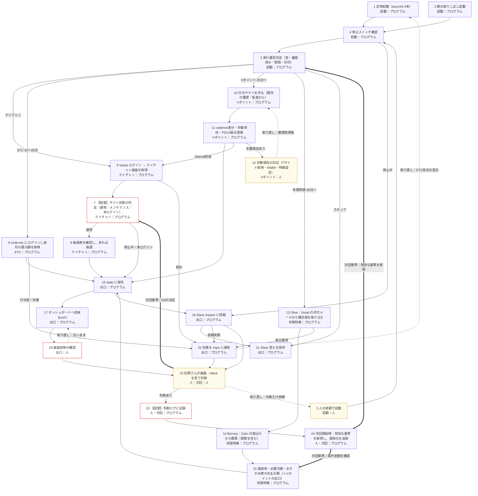

# フロー — ポイント・還元ウォッチ係（614）

**状態**: 第1段階（フロー案づくり・Claude 2026-11-23）。Codex レビュー前・松野さんの図の確認前。
親: 600 リソース・家計BL ラコ #36（『魂を込める』今週の社員＝614）。
図（同じ内容）: [`flow.json`](./flow.json)（正本）・[`flow.html`](./flow.html)（ブラウザで開く。金融サイト・DB・Slack に接続しない）。
**FlowForge**: 54b の決まりにより画面は触らない・登録しない。このフォルダの `flow.json`／`flow.md`／`flow.html` が当面の正。
手順: [`workflow-review/README.md`](../../workflow-review/README.md)・[`prompt-template.md`](../../workflow-review/prompt-template.md)。工程番号は図・表・会話で共通。

## 1. 何のための社員か

得る側（テイチャン・ETC還元・Vポイント定例・年間特典）の定例が**本当に動いて新しい数字を持ってきたか**を1係で松野さんに見せ、年間特典の寄せ先などの**判断材料**を出す。決めるのは松野さん。払う側（年会費・課金）は 612、Zaim の鮮度は 613。

**実行時にAIを呼ぶ工程は0**（全て Python／launchd のプログラム）。AI（ジャービス／Codex／Claude）が出てくるのは、松野さんの依頼で本線を手動実行する時と、設計・保守の時だけ。

## 2. 資産の棚卸し（参照日 2026-11-23）

凡例: **実装済**＝コードがあり動作の証拠を確認／**一部**＝動くが検知・保存に穴／**手動**＝人が動く／**未実装**＝提案のみ／**未確認**＝今回確かめていない。

| 系統 | 本線（スクリプト・launchd） | 起動 | 状態 | 動いた証拠（実額は書かない） |
|---|---|---|---|---|
| テイチャン | `jarvis_teiki_barai_chance.py`・`teiki_draw_runner.sh` | launchd 月・木10:15（runs=3・最終 exit 0）＋朝の取りこぼし（**毎朝**）。毎日動くのは『券あり』の古い値が残るため | **一部**（サイトがメンテ停止中でも報告が止まらない） | Mac ログは 10/21〜11/23 の毎日（11/6〜11/20 は1日5〜7回）。Slack 控え: 確認 33 件・失敗 4 件。最終抽選 10/11。**10/22 朝からサイトがメンテ画面（10/22・10/29・10/31・11/23 の画面写真を目視。再開は『決まり次第』）** |
| ETC還元 | `jarvis_etc_rebate_fetch.py`・`etc_rebate_monthly_runner.sh` | launchd 20〜26日09:30（runs=3・最終 exit 0）＋朝の取りこぼし | **実装済** | 11/20 05:12 に取得成功（10月利用分）・Slack 控えあり。11/21・11/22 は履歴済みで正常スキップ。次: 11/23〜26 は履歴済みスキップの見込み |
| Vポイント定例（窓C） | `jarvis_vpoint_routine.py`・`jarvis_vpoint_monthly_check.py`・`jarvis_vpoint_cadence_check.py`・`jarvis_vpoint_pdca.py`・`vpoint_routine_runner.sh` | launchd 25〜31日09:40＋朝の取りこぼし | **一部**（印は付くがデータは 9/10 のTサイト履歴のまま。asks の保存に疑い） | 10/25〜10/31 の7日分の Slack 控え、Mac ログ中身は 10/27〜31、`last_check_c`=2026-10。**11/25 が11月窓の初日** |
| 年間特典ウォッチ | `jarvis_card_benefit_watch.py`・`jarvis_card_benefit_monthly.py`・`card_benefit_monthly_runner.sh`・`config/card_benefit_watch.yaml` | launchd 毎月28日09:50＋朝の取りこぼし（28日以降） | **実装済・本番未実行** | 11/23 00:20 に plist 作成、dry-run の控え（state 側）まで。`last_monthly_run` なし＝**初回の本番は 11/28** |
| 共通：Slack 短報 | `jarvis_points_rebate_slack_report.py`・`jarvis_slack_webhook_post.py` | 各本線から | 実装済 | 11/23 05:13 Webhook 200。同日・同文は再投稿しない |
| 共通：画面 | `apps/jarvis-dashboard/app/vpoint`・`/etc`、`jarvis_dashboard_push.py --watch-only` | 各本線の `--push`／dashboard-push 毎日12:30 | 実装済（反映確認は人） | push の戻り値0を確認。本番画面は今回開いていない |
| 共通：朝の取りこぼし | `jarvis_morning_mac_refresh.py`（呼び出し元 `jarvis_triage_morning_open.py`） | Mac を開いた朝 | 実装済 | 系統ごとの条件で runner を起動 |

**Vポイントの出口**（`/vpoint#vpoint-exit`）は計算ではなく `config/card_benefit_watch.yaml` の静的リスト（確認済み／注意／未確認。投資を先頭・『元本割れの可能性・判断は松野さん』）。ノード15の画面に含める。
**確定/提案の区別**: ノード7・18・23 と 24 の一部は**提案（未実装）**。他は既存。
**既存社員との境界**: 612（払う側）・613（Zaim 鮮度）・618（資産記録）は作り直さない。年間特典の Zaim 概算は 613 の取込結果を読むだけ。

### 11/23 時点の事実の確認

| 依頼文の事実 | 確認結果 |
|---|---|
| テイチャン＝毎日 | 一致。ただし launchd は月・木のみ。毎日は**朝の取りこぼし**（『券あり』の古い値で毎朝起動）による |
| ETC還元＝20〜26日 | 一致（launchd 20〜26日09:30。履歴済みなら正常スキップ） |
| Vポイント定例＝25日〜月末の毎日（窓C） | 一致（launchd 25〜31日09:40）。10月窓の発火は Slack 控え7日分・ログ中身は 10/27〜31 |
| 年間特典＝毎月28日09:50＋朝の取りこぼし | 一致。plist 作成済み・**まだ一度も本番では動いていない** |

## 3. フロー図

凡例: 色＝主体（紫=プログラム／黄=人／青=AI／緑=外部サービス）。赤の破線枠＝**提案（未実装）**。実線＝通常の流れ・分岐、**点線＝今回の取り直し（元のノードへ・条件付き）**、**太線＝次回基準への改善（次回開始時に反映）**。無条件の反復・自動承認は置かない。

### 主な流れを文字で
1. 起動（定時1／朝の取りこぼし2／人の依頼3）→ 停止スイッチ4 → 実行要否5。
2. 5 が系統ごとに分岐: テイチャン6〜8／ETC9／Vポイント10〜12／年間特典13〜15。
3. 全系統が保存16 → 画面反映17→確認18／Slack 短報19→控え21 に合流。失敗は #ops 20。
4. 人が22で判断 → 記録23 → 次回の基準24 → 次回の5へ。

## 4. 各ノード表

各ノードの『開始トリガー・入力・処理・保存先・画面反映先・報告先・成功/部分成功/失敗・判断点』を1行にまとめた。**保存の成功と画面反映の確認は別**（17・18）。

### 起動・ガード

| # | 工程（主体｜実行者・道具） | 入力 → 処理 | 保存先／画面反映先／報告先 | 成功／部分成功／失敗 | 判断点 | 実装・今回の状態 |
|---|---|---|---|---|---|---|
| 1 | **定時起動（launchd 4本）** プログラム｜macOS launchd → launchd/*_runner.sh（teiki-draw 月・木10:15／etc-rebate-monthly 20〜26日09:30／vpoint-routine 25〜31日09:40／card-benefit-monthly 28日09:50） 開始: カレンダー時刻（Mac が起きている時だけ動く） | なし（runner が .env.jarvis_private を読み込む。値はログに出さない） → 該当スクリプトを起動し、~/Library/Logs/<系統>/ にログを残す | 保存: Mac ログ（# start / # end exit=…） 画面: なし 報告: なし（結果の短報は各スクリプトが出す） | 成功: ログ末尾が「# end exit=0」 部分: — 失敗: ログが無い（Mac スリープ等）→ ノード2が補う／exit≠0 → ノード20 | なし | 実装済（確認済み） 今回: **一部** 根拠: launchctl print と plist（2026-11-23）。teiki=月・木10:15で runs=3・最終 exit 0／etc=20〜26日で runs=3・最終 exit 0／vpoint=runs=0（再読込で数え直された可能性。10/27〜31 のログ中身は有り）／card-benefit=11/23 00:20 に plist 作成・未実行（初回の本番は 11/28） |
| 2 | **朝の取りこぼし起動** プログラム｜jarvis_morning_mac_refresh.py（呼び出し元は jarvis_triage_morning_open.py＝triage-morning-open launchd RunAtLoad） 開始: Mac を開いた朝。系統ごとに「取りこぼし条件」を判定して該当 runner を起動 | 各 state（etc_monthly／vpoint_monthly／teiki_barai_chance／card_benefit_watch） → etc=20〜26日かつ前月分が履歴に無い／vpoint=25日以降かつ当月印(last_check_c)なし／年間特典=28日以降かつ当月印(last_monthly_run)なし／テイチャン=券が1枚以上 または 前回確認から interval_days(3)日以上 | 保存: runner をバックグラウンド起動（~/Library/Logs/<系統>/morning_catchup.*.log） 画面: なし 報告: なし | 成功: 条件に合う系統だけ起動する 部分: — 失敗: 起動失敗はログ（spawn failed）のみ。通知なし | なし | 実装済（確認済み） 今回: **確認済** 根拠: teiki: 11/6〜11/20 は1日5〜7回起動（11/10 は 05:11〜05:19 に6回）、11/21〜23 は1回。state の「券=2枚」が残るため毎朝『券あり』と判定される＝テイチャンが『毎日』動く正体（launchd は月・木のみ）。etc: 11/20 05:12 に朝の取りこぼしで起動し取得成功 |
| 3 | **人の依頼で起動** 人｜松野さん（音声／チャット）→ ジャービス／Codex／Claude が該当スクリプトを手動実行（実行はプログラム。AI は呼び出すだけ） 開始: 「テイチャン」「ETC還元」「Vポイント定例」「年間特典を更新して」など | 依頼文。取り直しは対象ノード番号を言う → 該当の本線スクリプトを --run／--apply／--force 付きで実行 | 保存: 本線と同じ（ログ・state・Slack） 画面: 本線と同じ 報告: 本線と同じ | 成功: 対象ノードの成功条件を満たす 部分: 一部の対象だけ成功 失敗: 対象ノードの失敗に同じ | 取り直す対象はどれか（松野さんが選ぶ） | 手動（確定） 今回: **未検証** 根拠: CLAUDE.md「動き出す合図」に記載。今回は実行していない |
| 4 | **停止スイッチ確認** プログラム｜各スクリプト冒頭（env の *_DISABLE と state の disabled） 開始: 全ての起動の直後 | env（値は読まない・書かない）／各 state の disabled → teiki=JARVIS_TEIKI_BARAI_DISABLE／etc=JARVIS_ETC_MONTHLY_DISABLE・JARVIS_ETC_REBATE_AUTO_DISABLE／vpoint=JARVIS_VPOINT_MONTHLY_DISABLE・JARVIS_VPOINT_ROUTINE_DISABLE／年間特典=JARVIS_CARD_BENEFIT_DISABLE／Slack=JARVIS_POINTS_REBATE_SLACK_REPORT_DISABLE と種別別。朝の取りこぼし判定側にも同じ判定がある | 保存: 停止なら何もせず終了（teiki・etc は「停止」の短報、vpoint・年間特典は無言） 画面: なし 報告: 停止中のとき teiki・etc のみ短報 | 成功: 停止の有無を正しく見分けた 部分: — 失敗: env を読めない→停止なしとして進む（読取失敗＝基準なし扱いになる点は未確認） | 止めるかどうかは松野さん（ここは自動で止めない） | 実装済（確認済み） 今回: **確認済** 根拠: state の disabled は teiki／etc／vpoint いずれも false（2026-11-23）。env の中身は確認していない |
| 5 | **実行要否判定（窓・履歴済み・間隔・月印）** プログラム｜teiki=is_due()／etc=default_target_month()・history_has()／vpoint=in_window_c()・last_check_c／年間特典=needs_catchup() 開始: 停止スイッチを通った後 | 今日の日付、各 state（履歴・印・前回確認日） → 動く／スキップを決める。スキップは『正常な何もしない』で、成功の件数に数えない | 保存: 次のノード（6／9／10／13）へ。スキップ時はログのみ 画面: なし 報告: スキップは無言（teiki のみ『スキップ』短報） | 成功: 必要な時だけ動く 部分: — 失敗: state が壊れて読めない→再実行側に倒れる（etc・vpoint の読込例外は『要実行』扱い） | なし（人の依頼 n03 は窓外でも --force で動かせる） | 実装済（確認済み） 今回: **確認済** 根拠: etc: 11/21・11/22 09:30 のログが『history already has 2026-10』で正常スキップ。年間特典: 11/23 時点で last_monthly_run なし＝初回は 11/28 |

### テイチャン

| # | 工程（主体｜実行者・道具） | 入力 → 処理 | 保存先／画面反映先／報告先 | 成功／部分成功／失敗 | 判断点 | 実装・今回の状態 |
|---|---|---|---|---|---|---|
| 6 | **Vpass ログイン → テイチャン画面を取得** プログラム｜jarvis_teiki_barai_chance.py --run --push（Playwright／Mac Chrome CDP 専用プロファイル・終了時に自動で閉じる）。外部サービス: Vpass（三井住友カード）・定期払いチャンス 開始: ノード5が『券あり／間隔到来』と判定 | VPASS_* の認証（env。値は書かない） → Vpass SSO → gift_info 画面の本文と画面写真を取る。ログイン未完了なら券数・規約は更新しない | 保存: 画面写真（.jarvis_state/teiki_barai_chance/・非公開）／本文テキスト 画面: なし（ノード16〜17で反映） 報告: なし（ノード19） | 成功: ログインでき、画面本文を取れた 部分: ログイン途中で止まる（login_incomplete） 失敗: ブラウザ例外→ノード20 | なし（規約未同意・OTP は人） | 実装済（確認済み） 今回: **一部** 根拠: 11/23 05:13 のログと画面写真: ログインは通ったが画面は『システムメンテナンスにより一時停止』。10/22・10/29・10/31・11/23 の写真を目視で確認（10/21 までは通常サイズの画面。10/31 は再開予定11/16、11/23 は延期で『再開時期が決まり次第』）。失敗の控えは 10/27・10/29・11/2・11/10 の4件（『Target page, context or browser has been closed』） |
| 7 | **【提案】サイト状態の判定（通常／メンテナンス／未ログイン）** プログラム｜jarvis_teiki_barai_chance.py に追加する判定（提案。実行時に AI は呼ばない） 開始: ノード6の直後 | 本文テキスト（『システムメンテナンス』『サービスを一時的に停止』等） → 現状は『未ログイン』しか見分けない（コードに『メンテ』の判定なし）。提案: メンテ画面なら『サイト停止中』と本文の再開予定を保存し、券数・規約は前回値のまま『古い』と明示。『券あり』による毎朝の再起動はやめ、停止中は interval（3日）に戻す | 保存: site_status（通常／メンテ／未ログイン）と画面から読んだ再開予定文、最終確認できた日 画面: /vpoint のテイチャン欄に『停止中（最終に券数を確認できた日◯）』 報告: Slack『テイチャン停止中（サイト側メンテ）』を状態が変わった時だけ | 成功: 停止中を『確認のみ』と区別して保存・表示できる 部分: 本文が想定外（未知の文言）→『読めず』として #ops 相談へ 失敗: 判定の取りこぼし→今と同じ『確認のみ』報告（現状） | D4: 停止中の扱い（毎朝確認をやめて interval に戻す／停止中は Slack を出さない 等） | 未実装(提案)（提案） 今回: **未実行** 根拠: 現状の報告: 11/23 の Slack 控えは『結果: 確認のみ（抽選なし）／状態: 規約=yes · 券=2枚』。券数は画面に出ておらず、前回値の2枚が残っている（最終抽選は 10/11） |
| 8 | **抽選券を確認し、あれば抽選** プログラム｜jarvis_teiki_barai_chance.py（_parse_counts／_click_draw）。外部サービス: 定期払いチャンス 開始: ノード7が『通常画面』 | 券枚数・Wチャンス枚数（画面本文） → 枚数が1以上なら抽選ボタンを押す（無料の抽選。既存運用では自動実行の取り決め）。0枚ならスキップ | 保存: draw_history（最大12件）、券数の更新、サービス追加候補（Step1） 画面: /vpoint#teiki-barai（券・最終確認・追加候補） 報告: Slack『テイチャン』（抽選あり／確認のみ） | 成功: 抽選が ok／券0で正常スキップ 部分: 抽選したが結果文が読めない 失敗: 押下失敗→ノード20 | D4: 追加候補（SBI・コミュファ・AXA・Chatwork 等）を対象に入れるか（画面確認は人） | 実装済（確認済み） 今回: **保留** 根拠: 最終抽選は 10/11（draw_history 3件: 9/10・9/11・10/11）。以後サイトが停止中（10/22 朝からメンテ画面を目視確認）のため抽選の実績なし |

### ETC還元

| # | 工程（主体｜実行者・道具） | 入力 → 処理 | 保存先／画面反映先／報告先 | 成功／部分成功／失敗 | 判断点 | 実装・今回の状態 |
|---|---|---|---|---|---|---|
| 9 | **smile-etc にログインし前月の還元額を取得** プログラム｜jarvis_etc_rebate_fetch.py --apply --push（Playwright headless）。外部サービス: smile-etc（ETCマイレージ） 開始: ノード5が『20〜26日かつ前月分が履歴に無い』 | ETC_MILEAGE_ID／ETC_MILEAGE_WEB_PASSWORD（env。値は書かない） → 特典行→無ければ還元額明細の開始残高から前月利用分の還元額を取る（付与は翌月20日）。参考にNEXCOポイントも読む | 保存: etc_monthly.json の rebate_history（source=smile-etc_auto） 画面: /etc 報告: Slack『ETC還元』（取得できた月だけ。窓外は無言） | 成功: 対象月の還元額を取れて履歴に追加 部分: 還元額は取れたがNEXCOポイントが読めない（参考値のため成功扱い） 失敗: 付与前（翌月20日前）／ログイン・画面変更→ノード20。窓内なら翌日の定時で再試行（20→1 の矢印） | なし（異常値かどうかは松野さんが /etc で見る） | 実装済（確認済み） 今回: **確認済** 根拠: 11/20 05:12 取得成功（10月利用分・source=smile-etc_auto）・Slack 控えあり。11/21・11/22 09:30 は履歴済みで正常スキップ。10月窓の取得日は未確認（10/21〜26 のログはスキップ。10/17 の控えあり） |

### Vポイント定例

| # | 工程（主体｜実行者・道具） | 入力 → 処理 | 保存先／画面反映先／報告先 | 成功／部分成功／失敗 | 判断点 | 実装・今回の状態 |
|---|---|---|---|---|---|---|
| 10 | **付与サマリを作る（既存の履歴・監査から）** プログラム｜jarvis_vpoint_routine.py --apply --push → jarvis_vpoint_monthly_check.py --build-summary-only --target-month 前月（窓内は --mark-done） 開始: ノード5が『25日以降かつ当月印なし、または対象月の付与履歴なし』 | .jarvis_state/vpoint_tsite_history_*.json（Tサイト履歴・メールOTPで人が取得）／vpoint_audit_result.json。新規にサイトへ取りに行かない → 対象月の付与ポイントを種別・率別に集計して grant_history に追加し、当月印(last_check_c)を付ける | 保存: vpoint_monthly.json（grant_history・last_check_c） 画面: /vpoint 報告: Slack『Vポイント』（毎回『定例ウォッチ更新』） | 成功: 対象月の末日以降の基準日を持つデータから作れた（提案する成功の線） 部分: 監査のフォールバックや古い履歴から作った（source_note に出る） 失敗: 履歴が無い→要手動項目に出す。スクリプト例外→ノード20 | D6: 『印が付いた＝成功』をやめ、基準日の鮮度で成功／部分成功を分けるか | 実装済（確認済み） 今回: **一部** 根拠: 10月窓: Slack 控え 10/25〜10/31 の7日分・Mac ログの中身は 10/27〜31（10/26 は0バイト・10/25 は無し）。last_check_c=2026-10。9月分の付与サマリの出どころは 9/10 取得のTサイト履歴（月末前のスナップのため不完全の疑い・未確認）。11月窓は 11/25 開始で未到来 |
| 11 | **cadence差分・手動項目・PDCA板を更新** プログラム｜jarvis_vpoint_cadence_check.py --force／build_jarvis_asks()／jarvis_vpoint_pdca.py --apply／（interval 到来時のみ）jarvis_teiki_barai_chance.py --run --push 開始: ノード10の後（毎回） | vpoint_cadence.json、vpoint_monthly.json、teiki_barai_chance.json → open_actions を整理し『手で確認する項目』(asks) と PDCA 板を作る。テイチャンの interval 到来時はノード6へ（定例からの2本目の入口） | 保存: vpoint_monthly.json（jarvis_asks・pdca_board）、vpoint_cadence.json 画面: /vpoint（要対応・PDCA） 報告: Slack に件数だけ（『手で確認する項目: N件』） | 成功: asks と PDCA 板が新しい日付で保存された 部分: PDCA だけ失敗 失敗: 保存されない（下記の疑い）→画面は古い asks のまま | なし | 実装済（確認済み） 今回: **一部** 根拠: 疑い（コード読解＋state で一致・未確認）: pdca 実行後に state を読み直してから保存するため last_routine_at と jarvis_asks が上書きされて残らない。state の last_routine_at は 2026-09-10 のまま（10/27〜31 に定例は動いている） |
| 12 | **手動項目の対応（Tサイト取得・Wallet・特典設定）** 人｜松野さん＋ジャービス（『Tサイト取って』＝メールOTPが必要。Wallet／Visaタッチ実機確認、選べる特典・NISA評価額帯の設定変更、Vpass深い明細監査） 開始: ノード11の asks（現行 state は8件）を松野さんが見て依頼 | OTP（松野さんのメール）、実機 → Tサイトの履歴を新規取得、設定を変更 | 保存: vpoint_tsite_history_<日付>.json などの新しい履歴 画面: /vpoint 報告: 完了報告はチャット | 成功: 新しい履歴ができ、付与サマリを作り直せる 部分: 一部の設定だけ完了 失敗: OTP 不調・未対応→asks に残す | D6: Tサイトの取得をいつ行うか（現行の最新履歴は 9/10。窓C前に取らないと 10月分も古いデータで作られる） | 手動（確定） 今回: **保留** 根拠: 最新のTサイト履歴は 2026-09-10（40日超＝asks に『古い』が出る条件）。11/25 の窓C開始までに新規取得が無ければ、10月分の付与サマリは古い履歴かフォールバックになる見込み |

### 年間特典ウォッチ

| # | 工程（主体｜実行者・道具） | 入力 → 処理 | 保存先／画面反映先／報告先 | 成功／部分成功／失敗 | 判断点 | 実装・今回の状態 |
|---|---|---|---|---|---|---|
| 13 | **Olive：Gmail の月次メールから確定値を取り込む** プログラム｜jarvis_card_benefit_monthly.py → jarvis_card_benefit_watch.py --refresh（orca gmail 検索）。外部サービス: Gmail（三井住友カードの月次メール『各種特典条件達成状況』） 開始: ノード5が『28日以降かつ当月印なし』（launchd 28日09:50 ＋ 朝の取りこぼし） | Gmail（アカウントは env）。メールは15日現在の達成状況が約10日後（25〜27日ごろ）に届く → メール本文を解析して基準日と利用額（確定値）を state に追加 | 保存: card_benefit_watch.json の olive.snapshots 画面: /vpoint#card-benefit 報告: Slack『年間特典』（ノード19） | 成功: 新しいメールを1通以上追加、または最新の基準日が45日以内 部分: メール0件（未着）→『古い』表示付きで続行 失敗: Gmail 検索に失敗しても終了コード0のまま進む（疑い・未確認）。現行は『失敗』として #ops に出ない | なし | 実装済（確認済み） 今回: **未検証** 根拠: 11/23 の dry-run 控え（state 側）で Olive は『10/15 時点』の確定値。次の11/15 現在分は 11/25〜27 ごろ届く見込み＝11/28 の実行ログで確認する |
| 14 | **Bonvoy：Zaim の取込行から概算（振替を含む）** プログラム｜jarvis_card_benefit_watch.py（aggregate_zaim／aggregate_zaim_transfers）。参照: Zaim 取込 index とローカルCSV（Zaim のサイトには触らない。取込は 613 の領分） 開始: ノード13の後 | Zaim 取込 index・CSV（ローカル） → 年会費を除いた支出行＋アメックスでの Amazon 購入の振替行を加算し概算。足さなかった振替の件数も保存。CSV を読めない時は『振替は未加算』と警告 | 保存: card_benefit_watch.json の bonvoy.zaim（基準日つき） 画面: /vpoint#card-benefit 報告: Slack（概算・振替N件・基準日） | 成功: 基準日が10日以内（zaim_stale_days） 部分: 基準日が古い→『Zaim が古い』を併記 失敗: index／CSV が読めない→『未加算（要再取込）』と表示。基準なしとして推奨を出さない | なし | 実装済（確認済み） 今回: **一部** 根拠: 11/23 の dry-run 控え: 基準日 11/12（11日前＝『Zaim が古い』を併記）、振替20件を含む概算 |
| 15 | **達成率・必要月額・おすすめ寄せ先を計算（＋Vポイントの出口）** プログラム｜jarvis_card_benefit_watch.py（compute／recommend／build_vpoint_exits）。実行時に AI は呼ばない 開始: ノード14の後（state だけで再計算できる） | state ＋ config/card_benefit_watch.yaml（条件の線・threshold_status・判定の比率） → 達成率・残り月・月あたり必要額・判定（届く／厳しい／届かない見込み）、条件金額の確かさ（確認済み／推定／要確認／未確認）を併記。末尾に『今月はこちら（判断はあなた）』。出口は config の静的リスト（投資を先頭・『元本割れの可能性・判断は松野さん』） | 保存: 計算結果（画面・短報用） 画面: /vpoint#card-benefit・#vpoint-exit 報告: Slack『年間特典』 | 成功: 数値と確かさの両方が出る 部分: 基準が古い・推定の金額→目安として明記 失敗: データなし→『データなし／基準日』と出し、推奨を出さない | D1: 今月どちらに寄せるか／D2: 条件金額を『確認済み』に上げるか／D3: 出口の優先表示 | 実装済（確認済み） 今回: **未検証** 根拠: 条件金額は Olive=推定・Bonvoy=要確認（config、11/23）。公式で確認できるまで『目安』扱い |

### 保存・画面・報告

| # | 工程（主体｜実行者・道具） | 入力 → 処理 | 保存先／画面反映先／報告先 | 成功／部分成功／失敗 | 判断点 | 実装・今回の状態 |
|---|---|---|---|---|---|---|
| 16 | **state に保存** プログラム｜各スクリプト（.jarvis_state/*.json。gitignore・公開リポに入れない） 開始: ノード8／9／11／15 の完了 | 取得・計算結果 → JSON に書く。年間特典は成功した月だけ last_monthly_run を付ける | 保存: .jarvis_state/{teiki_barai_chance,etc_monthly,vpoint_monthly,vpoint_cadence,card_benefit_watch}.json 画面: （次のノード17が送る） 報告: なし | 成功: 書き込めた（これは画面反映とは別） 部分: 一部の state だけ書けた 失敗: 書込失敗→ログのみ（通知なし） | なし | 実装済（確認済み） 今回: **確認済** 根拠: teiki_barai_chance.json 11/23 05:13／etc_monthly.json 11/20 05:13／vpoint_monthly.json 10/31 09:40／card_benefit_watch.json 11/23 00:52 の更新日を確認 |
| 17 | **ダッシュボードへ反映（push）** プログラム｜jarvis_dashboard_push.py --watch-only（teiki・etc・vpoint は各スクリプトが直接呼ぶ。年間特典の月次は呼ばず、別の dashboard-push launchd 毎日12:30 頼み）。外部サービス: Vercel ダッシュボード 開始: ノード16の後 | state → /vpoint・/etc の元データを送る。戻り値0＝送れた（画面に出たとは別） | 保存: ダッシュボード側の保存先（送り先の保存先は今回未確認） 画面: /vpoint・/etc（ノード18で確認） 報告: なし | 成功: push の戻り値が0 部分: 一部の項目だけ反映 失敗: 戻り値≠0→ログのみ（通知なし） | なし | 実装済（確認済み） 今回: **一部** 根拠: teiki 11/23 05:13 の push は ok・returncode 0。dashboard-push の最終実行ログは 11/22 12:30。年間特典の画面反映は『最短で当日12:30』の見込み（未確認） |
| 18 | **画面反映の確認** 人｜現状: 松野さんが /vpoint・/etc を目視。提案: 今回の run の時刻より新しいかをプログラムで読み返す 開始: ノード17の後 | 本番の /vpoint・/etc（今回は未閲覧） → 『最終確認』などの時刻が今回の run 以降か、停止中・古い基準が出ているかを見る | 保存: 確認済み／未確認の記録（現状は記録なし） 画面: /vpoint・/etc 報告: （提案）確認できなかった時だけ短報 | 成功: 画面の時刻が今回の run 以降（保存の成功とは別に数える） 部分: 一部の欄だけ新しい 失敗: 古いまま→ノード3で再 push を依頼 | D7: 自動の読み返しを作るか（作るなら 614 の実装 TASK） | 未実装(提案)（提案） 今回: **未検証** 根拠: 今回、本番画面は開いていない（保存・push の結果だけ確認） |
| 19 | **Slack #report に短報** プログラム｜jarvis_points_rebate_slack_report.py --kind teiki／etc／vpoint／card_benefit → jarvis_slack_webhook_post.py。外部サービス: Slack Webhook 開始: ノード8／9／11／15 の完了（各スクリプトが呼ぶ） | state の値（番号＋短い役割語の文面を組み立てる） → 見出し【614 ポイント還元｜種別】。同日・同一文面は再投稿しない。年間特典の控えは実額入りのため state 側に置く | 保存: Slack #report、控えファイル（ノード21） 画面: なし 報告: Slack #report | 成功: Webhook が 200 を返した 部分: 年間特典で本文だけ投稿されて控えが残らない 等 失敗: 投稿失敗→年間特典のみ #ops に別通知。他はログのみ | D5: Vポイントを窓C 7日間ほぼ毎日出すか／月1にまとめるか | 実装済（確認済み） 今回: **確認済** 根拠: 11/23 05:13 ログ『Slack webhook OK status=200』。Slack の投稿そのものはコネクタで未照会（控えファイルは投稿成功時だけ書かれるコード）。Vポイントの結果語は常に『checked』（付与サマリの失敗も成功と同じ語） |
| 20 | **失敗を #ops に通知** プログラム｜jarvis_points_rebate_slack_report.py --outcome failed（channel を #ops へ振替） 開始: ノード6／9／13 の失敗、年間特典の短報投稿失敗 | エラー文 → 『失敗 — 理由』『次: …を確認』を #ops へ | 保存: #ops 投稿、控え（*_failed.md） 画面: なし 報告: Slack #ops | 成功: 失敗が #ops に届く 部分: — 失敗: Webhook 自体が落ちている→ログのみ | なし（取り直しは人が依頼＝ノード3） | 実装済（確認済み） 今回: **確認済** 根拠: テイチャンの失敗控え4件（10/27・10/29・11/2・11/10）。ETC の付与前失敗の実例は無し（未確認） |
| 21 | **Slack 控えを保存** プログラム｜jarvis_points_rebate_slack_report.py の _archive() 開始: ノード19／20 の投稿成功後 | 投稿本文 → reports/<日付>_<種別>_<結果>.md に保存（年間特典は .jarvis_state/card_benefit_reports/） | 保存: 公開リポ docs の reports/（実額なし）／年間特典は非公開 state 側 画面: なし 報告: なし | 成功: ファイルができた 部分: — 失敗: 保存失敗→stderr のみ | なし | 実装済（確認済み） 今回: **確認済** 根拠: Mac の実体は47件、git（この worktree）は41件＝11/19〜11/23 分の6件は未取り込み |

### 人の判断と次回基準

| # | 工程（主体｜実行者・道具） | 入力 → 処理 | 保存先／画面反映先／報告先 | 成功／部分成功／失敗 | 判断点 | 実装・今回の状態 |
|---|---|---|---|---|---|---|
| 22 | **松野さんが画面・Slack を見て判断** 人｜松野さん（iPhone の Slack、/vpoint、/etc） 開始: Slack 短報・画面の更新 | 短報、画面、条件金額の確かさ（確認済み／推定／要確認） → D1 寄せ先（Olive／Bonvoy）／D2 条件金額の確認／D3 Vポイントの出口／D4 テイチャンの扱い／D5 Slack の出し方／D6 Tサイト取得の時期／D7 画面確認の自動化 | 保存: 判断（今回だけ／次回基準） 画面: — 報告: チャット（音声）。Slack は出口だけ | 成功: 判断が出て記録される 部分: 保留 失敗: 未判断のまま→基準にしない | 上記 D1〜D7 | 手動（確定） 今回: **未実行** 根拠: 寄せ先の方針メモ（定期払いは Olive に寄せ済み／今後の支払いを Bonvoy に寄せて狙い、狙えなければ打ち切り・年会費の前に判断）は既存。判断の記録場所は未整備 |
| 23 | **【提案】判断ログに記録** プログラム｜未実装。保存先の案: .jarvis_state の JSON（非公開）。決めるのは松野さん（D8） 開始: ノード22で判断が出た時 | 事項・AI案・本人選択・本人の述べた理由（AI が補作しない）・対象・今回だけ／次回基準・期限／取消／改定・run_id → 1判断1行で追記。未判断・見送りは『採用』にしない | 保存: decision_id つきの判断記録 画面: — 報告: なし | 成功: 記録できた 部分: 理由が無い→『理由なし』のまま保存 失敗: 保存失敗→今回の判断だけ有効・次回基準にしない | D8: 判断ログを作るか／保存先 | 未実装(提案)（提案） 今回: **未実行** 根拠: 今ある近い物: config/card_benefit_watch.yaml の threshold_status と、各 state の services.status（excluded_keep_paypay 等）。run_id・理由は持っていない |
| 24 | **次回開始時：有効な基準を取得し、適用IDを追跡** プログラム｜config 読込は既存（card_benefit_watch.yaml・teiki services）。判断ログからの取得と適用ID記録は未実装 開始: 次回の起動（ノード5の前） | 採用済みで期限内の基準だけ → 実行前に取得→適用した decision_id と結果を記録。読取失敗は『基準なし』にせず保留して知らせる | 保存: 適用した decision_id と結果 画面: （提案）画面に『適用中の基準』 報告: 読取失敗時だけ #ops | 成功: 有効な基準が取れ、適用IDが追える 部分: config だけ取れる（今の姿） 失敗: 読取失敗→保留 | D2: 条件金額を公式確認して confirmed に上げた時は config を直し、ノード15へ戻る | 一部実装（確認済み） 今回: **一部** 根拠: config の threshold_status・pace・zaim_stale_days が実質の基準として読まれている。decision_id による追跡は無い |

## 5. 取り直しと次回改善（戻り矢印）

**今回の取り直し**（対象を絞り、条件付き。無条件の自動反復はしない）:

| 元 | 先 | 条件 |
|---|---|---|
| 22 松野さんが画面・Slack を見て判断 | 3 人の依頼で起動 | 【取り直し】失敗・未更新の対象だけ、対象ノード番号を言って依頼 |
| 12 手動項目の対応（Tサイト取得・Wallet・特典設定） | 10 付与サマリを作る（既存の履歴・監査から） | 【取り直し】Tサイト取得などが済んだら --force-window-c で付与サマリを作り直す |
| 20 失敗を #ops に通知 | 1 定時起動（launchd 4本） | 【取り直し】ETC のみ：付与前の失敗は窓内（〜26日）の翌日定時で再試行。履歴ができたら止まる |
| 18 画面反映の確認 | 17 ダッシュボードへ反映（push） | 【取り直し】画面が古いまま：人が依頼した時だけ再 push |

**次回基準への改善**（今回の結果は変えず、次回の開始時に反映）:

| 元 | 先 | 条件 |
|---|---|---|
| 24 次回開始時：有効な基準を取得し、適用IDを追跡 | 5 実行要否判定（窓・履歴済み・間隔・月印） | 【次回基準】次回開始時に有効な基準を取得して要否判定へ |
| 24 次回開始時：有効な基準を取得し、適用IDを追跡 | 15 達成率・必要月額・おすすめ寄せ先を計算（＋Vポイントの出口） | 【次回基準】条件金額を公式確認→config を直して計算へ |
| 22 松野さんが画面・Slack を見て判断 | 7 【提案】サイト状態の判定（通常／メンテナンス／未ログイン） | 【次回基準】D4 で決めたテイチャン停止中の扱いを判定ノードへ反映 |

- 取り直しの対象は『失敗・未更新の系統だけ』。成功済みの系統まで再実行しない。
- 窓内の自動再試行は ETC の20〜26日だけ（履歴ができれば止まる＝既存の動き）。それ以外の再実行は人の依頼。

## 6. 判断点（松野さんに決めてほしいこと）

| # | 関連ノード | 判断事項 | おすすめ・理由 | 保留した場合 |
|---|---|---|---|---|
| D1 | n15・n22 | 年間特典：今月どちらに寄せるか（Olive／Bonvoy）。狙えなければ打ち切り（年会費の前に判断） | ツールは材料を出すだけ。決めるのは松野さん（既存方針） | 保留なら今のまま Olive 優先の表示のみ |
| D2 | n15・n24 | 条件の金額を公式で確認して『確認済み』に上げる時期 | 推定・要確認のまま『目安』と併記し続けるのは安全側 | 上げるまでは目安表示（既存） |
| D3 | n15・n22 | Vポイントの出口：投資を先頭・大きめに出す現行表示を続けるか | 11/23 に入れた表示。元本割れの可能性の注記つき | 続ける（変更しない） |
| D4 | n07・n08 | テイチャンがメンテ停止中の扱い：毎朝の確認をやめて3日間隔に戻す／停止中は短報を『停止中』に変える／再開の検知方法 | サイトは10/22朝からメンテ画面（約1か月）。毎朝（日によっては1日5〜7回）開いても得るものがない | 保留なら現状維持（毎朝確認・『確認のみ』報告） |
| D5 | n19 | Vポイントの Slack を窓C（25〜末日）で毎日出すか、月1にまとめるか | 10月は7日連続で同じ文面（件数だけ）。同文でも日付が変わると再投稿される | 保留なら現状維持（毎日） |
| D6 | n10・n12 | Tサイト履歴の新規取得（メールOTP）を窓C前に行うか。成功の線を『対象月の末日以降の基準日』に変えるか | 最新履歴は 9/10。このまま窓Cに入ると10月分は古いデータで作られる見込み | 保留なら今のまま（印が付けば成功扱い） |
| D7 | n18 | 画面反映の自動読み返しを作るか（実装 TASK） | 保存と画面反映を別の成功にする（ルール3）のに、反映側の確認が人頼み | 保留なら目視のまま・『反映確認は未実施』と報告に書く |
| D8 | n23・n24 | 判断ログ（ルール5・6）を作るか／保存先 | 今は config の確かさだけ。理由・適用IDの記録がない | 保留なら今回の判断はチャット記録のみ・次回基準にしない |

判断の記録（ルール5）は D8 が決まるまで未整備。決まるまでは『今回だけ』の判断としてチャットに残り、次回基準にしない。

## 7. 年間特典ウォッチと Vポイントの出口の位置づけ

- **年間特典ウォッチ**（Olive Infinite／Marriott Bonvoy の2枚だけ・汎用化しない）は第4の定例として 13〜15 に置く。起動は月1（28日09:50）＋朝の取りこぼしで、他の3系統（テイチャン・ETC・Vポイント）とは**取得元が違う**（Olive=Gmail 月次メールの確定値、Bonvoy=Zaim 取込行の概算＋Amazon 購入の振替）。
- **判断材料を出すだけ**。寄せ先を決めるのは松野さん（D1）。条件金額の確かさ（確認済み／推定／要確認／未確認）を必ず併記し、取込失敗や古いデータでは推奨を出さない。実額入りの控えは公開リポでなく state 側。
- **Vポイントの出口**は年間特典と同じ画面（`/vpoint`）にある静的な一覧。計算しない。更新するのは config を直した時（人）。
- 現行で弱い点: 取込が失敗しても月印が付く疑い（F5）、画面反映が12:30の別 push 頼み（F6）。

## 8. 成功の定義（保存と画面反映を分ける）

『スクリプトが exit 0』『取得できた』『state に保存できた』『画面に出た』『Slack に届いた』は**別々の成功**として数える。

| 系統 | 取得成功 | 保存成功 | 画面反映確認 | 報告成功 | 現行の弱点 |
|---|---|---|---|---|---|
| テイチャン | 通常画面で券数が読めた | state に書けた | /vpoint の最終確認が今回以降（人） | Webhook 200 | **メンテ画面でも『確認のみ』と出て成功に見える**（F1） |
| ETC | 対象月の還元額を履歴に追加（source=smile-etc_auto） | etc_monthly.json | /etc（人） | Webhook 200 | 履歴済みスキップは『正常スキップ』で成功の件数に数えない |
| Vポイント定例 | 付与サマリが**対象月の末日以降の基準日**の履歴から作れた（提案の線） | vpoint_monthly.json（asks の保存に疑い） | /vpoint（人） | Webhook 200 | 現行は『印が付いた＝成功』。古い履歴でも『定例ウォッチ更新』（F3・F4） |
| 年間特典 | Olive: 新メール追加 or 基準日45日以内／Bonvoy: 基準日10日以内 | card_benefit_watch.json＋月印 | /vpoint#card-benefit（人） | Webhook 200＋控え | 取込失敗でも月印が付く疑い（F5）・push は別 launchd（F6） |

**部分成功**は『古い基準で作った』『一部の欄だけ新しい』『投稿だけ失敗』など、足りない所を短報に明記して数える。報告に載せる/載せない: 実額・口座・カード番号は載せない（画面で見る）。

## 9. 停止スイッチ

| 止めたいもの | 方法 |
|---|---|
| テイチャン | `JARVIS_TEIKI_BARAI_DISABLE=1` または `teiki_barai_chance.json` の `disabled` |
| ETC還元 | `JARVIS_ETC_MONTHLY_DISABLE=1`／`JARVIS_ETC_REBATE_AUTO_DISABLE=1` または `etc_monthly.json` の `disabled` |
| Vポイント定例 | `JARVIS_VPOINT_MONTHLY_DISABLE=1`／`JARVIS_VPOINT_ROUTINE_DISABLE=1` または `vpoint_monthly.json` の `disabled` |
| 年間特典 | `JARVIS_CARD_BENEFIT_DISABLE=1` |
| Slack 短報すべて／種別だけ | `JARVIS_POINTS_REBATE_SLACK_REPORT_DISABLE=1`／`JARVIS_TEIKI_…`・`JARVIS_ETC_…`・`JARVIS_VPOINT_…`・`JARVIS_CARD_BENEFIT_SLACK_REPORT_DISABLE=1` |
| launchd ごと外す | `launchd/uninstall_*_launchd.sh`（teiki／etc／vpoint／card_benefit） |

2026-11-23 時点で state の `disabled` は teiki／etc／vpoint とも false。env の中身は確認していない。**停止は人だけが決める**（自動停止は置かない）。

## 10. 未確認一覧

- **U1** テイチャンのメンテ開始日と再開日 — 目視で確認したのは 10/22・10/29・10/31・11/23 の4枚（10/21 の写真は通常サイズ＝開始は 10/22 朝）。10/31 時点の再開予定 11/16 は延期され、11/23 時点は『決まり次第』。再開の検知方法は未整備
- **U2** テイチャンの『券=2枚』が今も実在するか — 画面に枚数は出ておらず、前回値が残っているだけ。最終抽選は 10/11
- **U3** Vポイント launchd が 25〜31日に毎日発火しているか — runs=0 の意味が未確認。10/25 はログ無し・10/26 は0バイト（Slack 控えは7日分ある）。11/25 09:40 で確認
- **U4** 9月分の付与サマリの完全性 — 9/10 取得のTサイト履歴から作成。月末前のスナップのため不完全の疑い
- **U5** vpoint_monthly.json の last_routine_at／asks が保存されない件 — コードの順序と state の日付が一致するが、再現はしていない
- **U6** 年間特典の取込失敗が exit 0 のまま『月印』になるか — コード読解のみ。実際に Gmail 失敗を起こして確認していない
- **U7** 年間特典 launchd の導入了承 — plist は 11/23 00:20 作成。松野さんの了承の記録は今回確認できていない。初回の本番は 11/28
- **U8** 本番 /vpoint・/etc の表示 — 今回は開いていない（保存・push の結果のみ確認）
- **U9** dashboard-push（毎日12:30）の対象と年間特典の画面反映の遅れ — 年間特典の月次は push を呼ばない。反映が最短12:30かは未確認
- **U10** Slack #report に実際に届いた投稿 — Slack コネクタでは照会していない。Webhook 200 と控えファイルが根拠
- **U11** ETC：10月窓（9月利用分）の取得日・付与前失敗が #ops に毎日出るか — 10/21〜26 のログはスキップのみ。付与前失敗の実例なし
- **U12** Olive の11/15現在分メールの到着日 — 25〜27日ごろの見込み。11/28 の実行時に確認
- **U13** Olive・Bonvoy の条件金額 — Olive=推定・Bonvoy=要確認のまま。公式確認は未
- **U14** テイチャンの多重起動と『closed』失敗の因果 — 排他ロックはコード上無い（確認済み）。同時刻の重複と失敗の関連は推定
- **U15** 停止スイッチの env の中身 — 秘密を見ないため state の disabled だけ確認

## 11. 気づいた不具合（直していない・docs のみの作業のため）

- **F1** テイチャンがメンテ停止中でも『確認のみ（抽選なし）・券=2枚』と報告し、停止が見えない（n7）
- **F2** 『券あり』の古い値で毎朝再起動し、排他ロックも無いので 11/6〜11/20 は1日5〜7回起動（n2・n6）
- **F3** Vポイント定例：last_routine_at／asks が保存されない疑い（pdca 後の読み直しで上書き。n11）
- **F4** Vポイント定例：Tサイト履歴が 9/10 のままでも『定例ウォッチ更新』を毎回出し、窓C7日間連投（n10・n19）
- **F5** 年間特典：取込（Gmail／Zaim）が失敗しても exit 0 で月印が付く疑い（n13）
- **F6** 年間特典の月次が push を呼ばず、画面反映が別 launchd（12:30）頼み（n17）

## 12. 『魂がこもった』への進み具合

親 #36 の定義: 作業フローを Codex と磨き込み → ビジュアルで確認 → 松野さんが『これなら動く』と判断 → 運用して回った。**D（回った証拠）は次の定例の実行ログで確認する**（実額は見ない・書かない）。

**A. 磨き込み済みか**

- [x] 第1段階：資産棚卸し・番号つきフロー・判断点・成功の定義を作った（Claude・2026-11-23）
- [ ] Codex（チャッピー）が別の目でレビューした
- [ ] レビュー指摘を同じノード番号で反映した

**B. 図の確認済みか**

- [ ] 松野さんが flow.html を開いて、番号・つなぎ・戻り矢印を見た（確認は後追いでもよい＝2026-11-15）
- [ ] 直しが出たら同じ番号で flow.json／flow.md に戻して再確認した

**C. 松野さんの判断**

- [ ] D1〜D8 のうち、今回決めるものに回答した（保留は『保留』と記録）
- [ ] 松野さんが『これなら動く』と判断した（本人の言葉で記録。AI が代わりに書かない）

**D. 運用して回った証拠（次の定例で確認。実額は見ない・書かない）**

- [ ] 【n9】ETC 11/23〜26 09:30：ログに『history already has 2026-10』（正常スキップ）が出て、state・Slack に重複がない
- [ ] 【n1・n10】Vポイント窓C 11/25 09:40：~/Library/Logs/jarvis_vpoint_routine/run_20261125_*.log に『# end exit=0』、vpoint_monthly.json の last_check_c が 2026-11、reports/ に 2026-11-25_vpoint_checked.md
- [ ] 【n10・n12】同日：付与サマリの source_note とTサイト履歴の基準日が『対象月（10月）の末日以降』か（古ければ『部分成功』と読む）
- [ ] 【n1・n10】11/26〜11/30 の毎日：launchd 発火のログ（日数を数える。U3 の確認）
- [ ] 【n13〜15】年間特典 11/28 09:50：~/Library/Logs/jarvis_card_benefit/run_20261128_*.log に『# end ok』、card_benefit_watch.json の last_monthly_run が 2026-11、Olive の基準日が 11/15 に進んだか（U12）、Zaim の基準日が10日以内か
- [ ] 【n19・n21】同日：Slack #report に『年間特典』が1通だけ届き、state 側の card_benefit_reports に控えがある（実額は見ない）
- [ ] 【n17・n18】11/25・11/28 の後：/vpoint の最終確認・年間特典欄が今回の run 以降の時刻になっている（目視。自動確認は D7 の判断待ち）
- [ ] 【n6〜n8】テイチャン：11/23 以降の毎朝／月・木のログと画面写真で、停止中か再開かを記録（D4 の判断後は新しい報告文で）

---
**次の定例の目安**: ETC 11/23〜26 09:30／Vポイント窓C 11/25 09:40（〜11/30）／年間特典 11/28 09:50。
