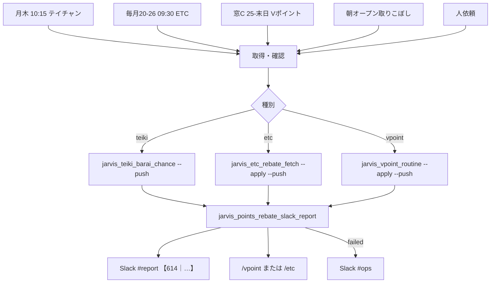

# フロー — ポイント・還元ウォッチ係（614）素案

第2段階（動きの作り込み）のたたき。編成は第1段階（ビルダー）で追加済。  
作り方: [`06_社員の作り方_二段階_20261009.md`](../../06_社員の作り方_二段階_20261009.md)

- FlowForge（閲覧／編集）: **未作成**（作り込み待ち。本 MD が当面の正）
- Flowforge 入口: https://flowforge-259747770348.asia-northeast1.run.app/
- 動きの例（型参考）: https://flowforge-259747770348.asia-northeast1.run.app/flows/flow_uGZ3apXgbHVdZJfnuqYA8_QZ
- ビルダー共有: https://agent-team-builder-teal.vercel.app/s/uksxiDIzE1AEckKH （不動産・家計室）
- 更新: 2026-10-17（素案。Slack 配線は実装済）

## いまの結論（文字1行）

開始（月木テイチャン／20–26日ETC／窓CVポイント／朝取りこぼし／人）→ 各取得・確認 → **ダッシュ投影** と **Slack `#report`【614｜種別】** に合流。失敗は `#ops`。払う側は **612** に渡さない。

## 合流の考え方

3本の定例はトリガーが違うが、**「お得（得る側）が動いた」を1係で見せる**ための一本。  
Slack 見出しで種別を分ける（`｜テイチャン`／`｜ETC還元`／`｜Vポイント`）。別社員に割らない。



## ステップ一覧

| # | 内容 | 方法 | 人/AI | ツール例 |
|---|---|---|---|---|
| 1a | **月・木 10:15** テイチャン枠 | 時間 | AI | `teiki_draw_runner.sh` / launchd |
| 1b | **毎月 20–26日 09:30** ETC還元枠 | 時間 | AI | `etc_rebate` launchd |
| 1c | **25–末日 09:40** Vポイント窓C | 時間 | AI | `vpoint_routine` launchd |
| 1d | 朝オープン取りこぼし | イベント | AI | `jarvis_morning_mac_refresh` |
| 1e | （副）「テイチャン／ETC還元／Vポイント定例」 | 人 | AI | Cursor / Jarvis |
| 2a | テイチャン: 券確認→あれば抽選 | Playwright/CDP | AI（規約未同意は人） | `jarvis_teiki_barai_chance.py` |
| 2b | ETC: smile-etc 還元額取得 | Playwright | AI | `jarvis_etc_rebate_fetch.py` |
| 2c | Vポイント: 付与サマリ＋cadence＋asks | CLI | AI（OTP等は人） | `jarvis_vpoint_routine.py` |
| 3 | state 更新 | CLI | AI | `teiki_*` / `etc_monthly` / `vpoint_*` |
| 4 | ダッシュ投影 | CLI | AI | `jarvis_dashboard_push.py --watch-only`（`--push` 内） |
| 5 | Slack 短報 | Webhook | AI | `jarvis_points_rebate_slack_report.py` |
| 6 | 人が Slack／`/vpoint`／`/etc` で把握 | Web | **人が確かめる** | ダッシュ・Slack |
| 7 | 失敗・ログイン不能 → `#ops` | Webhook | AI→人 | `SLACK_WEBHOOK_OPS` |

**人が確かめる印**: 6＝数値の妥当性、2a＝規約／迷うサービス追加、2c＝TサイトOTP・Wallet。  
**やらない**: 年会費退会操作（**612**）、Zaim鮮度・費目（**613**）、秘密の Slack 再掲、対外送信。

## FlowForge 作り込みメモ（別チャットへ渡す用）

- [ ] トリガー3本（テイチャン／ETC／Vポイント）を分岐→合流で描く（111・613 と同型）
- [ ] Mac 必須ノード（Vpass／smile-etc）と state のみノードを色分け
- [ ] Slack `#report` を出口、失敗だけ `#ops`
- [ ] 612（払う側）との境界を注釈で明示
- [ ] 停止条件（各 `*_DISABLE`／`JARVIS_POINTS_REBATE_SLACK_REPORT_DISABLE`）をガードノードに
- [ ] 作成後: registry の `flowforge_url` と本ファイル先頭リンクを更新 → `jarvis_agent_team_status_sync.py`

## 手順メモ（実装本線・いま動くもの）

```bash
cd ~/git-repos && set -a && source .env.jarvis_private && set +a
# テイチャン
~/selenium_env/venv/bin/python scripts/jarvis_teiki_barai_chance.py --run --push
# ETC
~/selenium_env/venv/bin/python scripts/jarvis_etc_rebate_fetch.py --apply --push
# Vポイント定例
~/selenium_env/venv/bin/python scripts/jarvis_vpoint_routine.py --apply --push
# Slack だけ確認
~/selenium_env/venv/bin/python scripts/jarvis_points_rebate_slack_report.py --kind etc --from-state --dry-run
```

（FlowForge 各ノードの磨きはここに追記）
