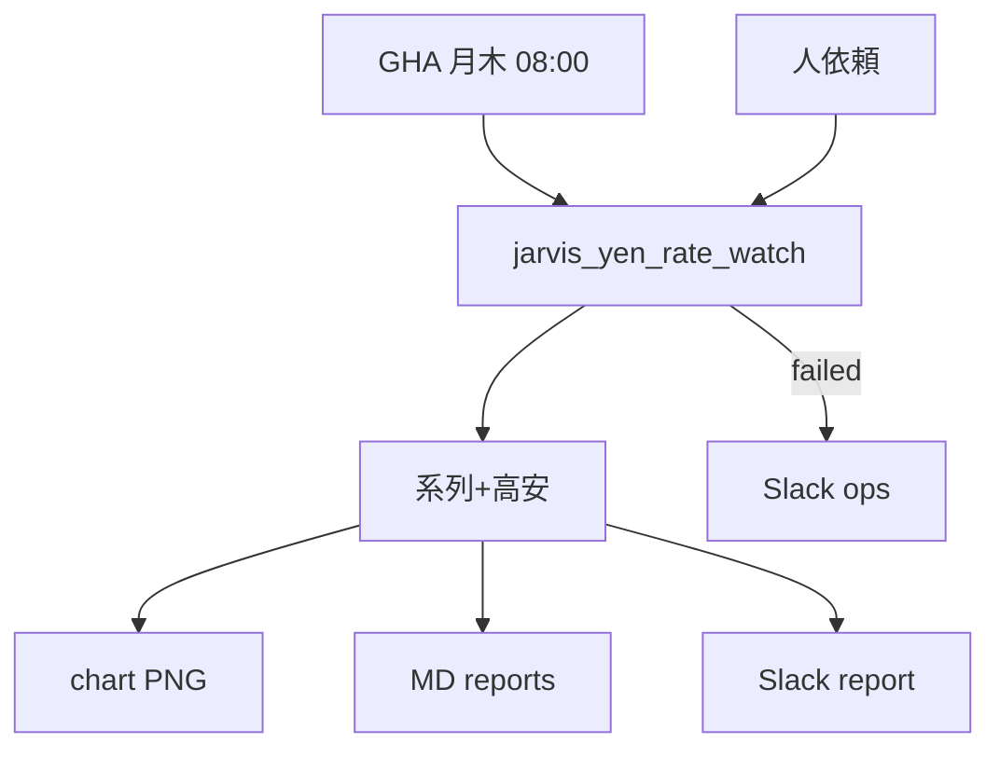

# フロー — 円動向報告係（615）素案

第2段階のたたき。FlowForge ノードは未作成。

- ビルダー共有: https://agent-team-builder-teal.vercel.app/s/uksxiDIzE1AEckKH
- 更新: 2026-10-17

## いまの結論（文字1行）

開始（GHA月木／人）→ Yahoo/Frankfurter 取得 → グラフ＋短報 → Slack `#report`【615｜USDJPY】と `reports/`。売買文言は出さない。

## やらないこと

- 売買推奨・自動発注
- `trade_watchlist` への混在
- Stage C ダッシュ `/yen`（別区切り）
