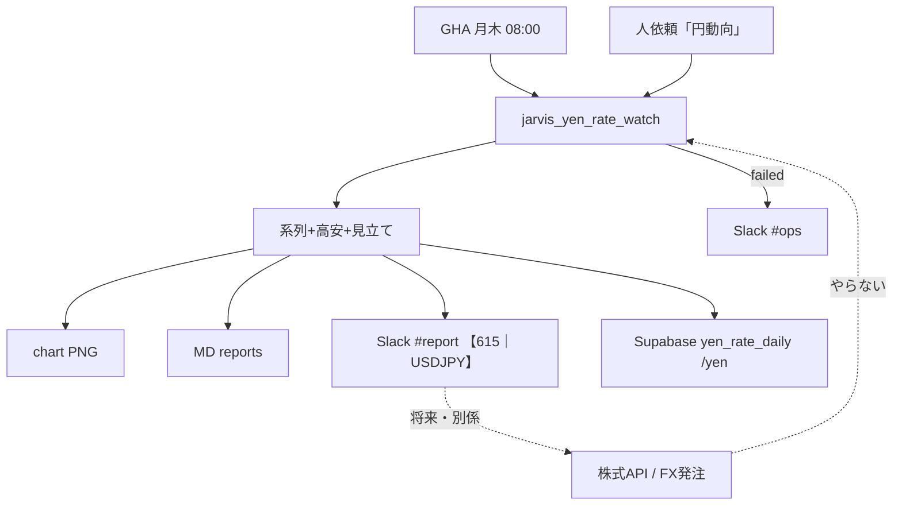

# フロー — 円動向報告係（615）素案

第2段階（動きの作り込み）のたたき。編成は第1段階（ビルダー）で追加済。  
作り方: [`06_社員の作り方_二段階_20261009.md`](../../06_社員の作り方_二段階_20261009.md)

- FlowForge（閲覧／編集）: **未作成**（作り込み待ち。本 MD が当面の正）
- Flowforge 入口: https://flowforge-259747770348.asia-northeast1.run.app/
- 動きの例（型参考）: https://flowforge-259747770348.asia-northeast1.run.app/flows/flow_uGZ3apXgbHVdZJfnuqYA8_QZ
- ビルダー共有: https://agent-team-builder-teal.vercel.app/s/uksxiDIzE1AEckKH （不動産・家計室）
- 更新: 2026-10-17（素案。GHA・Slack 配線は実装済）

## いまの結論（文字1行）

開始（GHA月木08:00／人）→ Yahoo/Frankfurter で USD/JPY 取得 → グラフ＋短報＋見立て → **Slack `#report`【615｜USDJPY】**・`reports/`・**ダッシュ `/yen`**（Supabase）。売買文言・発注は出さない。失敗は `#ops`。

## 合流の考え方

定例と手動はトリガーが違うが、**「円の動きを報告する」一本**。  
将来の株式API／FX発注動線は **別社員・別フロー**（本係は報告のみ。Todoist 615 コメントに意向のみ）。



## ステップ一覧

| # | 内容 | 方法 | 人/AI | ツール例 |
|---|---|---|---|---|
| 1a | **月・木 08:00** GHA | 時間 | AI | `.github/workflows/yen-rate-watch.yml` |
| 1b | （副）「円動向／USDJPY」 | 人 | AI | Cursor / Jarvis |
| 2 | USD/JPY 系列取得（Yahoo → Frankfurter フォールバック） | HTTP | AI | `jarvis_yen_rate_watch.py` |
| 3 | 高安・前日／約1ヶ月／約1年前比の表短報 | CLI | AI | 同上 |
| 4 | グラフ PNG | CLI | AI | matplotlib → `reports/charts/` |
| 5 | MD 控え | ファイル | AI | `reports/YYYY-MM-DD.md` |
| 6 | Slack 短報 | Webhook | AI | `jarvis_slack_webhook_post.py`（`#report`） |
| 7 | 人が Slack／`reports/` で把握 | Web | **人が確かめる** | Slack・フォルダ |
| 8 | 失敗・取得不能 → `#ops` | Webhook | AI→人 | `SLACK_WEBHOOK_OPS` |

**人が確かめる印**: 7＝数字の違和感。売買判断は人（本係は材料のみ）。  
**やらない**: 売買推奨・自動発注・`trade_watchlist` 混在・Stage C ダッシュ `/yen`（別区切り）・秘密の Slack 再掲。

## FlowForge 作り込みメモ（別チャットへ渡す用）

- [ ] トリガー2本（GHA／人）→取得→短報→Slack 合流（111・614 と同型）
- [ ] 「売買ノードなし」を注釈で明示（出口は `#report` のみ）
- [ ] 停止条件（`JARVIS_YEN_RATE_WATCH_DISABLE`／state `disabled`）をガードノードに
- [ ] 作成後: registry の `flowforge_url` と本ファイル先頭リンクを更新 → `jarvis_agent_team_status_sync.py`
- [ ] 共有URLを `config/flowforge_share_urls.json` に追記（ダッシュ「閲覧で開く」）

## 手順メモ（実装本線・いま動くもの）

```bash
cd ~/git-repos && set -a && source .env.jarvis_private && set +a
~/selenium_env/venv/bin/python scripts/jarvis_yen_rate_watch.py --dry-run
~/selenium_env/venv/bin/python scripts/jarvis_yen_rate_watch.py --apply --push --with-news
# GHA: yen-rate-watch.yml（月木）
```

（FlowForge 各ノードの磨きはここに追記）
