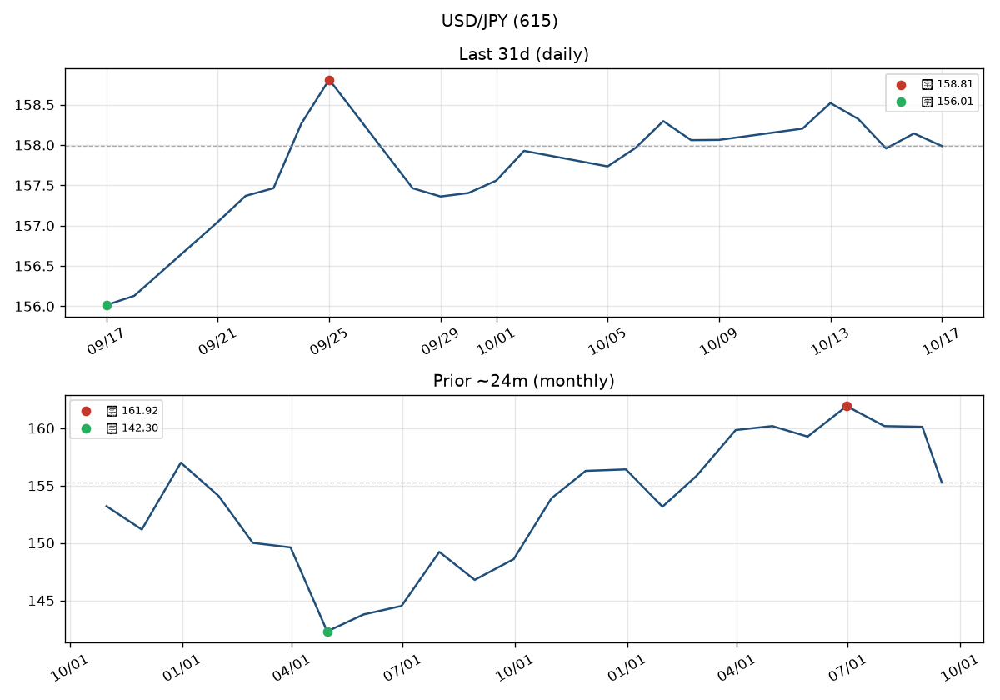

# 615 USD/JPY — 2026-10-17

**終値** 157.99 円（2026-10-17）／ソース: `yahoo`

## 比較（終値との差）

| 比較 | 参照日 | 当時(円) | 差分(円) | 変化率 |
|---|---|---:|---:|---:|
| 前日比 | 2026-10-16 | 158.14 | -0.16 | -0.10% |
| 約1ヶ月前 | 2026-09-17 | 156.01 | +1.97 | +1.26% |
| 約1年前 | 2025-10-17 | 150.12 | +7.87 | +5.24% |

## レンジ

| 範囲 | 高値 | 安値 |
|---|---|---|
| 取得期間 | 163.98（2026-07-23） | 139.89（2025-04-22） |
| 直近31日（n=23） | 159.00 | 155.34 |

## 見立て（売買指図なし）

直近1ヶ月の振れは小さめ（終値比 +1.3%）。円換算の短期ノイズは抑えめ、と読むのが無難。 1年前比は +5.2%（当時 150.12 → いま 157.99）。長期の水準変化として把握する程度でよい。 取得期間のレンジでは高め帯付近。円建てで見る外貨建て資産は、円安寄りの水準感が出やすい。 ニュース要約を踏まえると: The sources provided by the Bank of Japan explain that the 円ドル 為替 日銀 (Japanese Yen to US Dollar exchange rate) is determined in the foreign exchange market where different currencies are exchanged. The Bank of Japan publ ※評価は参考の見立てのみ。売買・ポジション・レバレッジの指図はしない。コア（NISA等）の方針は変えない。

## Slack短報（控え）

```
【615 円動向報告係｜USDJPY】
終値 157.99 円（2026-10-17）／ソース: yahoo

■ 比較（終値との差）
比較     参照日         当時      差分(円)  変化率   
-----  ----------  ------  -----  ------
前日比    2026-10-16  158.14  -0.16  -0.10%
約1ヶ月前  2026-09-17  156.01  +1.97  +1.26%
約1年前   2025-10-17  150.12  +7.87  +5.24%

■ レンジ
取得期間  高 163.98（2026-07-23）  /  安 139.89（2025-04-22）
直近31日  高 159.00  /  安 155.34  （n=23）

チャート: docs/AIエージェントチーム/600_リソース・家計室/615_円動向報告係/reports/charts/2026-10-17_usdjpy.png
ダッシュ: /yen
注: 報告のみ。売買・ポジション指図はしない。

見立て: 直近1ヶ月の振れは小さめ（終値比 +1.3%）。円換算の短期ノイズは抑えめ、と読むのが無難。 1年前比は +5.2%（当時 150.12 → いま 157.99）。長期の水準変化として把握する程度でよい。 取得期間のレンジでは高め帯付近。円建てで見る外貨建て資産は、円安寄りの水準感が出やすい。 ニュース要約を踏まえると: The sources provided by the Bank of Japan explain that the 円ドル 為替 日銀 (Japanese Yen to US Dollar exchange rate) is determined in the foreign exchange market where different currencies are exchanged. The Bank of Japan publ ※評価は参考の見立てのみ。売買・ポジション・レバレッジの指図はしない。コア（NISA等）の方針は変えない。
```



ダッシュボード: `/yen`
