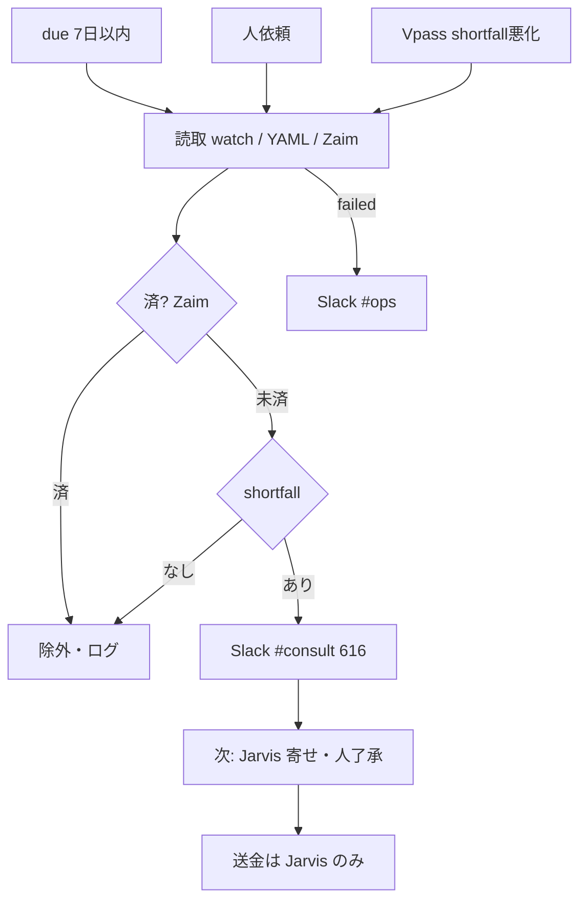

# フロー — 寄せリマインド係（616）素案

第1段階と同一ターンの初回叩き台。FlowForge URL は後追い可。  
作り方: [`06_社員の作り方_二段階_20261009.md`](../../06_社員の作り方_二段階_20261009.md)

- FlowForge（閲覧／編集）: **未作成**（作り込み待ち。本 MD が当面の正）
- Flowforge 入口: https://flowforge-259747770348.asia-northeast1.run.app/
- 動きの例（型参考）: https://flowforge-259747770348.asia-northeast1.run.app/flows/flow_uGZ3apXgbHVdZJfnuqYA8_QZ
- ビルダー共有: https://agent-team-builder-teal.vercel.app/s/uksxiDIzE1AEckKH （不動産・家計室）
- 更新: 2026-10-19（初回叩き台）

## いまの結論（文字1行）

開始（due接近／人／watch悪化）→ need・残高・Zaim済確認 → 不足なら **Slack `#consult`【616】** → 次は **Jarvis 寄せ実行（人了承）**。ルール本線・スキル／スラッシュ不要。送金ノードなし。

## 合流の考え方

定例（due／watch）と人依頼はトリガーが違うが、**「寄せが必要なら `#consult` で促す」一本**。  
実際の資金移動は **Jarvis（人了承後）**。本係は検知・促しのみ。



## ステップ一覧

| # | 内容 | 方法 | 人/AI | ツール例 |
|---|---|---|---|---|
| 1 | need／due／決済口座 | CLI 読取 | AI | watch / `known_recurring_debits.yaml` |
| 2 | Zaim で済除外 | CSV | AI | Zaim Watch／CSV |
| 3 | keep 注記（Preferred 残債等） | YAML | AI | `jarvis-fund-transfer-keep` |
| 4 | shortfall 判定 | 計算 | AI | money-ops／残高 |
| 5 | Slack 促し | Webhook | AI | `jarvis_slack_webhook_post.py` `#consult` |
| 6 | 寄せプラン・実行準備 | Cursor／任意ツール | **人＋Jarvis** | ルール `jarvis-agent-616-cash-remind`（スキル非依存） |
| 7 | 送金 OTP／実行 | 銀行UI | **人のみ** | IB／AW 等 |

**人が確かめる印**: 5＝促し文面／金額の違和感。6〜7＝送金了承と OTP。  
**やらない**: 本係からの送金・OTP入力・無確認 `/adjust_cash` 強制・秘密の Slack 再掲。

## FlowForge 作り込みメモ（別チャットへ渡す用）

- [ ] トリガー3本（due／人／watch）→読取→Zaim済→shortfall→Slack 合流
- [ ] **送金ノードを置かない**（注釈必須。出口は `#consult` のみ）
- [ ] Zaim 済確認ノードを入口に
- [ ] 停止条件（`disabled`／env）をガードノードに
- [ ] 作成後: registry の `flowforge_url` と本ファイル先頭リンクを更新 → `jarvis_agent_team_status_sync.py`
- [ ] 共有URLを `config/flowforge_share_urls.json` に追記（ダッシュ「閲覧で開く」）

## 手順メモ（実装本線・いま動くもの）

```bash
# Stage B: 検知スクリプト（任意・未実装なら設計のみ）
# 促しはルール jarvis-agent-616-cash-remind.mdc ＋ Slack Webhook
# 寄せ実行は Jarvis（人了承後）。本係は #consult まで
```

（FlowForge 各ノードの磨きはここに追記）
