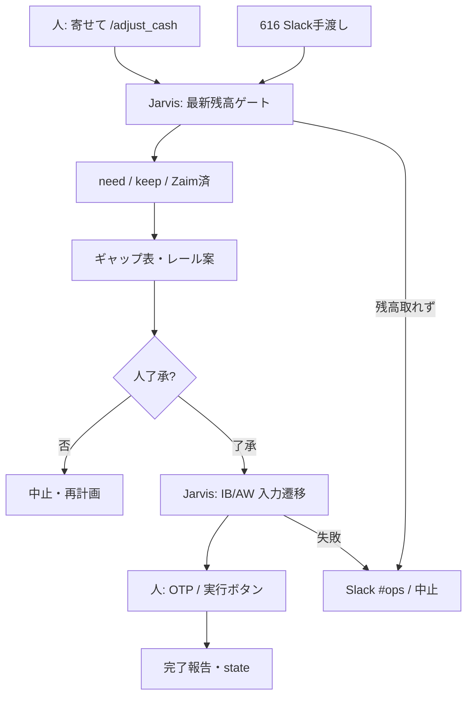

# フロー — 資金移動係（J専）（617）

第2段階（動きの作り込み）の正。編成は第1段階（ビルダー）で追加予定。  
作り方: [`06_社員の作り方_二段階_20261009.md`](../../06_社員の作り方_二段階_20261009.md)

- FlowForge（閲覧／編集）: [flow_duOrNmGET7-E_c7AAQE9fLfO](https://flowforge-259747770348.asia-northeast1.run.app/flows/flow_duOrNmGET7-E_c7AAQE9fLfO)
- 閲覧専用（共有）: https://flowforge-259747770348.asia-northeast1.run.app/share/NYLpUySk0tY27PvI
- Flowforge 入口: https://flowforge-259747770348.asia-northeast1.run.app/
- ビルダー共有: https://agent-team-builder-teal.vercel.app/s/uksxiDIzE1AEckKH （不動産・家計室）
- 表示名: **`617 資金移動係（J専）`**（J専＝Jarvis実行専属）
- 更新: 2026-10-21（FF作り込み・人が頼む本線・（J専）識別）

## いまの結論（文字1行）

**人が頼む**（または 616 手渡し）→ Jarvis が最新残高→ギャップ表→了承→レール実行（OTPは人）。**他ツールは送金しない**。定期自動は置かない。

## 合流の考え方

合図は **人依頼が本線**。616 の Slack 手渡しは入口の補助。  
実行は **一本の Jarvis フロー（`/adjust_cash`）**。cron／GHA 自動送金はしない。



## ステップ一覧

| # | 内容 | 方法 | 人/AI | ツール例 |
|---|---|---|---|---|
| 1 | **人が頼む**（対象・due・寄せ先） | 会話 | **人**＋Jarvis | `/adjust_cash` |
| 1b | （副）616 手渡し | Slack | AI→Jarvis | `#consult` |
| 2 | 最新残高 | アプリ／IB／Zaim更新 | **Jarvisのみ** | skill §0c |
| 3 | need・keep・済除外 | 読取 | Jarvis | watch／YAML／Zaim |
| 4 | ギャップ表・レール | 計算 | Jarvis | money-ops／rails |
| 5 | プラン了承 | チャット | **人** | — |
| 6 | 入力・遷移 | ブラウザ／CLI | **Jarvisのみ** | `run_phase1_*` 等 |
| 7 | OTP／実行 | 銀行UI | **人のみ** | IB／AW |
| 8 | 完了・監査 | state／Slack | Jarvis | transfer_audit |

**人が確かめる印**: 5＝金額・レール。7＝OTP／実行。  
**やらない**: 他ツールからの送金・了承前 `--go`・古い残高だけで確定・時間トリガー自動送金。

## FlowForge 作り込みメモ

- [x] トリガーは「人が頼む」「616手渡し」のみ（cron 自動送金なし）
- [x] **実行ノードに「（J専）Jarvis専属」注釈**（FRIDAY 等に振らない）
- [x] 残高ゲートノードをプラン前に必須化
- [x] 停止条件（了承なし／残高NG）をガードに
- [x] 作成後: registry の `flowforge_url` ＋本ファイル先頭 → `jarvis_agent_team_status_sync.py`
- [x] 共有URLを `config/flowforge_share_urls.json` に追記（ダッシュ「閲覧で開く」）

## 手順メモ（実装本線・いま動くもの）

```bash
# 実行入口＝本係発動（Jarvis）
# Cursor: /adjust_cash  →  【617 資金移動係（J専）】起動
# コマンド: .cursor/commands/adjust_cash.md
# スキル: .cursor/skills/adjust-cash/SKILL.md
# 促し: 616（本係は実行しない）
```
