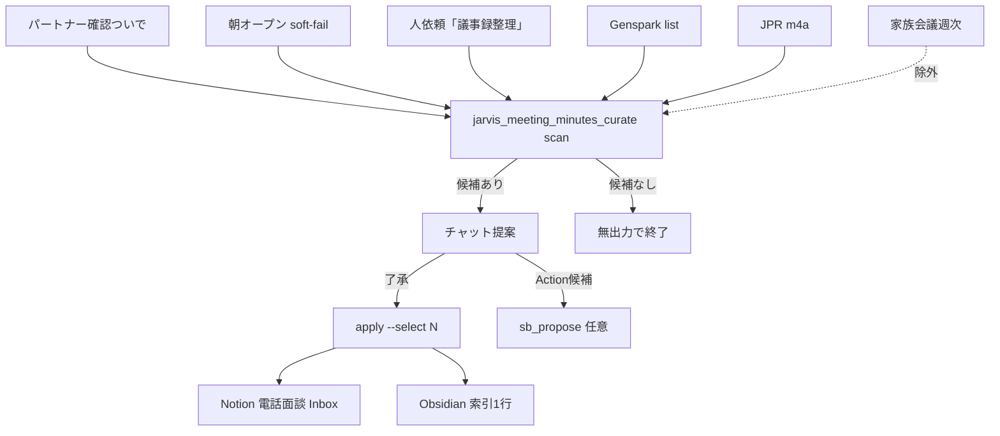

# フロー — 議事録整理係（714）素案

第2段階（動きの作り込み）のたたき。編成は第1段階（ビルダー）で追加済。  
作り方: [`06_社員の作り方_二段階_20261009.md`](../../06_社員の作り方_二段階_20261009.md)

- FlowForge（閲覧／編集）: **未作成**（作り込み待ち。本 MD が当面の正）
- Flowforge 入口: https://flowforge-259747770348.asia-northeast1.run.app/
- 動きの例（型参考）: https://flowforge-259747770348.asia-northeast1.run.app/flows/flow_uGZ3apXgbHVdZJfnuqYA8_QZ
- ビルダー共有: https://agent-team-builder-teal.vercel.app/s/uksxiDIzE1AEckKH （コーチ・俯瞰室）
- 更新: 2026-10-17（素案。scan／朝オープン／パートナー確認ついで配線済）

## いまの結論（文字1行）

スキャン → **候補提案のみ**（無言 Notion 作成なし）→ 了承後に Notion 電話面談 `_Inbox` ＋ Obsidian 索引1行。家族会議は除外（週次パスのまま）。

## 合流の考え方

入口は Genspark／JPR／明示依頼で違うが、**「残す価値ありを提案→了承後だけ正本化」一本**。  
家族会議は線を引かない（別係・週次）。



## ステップ一覧

| # | 内容 | 方法 | 人/AI | ツール例 |
|---|---|---|---|---|
| 1a | パートナー確認前半のついで | イベント | AI | `partner-email-check` → `scan --mark-prompted` |
| 1b | 朝オープン soft-fail | 起動 | AI | `jarvis_morning_mac_refresh` |
| 1c | （副）「議事録整理して」 | 人 | AI | Cursor / Jarvis |
| 2 | Genspark／JPR 候補スキャン | CLI | AI | `jarvis_meeting_minutes_curate.py scan` |
| 3 | 家族会議・既処理を除外 | CLI | AI | state／YAML |
| 4 | チャットに提案ブロック | チャット | AI | `📎 議事録整理（714）` |
| 5 | **了承待ち**（無言作成禁止） | 人 | **人が確かめる** | 番号 or 「起票して」系 |
| 6 | 了承後 Notion Inbox 作成 | API | AI | `apply --select N`／`notion_phone_meeting.yaml` |
| 7 | Obsidian 索引1行（任意） | ファイル | AI | Literature／索引パス |
| 8 | state／`reports/` 更新 | ファイル | AI | `.jarvis_state/meeting_minutes_curate.json` |

**人が確かめる印**: 5＝残す／捨てる。Notion 作成は了承後のみ。  
**やらない**: 無言 Notion 作成、家族会議の二重正本化、秘密のチャット再掲、対外送信。

## FlowForge 作り込みメモ（別チャットへ渡す用）

- [ ] トリガー3本（パートナー確認／朝／人）→ scan → **人ゲート** → apply
- [ ] 「人了承ノード」を必須（自動 apply 禁止を色分け）
- [ ] 家族会議除外を注釈
- [ ] 停止条件（`JARVIS_MEETING_MINUTES_CURATE_DISABLE`／state `disabled`）をガードノードに
- [ ] 作成後: registry の `flowforge_url` と本ファイル先頭リンクを更新 → `jarvis_agent_team_status_sync.py`
- [ ] 共有URLを `config/flowforge_share_urls.json` に追記

## 手順メモ（実装本線・いま動くもの）

```bash
cd ~/git-repos && set -a && source .env.jarvis_private && set +a
export PATH="$HOME/.local/bin:$HOME/.genspark-tool-cli/bin:$PATH"
~/selenium_env/venv/bin/python scripts/jarvis_meeting_minutes_curate.py scan --mark-prompted
# 了承後のみ
~/selenium_env/venv/bin/python scripts/jarvis_meeting_minutes_curate.py apply --select 1
```

（FlowForge 各ノードの磨きはここに追記）
