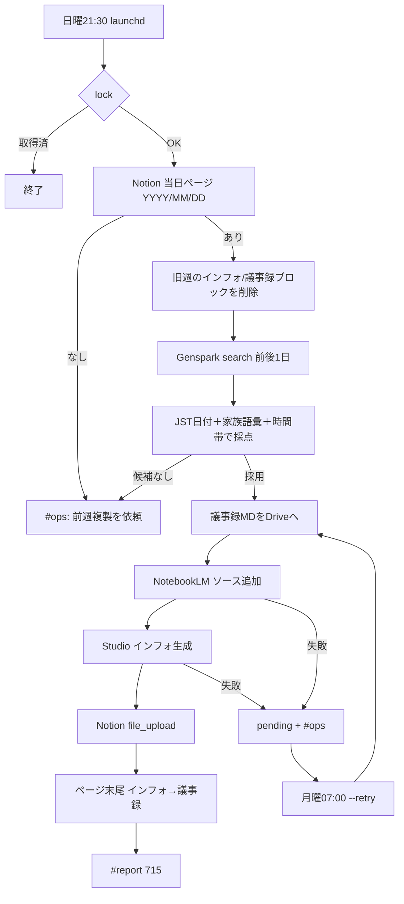

# フロー — 家族会議週次係（715）素案

第1段階と同一ターンの初回叩き台（実装本線は既に CLI／launchd あり）。  
作り方: [`06_社員の作り方_二段階_20261009.md`](../../06_社員の作り方_二段階_20261009.md)

- FlowForge（閲覧／編集）: **未作成**（作り込み待ち。本 MD が当面の正）
- Flowforge 入口: https://flowforge-259747770348.asia-northeast1.run.app/
- 動きの例（型参考）: https://flowforge-259747770348.asia-northeast1.run.app/flows/flow_uGZ3apXgbHVdZJfnuqYA8_QZ
- ビルダー共有: https://agent-team-builder-teal.vercel.app/s/uksxiDIzE1AEckKH
- 正本 CLI: `scripts/friday_family_meeting_weekly.py`
- 設定: `config/notion_family_coaching.yaml`（`automation`）／`config/notebooklm_studio.yaml`（`family_meeting_weekly`）
- 更新: 2026-10-19（初回叩き台整備）

## いまの結論（文字1行）

松野が当日ページを複製 → 日曜21:30「議事録MD → NLMソース → インフォ → Notion（インフォ→議事録順）」→ **Slack `#report`【715】**。失敗は `#ops`＋月曜 `--retry`。

## 合流の考え方

定例（日曜 launchd）と月曜 retry・人依頼はトリガーが違うが、**「その週の家族会議ページへ議事録＋インフォを載せる」一本**。



## ステップ一覧

| # | 内容 | 方法 | 人/AI | ツール例 |
|---|---|---|---|---|
| 0 | 当日ページ複製 | 人 | **人** | Notion（前週コピー） |
| 1 | 当日ページ検索 | Notion API | AI | `friday_family_meeting_weekly.py` |
| 2 | 会議特定 | Genspark search＋採点 | AI | `gsk meeting search` |
| 3 | MD 保存 | ファイル | AI | `13_家族会議_週次/議事録/` |
| 4 | NLM ソース追加 | CLI | AI | `jarvis_notebooklm_add_source.py` |
| 5 | インフォ生成 | Studio | AI | `jarvis_notebooklm_studio_run.py` |
| 6 | Notion 挿入 | API | AI | `friday_notion_ops.py` |
| 7 | Slack 報告 | Webhook | AI | `#report` |
| 8 | 人がページ／Slackで確認 | Web | **人** | Notion・Slack |

**人が確かめる印**: 0＝ページ複製。8＝インフォ／議事録の見え方。  
**やらない**: 秘密の Slack 再掲・無確認での別ノート破壊・ソース無のインフォだけ投稿。

## 複製前提（2026-10-19 松野さん指示）

前週複製では**旧週のインフォ／議事録が残る**。挿入前に、当該週以外の
`週次インフォグラフィック（旧日付）` / `Genspark 議事録要約（旧日付）` を自動削除する。
当該週の見出しは残すので、再実行しても二重挿入しない。削除前のページ内容は
`.jarvis_state/backups/family_meeting_YYYY-MM-DD_before.json` に保存する。

## 再実行の考え方

- `source_added` / `infographic_png` が立っていれば再生成しない
- Notion は見出し `週次インフォグラフィック（YYYY-MM-DD）` / `Genspark 議事録要約（YYYY-MM-DD）` の有無で判定
- 失敗時は `status: pending`。月曜07:00 `--retry` が拾う

## FlowForge 作り込みメモ（別チャットへ渡す用）

- [ ] トリガー（日曜／月曜retry／人）→ lock → Notion → Genspark → NLM → Notion → Slack 合流
- [ ] ページ無し・候補無しは `#ops` のみ（無言スキップしない）
- [ ] 停止条件（`disabled`／env）をガードノードに
- [ ] 作成後: registry の `flowforge_url` と本ファイル先頭リンクを更新 → `jarvis_agent_team_status_sync.py`
- [ ] 共有URLを `config/flowforge_share_urls.json` に追記

## 手順メモ（実装本線・いま動くもの）

```bash
cd ~/git-repos && set -a && source .env.jarvis_private && set +a
~/selenium_env/venv/bin/python scripts/friday_family_meeting_weekly.py --dry-run
# launchd: 日曜21:30 本線／月曜07:00 --retry
```
