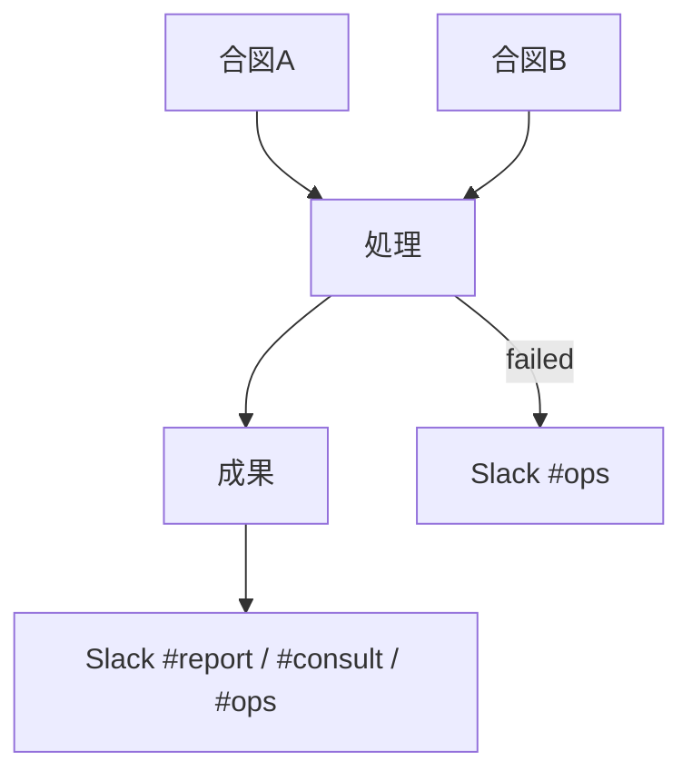

# フロー — （社員名）（NNN）素案

第1段階でフォルダを切った **同一ターン** に、本ファイルを初回叩き台として埋める（空のままにしない）。  
FlowForge の URL は後追い可。**Mermaid＋ステップ一覧＋人が確かめる印**までは必須。  
作り方: [`06_社員の作り方_二段階_20261009.md`](../06_社員の作り方_二段階_20261009.md)

- FlowForge（閲覧／編集）: **未作成**（作り込み待ち。本 MD が当面の正）
- Flowforge 入口: https://flowforge-259747770348.asia-northeast1.run.app/
- 動きの例（型参考）: https://flowforge-259747770348.asia-northeast1.run.app/flows/flow_uGZ3apXgbHVdZJfnuqYA8_QZ
- ビルダー共有: https://agent-team-builder-teal.vercel.app/s/uksxiDIzE1AEckKH
- 更新: YYYY-MM-DD（初回叩き台）

## いまの結論（文字1行）

（開始条件 → 主な処理 → 出口チャンネル／成果物。やらないことを1つ添えてよい）

## 合流の考え方

（定例と手動などトリガーが複数あるとき、どこで一本にするか。無ければ「一本」と書く）



## ステップ一覧

| # | 内容 | 方法 | 人/AI | ツール例 |
|---|---|---|---|---|
| 1 | 起動（合図） | … | AI | … |
| 2 | 取得・確認 | … | AI | … |
| 3 | まとめ | … | AI | … |
| 4 | 報告 | Webhook | AI | `jarvis_slack_webhook_post.py` |
| 5 | 人が確かめる | Web | **人** | Slack／成果物 |

**人が確かめる印**: （どのステップか）  
**やらない**: （送金／秘密／無確認送信 等）

## FlowForge 作り込みメモ（別チャットへ渡す用）

- [ ] トリガー → 処理 → Slack 合流
- [ ] 停止条件（`disabled`／env）をガードノードに
- [ ] 作成後: registry の `flowforge_url` と本ファイル先頭リンクを更新 → `jarvis_agent_team_status_sync.py`
- [ ] 共有URLを `config/flowforge_share_urls.json` に追記（ダッシュ「閲覧で開く」）

## 手順メモ（実装本線・いま動くもの）

```bash
# （CLI／launchd／GHA があればここに。無ければ「未実装・設計のみ」）
```
